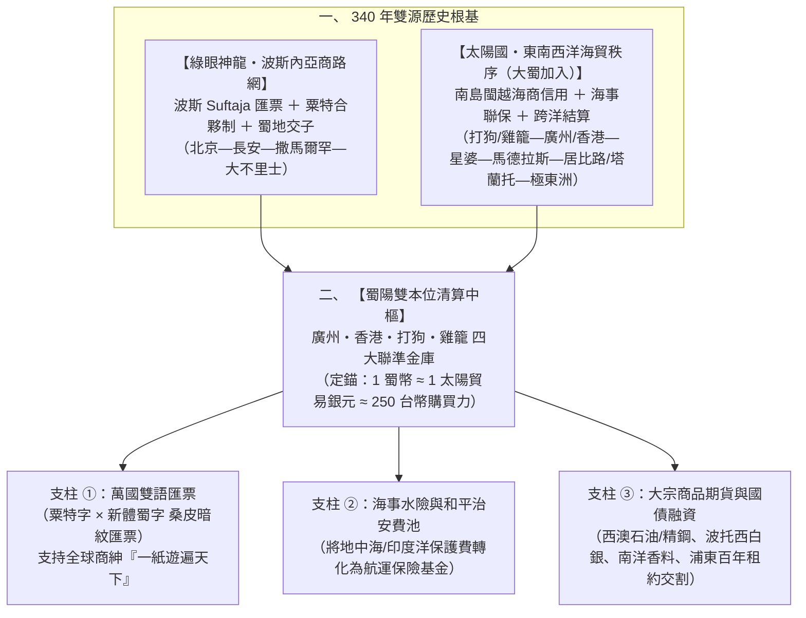

---
cssclasses:
  - largerruby
---
> [!warning] 玩家新指示（2026-10-31，蜀綠玩家裁示）
> **蜀語的語感由「像波斯語」改為「像中古高麗語（Middle Korean）」**：音系、詞彙與詞形以中古高麗語為底（如保留 ᄋ〔ʌ〕、固有詞 밤낫／집、漢字詞走中古漢字音），文法仍為 SOV 黏著語＋沙陀突厥／黑水靺鞨成分，書寫仍為 Hangul 式新體蜀字。本筆記內早於此日期的波斯語式蜀語詞（如 Šabrûz、Asân、Xâne、Âsân 等）屬**舊設定**，未來撰寫一律以新指示為準，勿再沿用。

## 規範
![[#^efa256]]

## 1249 User
20261023 8:59
蜀綠：
- 蜀楚等國建議江夏國不要加入不懷好意的長江共榮國，加入東洋多國聯盟可以有超過 5 個堅強盟友給予保護
- 降低國民選舉的門檻，從 25 歲降到 20 歲
- 兩派暫時達成協議，在領袖崔亨歸天前先合作，之後再討論對策
- 林家豪發明的竹籃球風靡了整個廣州，人們也發明出規則，並用更硬的鐵做出籃框以及網子

太陽：
- 外交情報運作絕對不容江夏國倒向荊南。運作廬江國、吉國派軍進駐江夏國強化防務；太陽國長江水軍也進駐

昭武：
- 在江戶過冬後，老汗
    - 在春季來到阿佩努普伊國，對這個女真戰士與艾努人共同創造、力抗南方日本人的國家深表敬意。他被引導遊歷了很多現實觀光勝地，另外也對東洋的熊印象深刻
    - 為了趕渡大洋到北極東洲，在女真國商船的協助下起行，為古今帝王前所未有。也照會了大蜀帝國，目標在 9 月初雪前抵達烏拉奈（不走苦寒女真阿拉斯加堅忍路線，傷亡率太高）

琉球：
- ==請 GM 續寫本島及新南領地的發展==

世界：
- 本年荊南毅然宣布退出東洋多國聯盟，隨後與控制長江下游的強國——越國結盟，有了後盾在背後撐腰
- 在朝鮮忠清道珍山山腳下的一座小村子誕生了一位叫鄭明熙的男孩，家人去問他的運勢，占卜師說他運勢大吉，將來注定闖出一番大事
- 江西國、贛國陸續加入由太陽國為核心的東海國聯
- 而吉國則加入由蜀國為核心的東洋多國聯盟
- 越國、荊南兩國組成長江共榮國，正在拉攏江夏國當中
- 輔佐新吳國多年的老臣孫廷愚，本年因病去世，享年 76 歲。他帶著未能繼續為國盡忠的遺憾
- 楚國也開始習武備戰，與荊南陷入對峙
- 東洋多國聯盟開始運送槍枝彈藥、大砲和物資到楚國，同時經過楚王周立杰同意之下，組成一支人數高達 20 萬的多國聯軍進駐常德、岳陽等地
- 女真國向西靺鞨進一步通好，致贈禮物，以邀請人力合作進一步開拓北極東洲以及探索「北寒林」（現實西伯利亞內陸）
- 少數北極東洲原住民來到舊大陸已有一段時日，在這個世界裡，各地原住民（太陽國一般敬稱為「地主人」）在東洋國際場合普遍是有尊嚴的（到西洋、南洋就不一定）
    - 蜀國地界的原住民則會為了生計出來到城市打工、居住、通婚
- 西歐文藝復興萌芽
    - 這裡靠的**不是**東羅馬的崩潰、鄂圖曼的威脅，而是威尼斯、太陽國、蜀國遠洋通商的巨大刺激，尤其新大陸原住民也出現在歐、非，是前所未有的震撼，不論東洋或新大陸，「黃種人」都得到西洋人的敬意，甚至有歐洲人開始學習日本劍術或蜀人發明的運動
    - 「蜀陽和平」可以保障航行安全，但也要交不少的治安費，蜀陽兩國都從歐洲達官顯貴商賈賺了不少
    - 東訪的歐人漸多，歐洲「格物仿製」開始（一直是歐洲人所擅長 🤔）
    - 挪、卡斯、卡塔、英、葡、瑞典、波美恩、菲仕蘭各國開始銳意效法航海
    - while 可憐巴巴的法國甚至比神羅還慘 🫂
    - 葡、卡斯仍是太陽國最大的敵人，因為地處西南歐門戶，侵門踏戶感嚴重

> [!important] GM 寫的分工：
> - User **完全沒**寫到的地方
> - User 寫的事情的**細節**。
> - 知識說明及解析
> - 建議及挑戰

^efa256

## 1249 GM
20261024 21:40

### 一、 User 寫的事情的細節（深化描繪本年核心事件）

**1. 昭武老汗耶律藏安的「阿佩努普伊（北海道）奇遇」與橫渡北太平洋壯舉**
*   **江戶冬雪與北渡蝦夷**：%%~~58~~%%++59++ 歲的老汗耶律藏安在威義氏統治下的江戶（東京灣）度過寒冬後，於 1249 年春暖花開時乘船北上，跨越津輕海峽，踏上了由女真戰士與阿伊努人（Ainu）共同建立、世代力抗南方日本武士入侵的堅韌國度——**阿佩努普伊國（Apenupuri，阿伊努語意為「火之山／火山之國」，即北海道）**！
*   **遊歷火山湖泊與震撼的「山神蝦夷羆」**：阿佩努普伊的阿伊努長老與女真貴族對這位來自內亞天中的傳奇老汗奉若上賓，親自引導他遊歷了硫磺蒸騰的**登別地獄谷**、碧波如鏡的**洞爺湖**、腳下雲海翻湧的**羊蹄山（後方羊蹄）**以及神秘的**阿寒湖綠球藻**。最令見慣中亞天山棕熊的老汗嘖嘖稱奇的，是體型龐大如小丘、站立高達一丈的北海道巨獸——**蝦夷羆（棕熊，阿伊努語尊稱為 *Kim-un-kamuy*「山之神」）**！老汗親眼見證了阿伊努人莊嚴神聖的「熊靈送行祭（Iyomante）」，對他們「視萬物生靈皆為神明（Kamuy）化身」的敬畏自然觀讚嘆不已，特命隨行畫師在《逍遙黃金冊·北溟卷》中繪下了巨熊與身穿樹皮衣（Attus）的阿伊努獵人並肩的巨幅插圖。
*   **古今帝王第一人：乘女真大船順西風漂流直抵烏拉奈**：為了完成橫跨北極東洲的宏願，老汗婉拒了走白令海峽與阿拉斯加冰原的「女真苦寒陸路」（深知高齡與三百隨從走極北凍土傷亡率太高），而是在女真國遠洋商船隊的護航下，並正式照會大蜀帝國後，於初夏自根室港揚帆出海！船隊順著北緯 45° 的**北太平洋西風漂流（黑潮延伸流）**一路向東順風疾馳，終於在 8 月底（9 月初雪降臨前）平安駛入大蜀北極東省**烏拉奈州（今西雅圖普吉特海灣）**！當老汗踏上紅杉參天的北美大陸時，大蜀烏拉奈州總督率領全城官民與原住民代表鳴禮砲二十一響迎接——耶律藏安正式成為**人類歷史上第一位橫渡太平洋踏上新大陸的舊大陸帝王**！

**2. 長江大對峙：「雙盟合流」保衛江夏與常德、岳陽二十萬聯軍陳兵**
*   **長江共榮國的野心**：荊南第二代國主**榮載明**自恃擴軍備戰已成，悍然宣布退出大蜀主導的「東洋多國聯盟」，轉而與盤踞南京、常州的「魏越」皇帝**魏寧**正式結盟，合組充滿侵略性的**「長江共榮國」**！一西（江陵）一東（南京）兩大野心家企圖東西夾擊，威逼利誘卡在長江中游樞紐的**江夏公國（武昌李炤）**就範。
*   **太陽國與大蜀的雷霆護盤**：
    *   面對危機，**太陽國**外交情報網瞬時啟動，絕不容許武昌九省通衢落入荊南之手——在太陽國++與蜀國（指示吉國）++強勢運作下，北岸的**廬江國**與南岸的**吉國（謝文浩）**精銳部隊星夜開進武昌城協防，**太陽國長江水軍**更將包銅裝甲巡防艦直接開入漢陽江面下錨鎮守！
    *   與此同時，江南政治版圖完成清晰重組：**江西國（朱賀）**與**贛國（劉武春）**正式加入以太陽國為核心的**「東海國聯」**；**吉國**則加入以大蜀為核心的**「東洋多國聯盟」**。蜀、楚等國更聯名致書江夏公李炤，力陳加入東洋多國聯盟即可獲五大強國鐵桶保護。
    *   在正面臨敵的湖南**楚國**，楚王**周立杰**下令全國習武備戰，並敞開國門迎入東洋多國聯盟的大批火繩槍、燧發槍、青銅大砲與糧秣。高達 **20 萬人的多國聯軍**浩浩蕩蕩進駐洞庭湖門戶**常德與岳陽（巴陵）**，連營百里、旌旗蔽空，硬生生將荊南榮載明的南下兵鋒死死釘在荊江北岸！
*   **新吳國元老孫廷愚薨逝**：同在長江北岸，輔佐新吳國（李琩）數十載、歷經長江風雨的三朝老臣**孫廷愚**於本年病逝，享年 76 歲。臨終前他仍指著江淮輿圖叮囑吳王「謹守盟約、勿墜國本」，吳王李琩輟朝三日、賜諡「文忠」，江北諸邦皆遣使弔唁。

**3. 大蜀憲政妥協、青年參政與廣州「鐵框竹籃球」的現代化成形**
*   **崔亨生前的朝堂大妥協**：面對去年浮現的「綠龍氏皇族宗室派」與「革新派文官」的尖銳對立，%%~~52~~%%++55++ 歲的大蜀最高領袖**崔亨**展現出爐火純青的政治智慧。在他的親自斡旋下，皇族派與革新派達成歷史性的《北京君子協議》：**在崔亨在世及執政期間，兩派停止內耗、全力合作推動國家建設，待崔亨歸天或退位後再行共議憲政新制**。作為交換與深化民主的關鍵一步，大蜀國會正式通過法案，**將國民選舉投票年齡門檻由 25 歲大幅下調至 20 歲**！數百萬剛步入社會的大蜀青年學子、海外省技工與歸化原住民青年首次獲得選票，大蜀社會湧動著前所未有的青春政治活力。
*   **廣州「鐵框有網籃球」誕生**：在東南首府廣州，由少年林家豪四年前發明的「竹籃投球」已徹底風靡全城大街小巷與各級學堂。由於原本的竹編籃子每次投進都得用竹竿把球捅出來，廣州鐵匠與學生們在今年正式制定了「五對五、運球不可抱球跑、分上下半場」的成文規則，並改用**高碳熟鐵鍛造出堅固的圓形鐵製籃框，下方懸掛切開底部的麻繩網袋（進球後球能直接穿網落下）**！現代籃球運動在 1249 年的廣州正式定型，成為珠江畔最火爆的城市競技。

**4. 「地主人」的國際尊嚴、朝鮮珍山天命之子與西歐「格物文藝復興」**
*   **「地主人」與大蜀城市融合**：隨著跨洋航線常態化，少數來自北極東洲（阿帕拉契、莫霍克、黑腳族、海岸薩利希人）的原住民使節與留學生已常駐舊大陸。在太陽國提倡的博愛精神下，東洋國際場合普遍將各地原住民尊稱為**「地主人（Tē-tsú-lâng / 土地真正的主人）」**，享有與各國使臣同等的禮遇；而在大蜀廣袤的海外行省，原住民青年則大量進入松神州、夏拉多與阿夏敏的工廠、船塢與農場打工領薪、在城市購屋定居並與唐人及波斯移民自由通婚，融入大蜀的大熔爐之中。
*   **朝鮮忠清道珍山郡的「大吉之子」**：本年，在朝鮮王朝忠清道**珍山郡（Jinsan）**秀麗的大芚山腳下一座小村落裡，一名取名為**鄭明熙（Jeong Myeong-hee）**的男嬰呱呱墜地。其家人抱往山中請白髮占卜師批命，占卜師凝視男嬰清奇的骨相與雙瞳，震驚起身道：「此子命格大吉、氣吞山河，將來必在東洋闖出一番驚天動地的大事！」
*   **西歐文藝復興萌芽與「尊崇東洋」風潮**：
    *   在歐洲，一場截然不同於正史的**「13 世紀文藝復興」**正在南義（那不勒斯、塔蘭托、敘拉古）、威尼斯%%~~与~~%%++與++巴塞隆納破土而出！這場復興不是因為東羅馬滅亡的難民潮，而是源於**「蜀陽遠洋通商與新大陸地主人現身歐洲」帶來的巨大文化休克**——當歐洲學者發現地球另一端不僅有比羅馬更龐大富庶的大蜀與太陽國，還有來自北極東洲、頭戴羽冠卻通曉算學與火器的「新大陸地主人」時，死板的經院哲學瞬間動搖！
    *   在西歐與北非，「黃種人（東洋人與新大陸地主人）」因其背後的強大船堅砲利、整潔衛生與巨額財富而受到西洋貴族由衷的敬畏。巴黎、倫敦與那不勒斯的年輕騎士以穿東洋絲袍、練習**日本刀劍術（擊劍與日本流派融合）**及在莊園草坪踢**大蜀規則足球**為最高時尚；雖然在「蜀陽和平」庇護下的地中海與大西洋航道必須向大蜀、太陽國艦隊繳納不菲的「海路治安保護費」，但西洋王公商賈依然趨之若鶩。同時，擅長拆解模仿的歐洲工匠已開始對東洋商品展開**「格物仿製」**，挪威、卡斯提亞、卡塔隆尼亞、英格蘭、葡萄牙、瑞典、波美恩與菲仕蘭紛紛效法造船出海（唯獨夾在中間、領土破碎的法蘭西王國比神羅還窮困潦倒）；而扼守直布羅陀與伊比利亞西南門戶的**葡萄牙與卡斯提亞**，因對太陽國加那利群島與非洲航線抱有強烈的「被侵門踏戶感」，依然是太陽國在西洋最具敵意的頭號對手。

---

### 二、 User 完全沒寫到的地方（琉球續寫與全球其他板塊推演）

**1. 【應玩家指定續寫】大琉球帝國：本島「山原名護」繁榮與薩馬島「新南領地」跨國貿易樞紐化**
*   **本島與北領地（名護）的內政深耕**：
    *   自去年與故鄉**吳越國**正式通使修好後，永恩帝**陳捷哥（56 歲）**迎來了第一批受邀來訪的吳越江南水車工匠、造紙師與蠶桑專家。琉球政府將這些吳越技術投入沖繩本島北部的**「北領地（山原地區）」**，在**名護城（Nago）**周邊的羽地大川流域興建起大型筒車灌溉網，使名護平原的甘蔗與雙季稻產量激增五成。
    *   名護灣內帆檣林立，山原地區熬製的高純度天然樟腦與琉球松造船木料，由名護直接裝船運往那霸與吳越明州，使名護正式躍升為僅次於首里—那霸都會圈的大琉球北方副都心！
*   **薩馬島「新南領地（Palapag）」的南洋商貿躍升**：
    *   隨著去年**「新南領地—大蜀爪哇省雅加達」**直通航線的正式開通，薩馬島 Palapag 港徹底擺脫了單純軍屯農墾村落的初期型態，搖身一變成為連接東海、呂宋與爪哇的**「中繼轉口良港」**！
    *   本年，琉球駐薩馬島按察使在沿海村落外圍興建了第一座石造海關與大型黑糖、麻織品（蕉布）倉庫。按察使信守與當地**繪身人（Pintados）**達圖的和平盟約，聘請熟悉菲律賓海流與暗礁的繪身人水手擔任琉球商船的護航舵工；繪身人部落採集的珍珠、玳瑁、椰子油與呂宋金砂在 Palapag 集中裝船，順著北風南下運往大蜀雅加達換取西澳精鐵、石漆燈油與爪哇胡椒。新南領地的琉球移民人口穩定突破一萬兩千人，具有沖繩紅瓦風格的街屋與南島高腳屋在薩馬島海灣和諧並立！

**2. 昭武本朝：天獅汗耶律阿斯蘭親征興都庫什山，痛擊「迦茲尼聖戰派」**
*   當老汗耶律藏安在太平洋乘風破浪時，坐鎮撒馬爾罕的第四代**天獅汗耶律阿斯蘭**針對去年在伊朗高原東部（阿富汗**迦茲尼 Ghazni 與古爾山區**）興起的反昭武極端聖戰派系，發動了雷霆萬鈞的**「興都庫什靖邊之役」**！
*   阿斯蘭並未派重騎兵盲目鑽入阿富汗險峻峽谷送死，而是調集了配備大蜀進口火藥與回回砲的**波斯火器步兵團**，聯合巴克特里亞（巴爾赫）的突厥山地獵兵，採取「封鎖山口、斷絕鹽茶、火砲轟擊山寨」的穩健戰術。僅用四個月便連拔迦茲尼外圍十二座聖戰派鷹巢堡壘，生擒自稱「聖戰馬赫迪」的叛軍首領，成功遏制了極端派系向河中與呼羅珊的蔓延，展現出無愧於「天獅汗」尊號的軍事統帥力！

**3. 歐洲北境：「波羅地戰爭」的卑爾根秘密斡旋與停火曙光**
*   面對波美恩（Pomern）公爵**腓特烈·阿爾布雷希特一世**去年底派出的求和與聯挪使團，挪威國王**哈康四世**（剛因大蜀紅檜精油與北極商道而國庫充盈）決定出面扮演北歐仲裁者！
*   哈康四世向瑞典攝政**比爾耶爾伯爵**發出嚴正外交照會，暗示若瑞典執意滅亡波美恩、打破波羅的海均勢，挪威王國將不得不從西側與波美恩夾擊瑞典；同時，暗中支持英格蘭與菲仕蘭十千戶的**太陽國駐歐洲商務代表**，也認為「削弱波美恩霸權之目的已達，若讓戰火繼續延燒恐損及漢薩與北海商貿」。在挪威與太陽國的雙重檯面下施壓下，瑞典、英格蘭、菲仕蘭與波美恩四方代表於 1249 年秋在呂貝克展開停戰談判，北德意志與波羅的海終於迎來不流血體面收場的曙光。

**4. 女真與西靺鞨的「北寒林（西伯利亞）大聯手」**
*   在歐亞大陸極北的森林腹地，**女真國**派出的盛大禮物使團抵達鄂畢河與葉尼塞河流域的**西靺鞨**王庭。這兩個同出通古斯—肅慎語族的遠親兄弟之邦一拍即合：西靺鞨派出數千名最耐嚴寒、精通馴鹿雪橇與森林狩獵的林木勇士，隨女真探險隊深入中西伯利亞高原的**「北寒林（泰加林 Taiga）」**採集紫貂皮與礦藏，並有一部跨過白令海峽進駐女真**北極東道（亞伯達）**，使女真在北美的拓殖人力獲得強大生力軍！

---

### 三、 知識說明及解析

**1. 為什麼老汗耶律藏安從「阿佩努普伊（北海道）」航向北美「烏拉奈州（西雅圖）」是最科學的北太平洋航線？**
> *   **海洋氣象學解析（北太平洋大圓航線 Great Circle Route）**：
>     *   在地球儀上，從北海道根室（北緯 43°）前往北美西雅圖／溫哥華島（烏拉奈州，北緯 47°–48°），看似橫跨萬里大洋，實則是北太平洋最短的**「高緯度大圓航線」**（距離約 7,000 公里，比從赤道或夏威夷繞行短了近三分之一）！
>     *   更重要的是，這條航線剛好順著溫暖的**「黑潮延伸流（Kuroshio Extension）」**匯入自西向東流的**「北太平洋洋流（North Pacific Current）」**，且全年盛行強勁的**中緯度西風**！
>     *   只要避開冬季暴風與阿留申群島的冰霧，在 5 月下旬自阿佩努普伊出發，女真與大蜀的大型遠洋帆船可以全程張滿橫帆**順風順水向東疾馳**，僅需約 60 至 75 天（即 8 月中下旬，遠在 9 月初雪之前）就能直接駛入風景如畫、氣候溫潤的烏拉奈州普吉特海灣，完全不必忍受阿拉斯加陸路零下四十度的凍傷折磨！

**2. 朝鮮忠清道「珍山郡（Jinsan）」的歷史地理背景（鄭明熙誕生地考據）**
> *   **地理與人文座標**：珍山郡位於朝鮮半島忠清南道東南部（今忠清南道錦山郡珍山面一帶），背靠素有「湖南小金剛」之稱的奇峰**大芚山（Daedunsan）**，錦江支流蜿蜒流經山谷。
> *   這裡地處忠清道與全羅道的交界要衝，山勢險峻秀麗、溪谷幽深，在朝鮮風水學（圖讖思想）中向來被視為「藏龍臥虎、孕育亂世或變局奇才」的靈氣之地。1249 年誕生於珍山山腳的**鄭明熙**，正逢大蜀與朝鮮在咸鏡北道合作開發茂山鐵礦、大蜀「新體字（蜀字）」與蒸汽技術流入半島的時代大潮，這位天命神童的未來成長軌跡令人無比期待！

**3. 「不靠東羅馬滅亡」的 13 世紀西歐文藝復興：跨文明衝擊如何喚醒歐洲？**
> *   在正史中，西歐文藝復興要等到 14–15 世紀（黑死病與 1453 東羅馬滅亡後）才全面爆發；但在本宇宙中，1240 年代的西歐同時受到了三股前所未有的強大外力撞擊：
>     1.  **物質與技術的降維刺激**：大蜀在塔蘭托、太陽國在敘拉古與居比路展示的精煉石漆路燈、千里筒鏡（望遠鏡）、包銅快船與精密算學，讓那不勒斯、巴塞隆納與牛津的學者意識到「唯有擺脫死板的教條、研究自然格物之理，才能造出如東洋般強大的器物」。
>     2.  **新大陸「地主人」現身帶來的世界觀重構**：《聖經》與亞里斯多德從未記載過的「北極東洲（美洲）地主人」活生生出現在里斯本、倫敦與威尼斯碼頭，徹底打破了歐洲中世紀封閉的「T-O 世界地圖」迷思，催生出強烈的地理探索與人文主義好奇心。
>     3.  **安提阿與居比路的知識走廊**：由於安提阿埃米爾國推行昭武式宗教寬容並與東羅馬、太陽國居比路結盟，大馬士革與君士坦丁堡的古希臘、阿拉伯與波斯典籍無須經過戰爭毀滅，便源源不絕地透過居比路與敘拉古翻譯傳入西歐！

---

### 四、 1250 年（Turn 220，13 世紀中葉里程碑！）建議及挑戰

1. **長江中游「岳陽—武昌防線」的攤牌或破局（蜀綠/太陽/世界）**：東洋多國聯盟 20 萬大軍進駐楚國常德、岳陽，太陽國水軍與廬江、吉國聯軍進駐江夏（武昌），面對這道銅牆鐵壁，結成「長江共榮國」的荊南榮載明與魏越魏寧，在 1250 年是會知難而退轉向內部整頓，還是會鋌而走險發動局部突襲？
2. **老汗耶律藏安的「北極東洲南北縱走」與大蜀漢克市之行（昭武/蜀綠/太陽）**：1249 年秋平安抵達大蜀北極東省烏拉奈州的老汗耶律藏安，在溫暖的西雅圖海灣過冬後，1250 年將南下造訪繁華的松神州首府**漢克廣域市（舊金山）**，甚至考慮跨越北美大陸去探望大平原上的「昭武牛仔」與東岸太陽國的「新閩浙」！老汗與失散六十年的昭武牛仔後裔相見會是何等感人的場面？
3. **葡萄牙與卡斯提亞的「大西洋私掠與格物仿製挑戰」（太陽/蜀綠/世界）**：對太陽國最有「侵門踏戶敵意」的葡萄牙與卡斯提亞，在偷偷仿製了混合帆裝與火砲後，是否會在 1250 年企圖繞過太陽國加那利群島防線，向西非黃金海岸或亞速群島發起試探性的航海挑戰？

## 1250 User
20261025～20261026 7:30
蜀綠：
- 有出現類似現代便利商店 ☞ [[AI/Gemini 對話/現代超商與十三世紀科技差距|現代超商與十三世紀科技差距]]
- 廣西出現了一支超乎正規軍強度的義勇軍「廣西狼兵」
    - 前期都是招募山區侗族、苗族，及城鎮裡的鄉勇組成，以對付盜賊
    - 目前已成為訓練有素、善於叢林作戰的勁旅，身穿輕便的迷彩軍服
        - ==這時代要做迷彩紡織應該做不了現代那麼複雜吧！！！==
    - 戰術包括趁敵人不備，從樹下跳下將其斬殺
    - 戰力是大明江南第 18 軍的 10 倍以上
    - 很多越南小孩哭鬧時，家長就會用「廣西狼兵要來了」嚇他們
- 在歐洲經營的塔蘭托會有鄰近的威尼斯、東羅馬等國來貿易
- 玩家開始寫人物傳記第 1 篇：[[創作/fiction/Green & Umin/綠光之龍|綠光之龍]]
- 塔蘭托港原本靠著「聖戰」之名大賺伊斯蘭錢，但也面臨即將成為聖戰對象
- 北極東總督以厚禮招待昭武老汗，謙稱「陛下的到來，讓整個北極東大陸蓬蓽生輝」

太陽：
- 開始遇到卡斯、葡萄牙私掠船的攻擊 → 請卡塔海軍助抗，開放更多利益給卡塔
- Lmdahu 至長老院報告：東洋我陽蜀兩國為世界航海先驅，今因歐洲群雄並起，我們不得不結交友國、對抗敵國，勢必要開放／交換利益
    - 有些長老並不樂意，因為會影響自己所代表商民競爭利益
    - 這將是 13 世紀中葉太陽國內部衝突的一項議題
- 國內有各種跨族 pidgin，但甚至沒有定式，每小群人、每個人都可能有自己的組合和語碼轉換
    - 只是每個地區有主流的幾種語言在混
- 昭武老汗抵達大蜀漢克市甚至得夏地的消息，轟動了新閩浙、阿拉巴馬、Florit 等太陽國殖民地，已有代表來見老汗，也促成了北極東洲的各族人民交流。老汗唱著各地學到的歌曲，也拿出手稿紙粟特字記的峒儂話與新閩浙人分享（但不少閩浙人反而不通曉，因為在閩地平地失傳太久）
    - 本來移民和原住民間不免產生的磨擦，也有了把臂言歡的機會
- 對誤入太陽國地界的琉球新南墾民：瞭解狀況、確認不是窺探的不良意圖後就照顧他、協助回去的路（理論上是不同海島啊……還是說琉球新南領地所在的群島這裡也有太陽國據點？） ^378193

昭武：
- 老汗
    - 南下到達漢克市，對不同的景物嘖嘖稱奇（沙漠的感覺也不一樣）
    - 走漢克往得夏地的大路，途中經過現實科羅拉多大峽谷，跌坐在地、讚嘆不已
    - 抵達得夏地
    - 秋冬領教北極東大平原的大風雪，也初次在堪薩斯、內布拉斯加、達科塔等地見到昭武牛仔們！牛仔們紛紛向大汗下拜，有的是父祖曾效力於太宗耶律速合時代，也有的父祖就是耶律夷列時期從龍（不過多半是本地的第二代了，而父祖很多也只是早年昭武帝國的寒門勇武之士，才會應募到西方）。老汗下令就地冬營，而不是回到溫暖的得夏地，讓昭武牛仔們、原住民們、女真人都感動不已

琉球：
- 新南領地上居民常常和島上繪身人交易
    - 有一墾民誤入太陽國地界 → [[#^378193|太陽國反應]] ← 感謝包容，並接受保護回新南領地

世界：
- 卡塔、威尼斯開始跨出加那利群島，往新大陸東岸、非洲建立據點
- 威義光田與島津氏停戰
- 面對如同銅牆鐵壁般的多國聯軍防線，荊南還不敢輕舉妄動，只能在交界乾瞪眼
- 聖戰！十字軍！歐洲及西亞南亞的伊斯蘭世界、基督教世界，開始有對蜀、陽兩國不滿的聲浪，湧向教宗、哈里發們！
    - 產生了對東洋人的歧視／敵視稱呼
    - 也波及到文藝復興的萌芽，產生了歐洲人自己的衝突，有些歐洲人在激情中不幸受到死傷！
    - 但有君主覺得可以從對東洋人的聖戰中取利，包括對抗神羅皇帝（神羅皇帝是親東洋人的）。產生了「純歐主義運動」、排外情緒

## 1250 GM
20261026 07:49

### 一、 User 寫的事情的細節（深化描繪 1250 年核心事件）

**1. 昭武老汗耶律藏安的「北美橫貫奇旅」：從科羅拉多大峽谷到堪薩斯暴風雪中的冬營**
*   **漢克市迎駕與仙人掌沙漠之奇**：1250 年春，59 歲的昭武老汗耶律藏安自烏拉奈州南下，抵達大蜀北極東省首府**漢克廣域市（舊金山）**。北極東總督率全省文武出城三十里迎駕，雙手奉上育空沙金打造的紀念金盤，謙稱：「陛下的到來，讓整個北極東大陸蓬蓽生輝！」隨後老汗踏上連接漢克市與太陽國**得夏地（Texas，德州）**的西南橫貫馳道，穿過莫哈韋與索諾蘭沙漠——看著滿山高達數丈的巨柱仙人掌（Saguaro）與赤紅砂岩，見慣中亞黃沙戈壁的老汗嘖嘖稱奇，連呼「此處沙海竟有綠色巨柱參天，真乃別有洞天」！
*   **科羅拉多大峽谷的震撼跌坐**：當車隊行經肅田州北部的**科羅拉多大峽谷（Grand Canyon）**南緣時，老汗信步走到懸崖邊，眼前景象瞬間如雷霆擊中靈魂——只見大地被硬生生劈開一道深達千丈、寬數十里的赤紅深淵，科羅拉多河如一線銀絲在谷底奔流，夕陽將億萬年岩層染成紫金與血紅。一生縱橫帕米爾與天山的老汗竟震撼得雙腿一軟、直接跌坐在紅岩地上，呆望良久方才喃喃讚嘆：「寡人以為蔥嶺已是天下至險，今日方知造物主劈開大地之手筆！」隨行波斯畫師立刻將老汗跌坐觀峽谷的一幕繪入《逍遙黃金冊·極東卷》。
*   **得夏地盛會與「峒儂語」把臂言歡**：老汗抵達溫暖富庶的太陽國**得夏地**後，消息轟動整個北美！來自太陽國**新閩浙、阿拉巴馬（Alabama）、Florit（佛羅里達）**的殖民地長老代表與阿帕拉契、克里克（Creek）等地主人酋長紛紛趕來朝見。在篝火晚會上，老汗不僅豪邁高唱沿途學來的琉球三味線小調與阿伊努熊歌，還神祕兮兮地掏出用粟特字母手寫的泉國**「峒儂話」**筆記與新閩浙代表分享——沒想到這群祖先來自閩南平原的漳泉移民後裔聽得一頭霧水、面面相覷，老汗哈哈大笑：「你們泉州老家的古話，倒要寡人這個撒馬爾罕老頭來教你們！」歡笑聲中，原本因土地界線偶有磨擦的各邦移民與地主人代表紛紛舉杯相擁、把臂言歡。
*   **大平原暴風雪中的「牛仔認祖」與感人冬營**：
    *   入秋後，老汗不顧隨從「返回溫暖得夏地過冬」的苦勸，毅然率隊北上進入蒼茫無際的**北美大平原（現實堪薩斯、內布拉斯加、南達科塔一帶）**。初冬的北極寒流席捲平原，鵝毛大雪鋪天蓋地，老汗卻在風雪中見到了夢寐以求的故國骨肉——數千名騎著北美野馬、頭戴寬邊皮帽與狼皮襖、背負契丹複合弓的**「昭武牛仔」**！
    *   這些牛仔多已是北美出生的第二代（不少混有蘇族與日耳曼血統），他們的父祖多是當年太祖耶律夷列、太宗耶律速合時代出身寒門的昭武百夫長與勇士，早年為討生活應募遠赴歐洲菲仕蘭，後又跨越重洋在北美大平原落地生根。當白髮蒼蒼的耶律藏安展開黑底金日月昭武皇旗時，從未見過母國君王的二代牛仔們激動得翻身下馬，在齊膝深的雪地裡磕頭泣拜，高呼：「吾父臨終遺言，我輩乃天中昭武子孫，今日竟得見老汗天顏！」
    *   老汗老淚縱橫，親自扶起領頭的牛仔千戶長，當場下達了一道震動北美的命令：**「寡人哪裡也不去！今冬就在堪薩斯雪原與我昭武兒郎一同紮營過冬！」** 整整一個寒冬，尊貴的內亞太上皇住進牛皮大帳，與寒門牛仔後裔、蘇族地主人及南下探視的女真騎士同吃一鍋野牛肉米粉、共頂零下二十度的暴風雪。這份跨越萬里與階級的君臣溫情，徹底凝聚了北美大平原各族的人心！

**2. 大蜀「日夜便民局（13 世紀便利商店）」、「廣西狼兵」與開國傳記《綠光之龍》**
*   **街角永不熄燈的「日夜便民鋪」**：在煤油（西澳精煉石漆）照明普及與城市夜禁徹底消失的基礎上，大蜀北京、廣州、成都與漢克市的十字街口，今年紛紛開起了統一懸掛綠白雙色防風琉璃燈籠的連鎖小鋪——**「日夜便民鋪（13 世紀版便利商店）」**！店內採取兩班夥計輪值、十二時辰通宵營業：進門右側是「長明炭火保溫灶」，陶鍋裡終日慢煨著吸飽高湯的滷豆乾、水煮蛋、蘿蔔與牛雜（古代版關東煮），蒸籠裡熱騰騰的炊餅與肉包隨拿隨走，旁邊的「熟水銅壺」隨時供應熱紫蘇熟水與摩卡黑豆飲；左側開放式木架上，整齊陳列著用油紙與竹筒預先分裝、標定統一銅錢價格的火石火絨、止瀉草藥散、烘烤米果、鹽漬肉乾與油紙傘，櫃檯還能兌換蜀幣散錢、代寄快馬遞鋪家書，成為大蜀市民深夜最溫暖的依靠！
*   **叢林死神「廣西狼兵」威震南疆**：在廣西十萬大山與桂西溪峒之間，一支最初由山區**侗族、苗族、壯族獵人**與城鎮鄉勇組建、原為剿滅山賊的義勇軍——**「廣西狼兵」**，在歷經數年實戰淬鍊後，已蛻變為戰力超越昔日大明王牌「江南第 18 師」十倍以上的恐怖叢林特種勁旅！他們身穿以苗侗古法植物染製的**「山林斑紋衣（13 世紀天然迷彩服）」**，赤足穿草鞋在溼滑樹冠與藤蔓間如猿猴般無聲穿梭，最擅長趁敵軍行軍不備時，從數丈高的密林樹頂如餓狼般凌空撲下、一刀斬首！其兇悍威名遠播中南半島，以至於南方的越南（大越陳朝）民間只要有孩童夜啼不止，父母只需低喝一聲**「莫哭！廣西狼兵跳樹下來了！」**孩童便嚇得立刻噤聲。
*   **帝國尋根熱潮——《綠光之龍本紀》問世**：適逢 1250 年世紀中葉，大蜀皇家史館與民間文人正式動筆編纂大蜀開國始祖的權威傳記首篇——**《綠光之龍》**！書中生動還原了這位生於西元 881 年 5 月 31 日、身高達一米九六（八尺有餘）、留著一頭標誌性濃密捲髮的傳奇巨人：記載他在 33 歲（914 年）英姿勃發之時，親手鍛造並致贈一把全新寶弓作為太陽國始祖 **Umin Boya（27 歲）**的生日賀禮，奠定蜀陽三百年兄弟情誼之基；以及他晚年親眼見證青年趙匡胤的歷史瞬間，引發全東洋讀者搶購拜讀。

**3. 太陽國長老院的「開放 vs. 保護」大辯論、卡塔隆尼亞結盟與「語碼轉換」奇觀**
*   **聯卡抗葡卡與太陽國元首 Lmdahu（聯盟盟長）的長老院國情咨文**：針對葡萄牙與卡斯提亞私掠船在西南歐門戶頻頻襲擊太陽國商船的挑釁，太陽國果斷邀請西地中海強權**卡塔隆尼亞海軍**出兵協防，並作為回報，首次批准卡塔隆尼亞與威尼斯商船跨出加那利群島，前往新大陸東岸與西非海岸建立貿易據點。
*   在打狗長老院議事堂上，太陽國聯盟盟長（最高元首）**Lmdahu** 親臨向眾長老報告：「東洋我陽蜀兩國雖為世界航海先驅，然今歐洲群雄並起、格物仿製日精，我輩絕不可孤立自守，必須結交卡塔隆尼亞、威尼斯與英格蘭等友國以制衡葡、卡敵國，故勢必要適度開放航線、交換商業利益！」此言一出，議場內代表傳統遠洋壟斷商團的保守派長老卻頗不樂意，質疑此舉恐瓜分自家商民的競爭利益。這場**「Lmdahu 地緣開放結盟路線 vs. 部分長老商貿保護路線」**的交鋒，正式成為 13 世紀中葉太陽國內政最核心的政治議題。
*   **自由奔放的太陽國 Pidgin 與語碼轉換**：在太陽國各大港口與殖民地，語言的融合已達到出神入化的境界——人們日常交談甚至沒有固定的洋涇浜（Pidgin）語法格式，而是隨說話者的出身與場合自由進行**「即興語碼轉換（Code-switching）」**：上一句用巴賽語或西拉雅語開頭，中間夾雜閩南語和客語動詞，轉折處蹦出馬來語與阿拉伯商業詞彙，結尾又帶上粟特字拼讀的助詞。雖然各地區各有兩三種主流基底語言，但這種千變萬化、毫無拘束的語言生命力，正是太陽國海洋自由精神的最佳寫照。

**4. 西方與西亞的逆流：「反東洋聖戰／純歐主義運動」與歐洲文藝復興的流血陣痛**
*   **嫉妒與恐懼催生的排外狂潮**：隨著大蜀塔蘭托、太陽國敘拉古與居比路的繁榮，以及東洋商品、新大陸地主人與格物新知大量湧入歐洲與中東，舊勢力的反撲終於在 1250 年全面引爆！歐洲天主教保守派教士與巴格達、開羅及德干的伊斯蘭激進派，紛紛向教宗英諾森四世與哈里發哭訴「東洋異教徒正用黑油、邪術望遠鏡與魔鬼算學掏空我們的世界」，狂熱呼籲發動針對蜀、陽兩國的**「新十字軍」與「反東洋聖戰」**！
*   **歧視稱呼與「純歐主義」街頭流血衝突**：歐洲排外分子開始使用充滿敵意的蔑稱（如稱東洋人為「東方黃皮煉金魔」、「硫磺商販」）煽動底層暴民，並掀起一場名為**「純歐主義運動（Puritas Europae）」**的極端排外浪潮——他們要求焚毀東洋絲綢與雙語書籍、禁止貴族青年學習日本劍術與大蜀足球！在巴黎大學、科隆與北義米蘭，高喊「純歐主義」的狂熱暴徒衝擊正在研讀東洋光學與醫學的「文藝復興派」學者與市民，雙方在街頭爆發慘烈械鬥，數十名歐洲學者與無辜市民在激情衝突中不幸死傷！
*   **借刀殺人的君主算計**：更危險的是，卡斯提亞、葡萄牙與部分反霍亨斯陶芬王朝的歐洲諸侯，發現高舉「反東洋聖戰／純歐主義」大旗不僅能賴掉積欠太陽國與大蜀的巨額商債，還能名正言順地攻擊親東洋的**神聖羅馬帝國皇帝腓特烈二世**（污衊腓特烈二世出租塔蘭托與敘拉古是「引東方異端入室的基督教叛徒」）。原本靠「聖戰」兩頭賺錢的大蜀塔蘭托港與太陽國敘拉古港，頓時站在了西方排外風暴的最前線！

**5. 日本威義與島津停戰、長江荊南在銅牆鐵壁前「乾瞪眼」**
*   **日本三國休兵**：本州霸主**威義光田**與九州**島津氏**在經歷連年拉鋸苦戰後，深知單憑血肉衝鋒無法吞併彼此，於本年正式簽署停戰協定，三國（威義、伊予、島津）轉向引進東洋新式鍛鐵與農具以休養生息。
*   **荊南進退維谷**：在長江中游，野心勃勃的荊南國主**榮載明**面對常德、岳陽高達 20 萬的東洋多國聯軍鐵桶防線，以及武昌江面上的太陽國包銅水軍與廬江、吉國協防大軍，深知強攻無異於以卵擊石，只能憋屈地命前線部隊在交界處掘壕「乾瞪眼」，不敢越雷池一步。

---

### 二、 User 完全沒寫到的地方（補齊 1250 年全球其他板塊未寫及之發展）

**1. 【東北亞與西伯利亞】茂山「蒸汽礦都」崛起、遼河金稻盛世與「北寒林」極地互市**
*   **朝鮮咸鏡北道的工業奇蹟**：隨著大蜀黑石研究院的「石漆燃料礦井抽水蒸汽機」在蓋馬高原北部的**茂山鐵礦**全面運轉，這片原本荒寒的邊境山區瞬間湧入數萬名朝鮮與大蜀礦工、技師。入夜後，茂山礦區與清津港點亮成排的石漆防風路燈，大蜀連鎖的「日夜便民鋪」更直接開進了礦工鎮！許多年輕的朝鮮兩班子弟與工匠為求高薪與新知，紛紛主動學習大蜀「新體字（蜀字）」與機械製圖，半島北部正悄然孕育出一股重工革新的力量。
*   **女真、契丹的「遼河鐵穀」與西伯利亞深處探勘**：在開原、鐵嶺共享鐵礦與耐寒「按出虎稻（金稻）」的加持下，**女真與契丹**兩國在遼河與松花江平原迎來百年未有的人口與糧產高峰。與此同時，去年女真與**西靺鞨**合組的「北寒林聯合探險隊」，今年成功推進至貝加爾湖（北海）北岸與勒拿河上游的泰加林深處，與當地的布里亞特人、雅庫特（Sakha）馴鹿部族建立起穩定的「紫貂皮、猛獁象牙與按出虎米粉」毛皮互市網。

**2. 【中南震旦與中南半島】長江軍需景氣、廣西狼兵威懾下的安南轉向與南洋商館繁榮**
*   **江南與東南的「冷戰軍需大景氣」**：雖然長江中游（荊南 vs. 楚國、江夏）陳兵二十萬陷入緊張對峙，但並未爆發毀滅性戰火；相反地，駐紮常德、岳陽與武昌的二十多萬多國聯軍每天消耗的海量糧秣、制服、火藥、包銅船材與金雞納藥丸，直接化為巨額訂單湧向後方的**吳越國、泉國、江西國（朱賀）、贛國（劉武春）與吉國（謝文浩）**！杭州、溫州、晉江與撫州的紡織坊、火器局與造船廠日夜趕工，江南與東南諸邦在「武裝和平」中迎來空前的商業繁榮。
*   **中南半島的地緣連鎖反應**：由於大蜀「廣西狼兵」在桂越邊境十萬大山的叢林演訓威名太盛，南方的**大越國（陳朝，陳太宗陳煚）**對北部邊境敬畏萬分，徹底打消了北窺廣西的念頭，轉而將國力投向南方，與**占婆王國（Champa）**展開海路商稅與港口爭奪；而中南半島腹地的**真臘（吳哥帝國）**、湄公河上游崛起的**泰族勐邦（素可泰前身）**與緬甸**蒲甘帝國**，則透過吳越與泉國經營數十年的南洋僑民商館，大量進口東洋精鋼農具與瓷器，出口樟木、象牙、紅寶石與優質稻米。

**3. 【內亞、西亞與東歐】昭武—安提阿「反聖戰防火牆」、梁贊和平與波羅的海《呂貝克和約》**
*   **天獅汗與安提阿聯手壓制西亞排外浪潮**：面對巴格達與開羅激進教士煽動的「反東洋聖戰」鼓譟，撒馬爾罕的昭武第四代君主**天獅汗耶律阿斯蘭**在肅清阿富汗迦茲尼山區叛軍後，立即與黎凡特的**安提阿埃米爾國**及海對岸的太陽國**居比路總長**達成戰略聯防。昭武與安提阿向西亞諸國發出嚴厲通牒：**「凡敢響應排外聖戰、襲擊東洋商旅之城邦，一律斷絕昭武生絲、大蜀磚茶與居比路白銀匯兌！」** 巴格達阿巴斯哈里發與埃及蘇丹眼見商隊改道、關稅暴跌，不得不親自出面彈壓國內的極端派系。
*   **東歐梁贊汗國與北歐《呂貝克停戰和約》**：在東歐，昭武長支**梁贊汗國（耶律索阿莫）**與西靺鞨駐軍維持著羅斯諸公國的穩定納貢，莫斯科與基輔成為東洋商品輸往北歐的陸路中繼站；而在波羅的海，經挪威國王**哈康四世**與太陽國駐歐商務代表的強力斡旋，多面受敵的**波美恩（Pomern）公爵腓特烈·阿爾布雷希特一世**與瑞典比爾耶爾伯爵、英格蘭、菲仕蘭十千戶正式簽署《呂貝克停戰和約》——波美恩讓出部分波羅的海北部航道關稅，換取瑞典與英菲聯軍全面撤軍，保住了斯德丁與公國核心領土，北歐各國正式將精力從陸海混戰轉向大西洋與極北的航海競速！

**4. 【南亞與非洲】德干蘇丹國內訌、孟加拉棉業勃興與西非馬利「粟特字黃金帳」**
*   **南印度防線穩固與德干蘇丹國內耗**：在南印度，太陽國支援的曷薩拉、卡卡提亞與東洋傭兵團憑藉新配發的「居比路千里筒鏡」與「祛瘴金雞納丸」，在西高止山脈將游擊斷糧戰術發揮到極致；東北印度的**孟加拉帝國**則在大蜀保護下，成為全球最大的細棉布與火藥硝石產地。久攻不下的**德干蘇丹國**因軍費枯竭、戰利品斷絕，首都道拉塔巴德內部的阿拉伯海商派系與馬穆魯克騎兵軍閥爆發激烈內訌，攻勢徹底停滯。
*   **西非馬利帝國的奇景**：當卡塔隆尼亞與威尼斯探險船隊今年在太陽國許可下首次駛過加那利群島、抵達西非甘比亞河口與黃金海岸時，歐洲船長們震驚地發現：**馬利帝國（Mali Empire）**的曼丁哥皇家稅吏不僅穿著吳越絲綢、使用大蜀精鋼佩刀，手裡拿著的竟然是用**太陽國粟特字母與阿拉伯文雙語記帳的黃金匯兌簿**！歐洲人深刻體會到自己在遠洋商貿上仍是剛入門的學徒。

**5. 【南極東省、Nemroz 洲與奇異省】南半球三大海外領地的黃金時代**
*   **南極東省（南美）的大西洋出口狂潮**：自從新海川州首府**松州市（里約）**至歐洲塔蘭托的「大西洋反向 S 型大迴旋」航線開通後，長馬州（彭巴草原）的鹽醃牛肉、馬鞍皮革與新海川州的蔗糖、蘇木染料得以直接橫渡大西洋銷往地中海；崎山州（安地斯山脈）的波托西銀礦更迎來第一批從大蜀本土海運而來的「礦井抽水蒸汽機」，白銀產量再度飆升。
*   **Nemroz 洲（澳洲）與奇異省（紐西蘭）的富庶日常**：西澳皮爾巴拉的巨型煉鋼高爐與坎寧盆地的石漆分餾廠日夜運轉，一桶桶高品質煤油源源不絕運往本土與海外，點亮了各大城市的「日夜便民鋪」；而在奇異省，天堂島（北島）與奇異島（南島）的美麗諾細毛羊存欄量正式突破百萬頭，大蜀牧民與毛利族（Māori）地主人合辦的皇家羊毛紡織合作社，將頂級「天堂雪絨」遠銷北京、打狗、撒馬爾罕與威尼斯，成為南半球最寧靜富足的人間樂土。

---

### 三、 知識說明及解析（針對本回玩家疑問與設定的深度解答）

**1. 13 世紀的「廣西狼兵」要如何做出實戰效果極佳的「迷彩軍服」？（To 蜀綠玩家）**
> *   **玩家的直覺完全正確！13 世紀當然做不出工業時代的「四色化學數位印花迷彩」，但廣西苗、侗、壯族恰恰擁有全世界最頂尖的天然叢林偽裝染色工藝——【楓香蠟染（Batik）＋ 絞纈（紮染）＋ 薯莨塘泥多層拓染】！**
> *   **13 世紀大蜀「廣西狼兵山林斑紋衣」的真實製作工序：**
>     1.  **第一步（不規則防染捆紮與點蠟）**：狼兵婦女將堅韌透氣的嶺南粗麻葛布，用麻繩隨意揪起、扭曲捆紮（古稱「撮絞」），或用融化的**楓香樹油脂與蜂蠟**在布面上胡亂甩塗出斑駁的塊狀紋路。
>     2.  **第二步（三色植物疊染）**：先浸入廣西盛產的**藍草（藍靛）**染缸染出深青底色；拆開部分繩結後，再浸入**黃梔子與黃檗汁**中，使藍底疊加出深淺不一的**叢林暗綠色與枯草黃**；最後浸入野生**薯莨（含豐富單寧酸）**的紅褐色汁液中。
>     3.  **第三步（河塘黑泥塗抹——香雲紗古法）**：在布料半乾時，局部抹上廣西山涧富含鐵離子的**河塘黑泥**，單寧酸與鐵離子瞬間發生化學反應，形成不反光的**烏黑腐植質斑塊**！
> *   **實戰奇效**：煮沸脫蠟晾乾後，每一件狼兵戰衣都呈現出獨一無二、毫無規則的**「暗綠、枯褐、泥黑、苔灰」四色暈染斑紋（時人稱之為「狼斑纈」或「鬼影衣」）**！不僅趴在亞熱帶雨林樹冠與腐葉堆中肉眼完全無法分辨，且因經過薯莨與楓香脂浸潤，衣服自帶**防水、防樹枝荊棘勾破、防山螞蟥與毒蚊叮咬**的驚人特性，比現代純棉迷彩服還要適合 13 世紀的嶺南叢林戰！

**2. 為什麼琉球薩馬島「新南領地」的墾民會輕易「誤入太陽國地界」？地理距離大揭密！（To 太陽/琉球玩家 `^378193`）**
> *   **答案是：因為菲律賓中部的維薩亞斯群島（Visayas）島與島之間挨得極近，而且太陽國在此早已經營了三百年！**
> *   **精確地理座標解析**：
>     1.  **窄如大河的「聖胡安尼科海峽」**：琉球建立「新南領地」的**薩馬島（Samar）**，其西南岸與旁邊的**萊特島（Leyte）**之間，僅隔著一條長長的水道——**聖胡安尼科海峽（San Juanico Strait）**，這條海峽**最窄處僅有 2 公里寬**！看起來根本不像外海，反而像一條內陸大河！
>     2.  **太陽國的環伺據點**：早在 1243 年（Turn 213），太陽國的**「呂宋總長（兼管 Visayas 群島）」**就曾派使團拜訪琉球新南領地，表明太陽國在呂宋與維薩亞斯群島已經營近三百年。太陽國在薩馬島北面僅隔十海里的**呂宋比科爾半島（Bicol）**、西南方近在咫尺的**萊特島與宿霧島（Cebu）**皆設有歷史悠久的香料與黃金收購商站。
>     3.  **誤入情境完全合理**：這名琉球新南領地的墾民跟著當地繪身人（Pintados）划著雙體螃蟹船（Karakoa）出海交易或捕魚，只要順著海流轉過一個海岬、或者穿過兩公里寬的海峽，一上岸就會發現碼頭上飄揚著太陽國的旗幟！這也展現了太陽國與琉球在菲律賓群島「犬牙交錯卻又高度互信友愛」的海洋鄰邦關係。

---

### 四、 1251 年（Turn 221）建議及挑戰

1. **大蜀塔蘭托與太陽國敘拉古面對「純歐主義與反東洋聖戰」的反制策略（蜀綠/太陽/世界）**：面對歐洲與西亞掀起的排外浪潮，以及部分歐洲君主企圖借「反東洋十字軍」打擊神羅皇帝腓特烈二世（史實腓特烈二世正是於 **1250 年 12 月**病逝！本宇宙中這位親東洋的千古一帝是否也在 1250 年底或 1251 年面臨健康危機或繼承人保衛戰？），大蜀西洋貿易公司（阿斯·德拉古）與太陽國地中海艦隊該如何聯手力挺霍亨斯陶芬王朝、分化歐洲排外陣營？
2. **老汗耶律藏安跨越密西西比河：從大平原牛仔冬營走向太陽國「新閩浙」與大西洋（昭武/太陽/蜀綠）**：1251 年春雪融化，在堪薩斯與昭武牛仔共度寒冬的老汗耶律藏安，是否會在牛仔騎兵與蘇族勇士的護送下，順著「野牛肉米粉商道」東進拜訪太陽國北美東岸重鎮**新閩浙**，並準備搭乘大西洋帆船返回歐洲（探訪波美恩或安提阿）？
3. **太陽國長老院「元首 Lmdahu 開放路線 vs. 部分長老保護路線」的政策折衷與卡塔隆尼亞新大陸據點規範（太陽/世界）**：面對卡塔隆尼亞與威尼斯船隊進入新大陸東岸與西非，太陽國盟長 Lmdahu 與長老院會制定怎樣的《大西洋通商航海條例》（例如規定西方友邦船隻必須購買太陽國海事保險、限定停靠港口或禁止私自武裝侵略地主人），以平衡內部商民利益與外部結盟需求？

## 1251 User  
20261026 8:12～20261031 9:00  
蜀綠：  
- 全國第一間日夜便民局公司（意譯為「便利屋」，請 GM 譯為[[蜀語]]）  
    - 商標 logo：城市一棟棟高樓、黑白兩色背景，高樓上面是便民局銷售最多的咖啡（黑豆飲）  
- ~~近幾年以西澳鐵礦砂鋼材研發出耐高壓的引擎發動機，並裝到船上（類似史實 19 世紀早期輪船）~~  
- 中島州海關給昭武老汗安排一艘~~從本土進口的輪船~~最精良的新式大帆船，航線可以直達新海川州松州港  
- 西洋貿易公司與太陽國合作，兩國增派海軍巡防塔蘭托到敘拉古之間海域，保護各自租借地的安全  
  
太陽：
- 無法理解荊南狹小 3 州之地的國家為何會貿然起釁，甚至被諸國圍毆。難道魏越的軍力有這麼強大到讓荊南自以為可恃？
    - 越與荊南間夾了吉國、江夏國，也難救荊南啊！
    - 荊南自招亡國級之禍不可取，但也照會大蜀請勿滅荊南，要求保持長江中下游自主、永不併吞長江淮以南各國
- 南極東洲 Psba Biru 的後代（Nahaw Bsba 現年？尚在？）與大蜀南極東省相安無事，世稱「東隱逸、西秘世」

昭武：  
- 老汗：  
    - 造訪太陽國北極東洲東岸各地  
    - 南下 Florit、阿拉巴馬，回到得夏地，再往下進入大蜀中島州，請求大蜀協助前往南極東洲，打算從南極東洲看完後才去歐洲，本年秋冬就在中島州過冬
    - 老汗明年想去探訪南極東洲的秘世之邦。大蜀已把基礎建設弄得很平安，只是最後的山路需要嚮導
  
琉球：  
- 新南領地派出探險隊沿著薩馬島海岸線一路往南探索，第一批小隊於冬季抵達現實菲律賓萊特島  
  
世界：  
- 越王魏寧派大將張濟、蘇容暢率十萬大軍進攻江西國，打得其陸軍毫無還手之力，甚至一路打到距離江西國首都撫州僅 60 公里遠的鷹潭。朱賀向吳越國、贛國求援  
- 荊南軍隊於 8/23 深夜時分襲擊了多國聯軍的糧倉岳陽郊外的監利縣附近，大量軍糧被燒毀。此事件也正式拉開了一場席捲全震旦的大戰  
- 8/25 大蜀帝國向荊南宣戰  
    - 蜀國從襄陽派出兩萬人陸軍師團，入侵荊南本土
- 8/26 楚國向荊南宣戰  
- 8/27 朝鮮、日本、吉國向荊南宣戰  
- 8/31 贛國向荊南宣戰  
- 9/1 江西國向荊南宣戰
- 雖然荊南受到越國的支援，但仍受蜀楚兩國南北夾擊，眼看可能撐不了一、兩年就會投降
- 江西戰區越國仍然占上風

> [!prompt] 魏氏越國要上演這樣大肆擴張的戲，那麼我們就來研究越軍有何獨到之處，或是這時代的將領需要什麼樣的才能，才可以讓越國把原本同為大明四象藩鎮的鄰國打到毫無還手之力吧！

## 1251 GM
20261031 9:30 #Gemini/4-Argon/Anti 
### 一、 User 寫的事情的細節

1. **大蜀全國第一間日夜便民局「밤낫 편ᄒᆞᆫ집（Pamnas Pyŏnhʌn-cip，便利屋）」誕生與摩卡黑豆飲商標**：
   - 1251 年春，隨著北京、河間、長安、錦官與廣州等大都會夜生活與輪班工商業的高度繁榮，大蜀商部與摩卡貿易商會合資創立了全國第一間連鎖日夜便民局公司——蜀語正式名稱為 **「밤낫 편ᄒᆞᆫ집 공ᄉᆞ」（Pamnas Pyŏnhʌn-cip Kongsʌ，字面「日夜便民局公司」，民間通稱「편ᄒᆞᆫ집 Pyŏnhʌn-cip」，意譯「便利屋」）**。
   - **黑白高樓與黑豆飲 logo**：店招採用極具視覺衝擊力的黑白雙色版畫設計——下方是排列緊湊、象徵大蜀現代化都會的五層磚石高樓剪影（黑底白窗與白底黑牆交錯，寓意白晝與黑夜十二時辰不打烊），高樓天際線上方則托起一盞冒著裊裊白煙的紅海摩卡咖啡（大蜀俗稱「黑豆飲」）瓷杯。店內不僅全天候供應現煮熱黑豆飲、波斯胡餅、紐西蘭奶油乾酪、北美野牛肉乾與煤油燈芯，還兼營郵政快遞代收與夜間緊急醫藥包，迅速成為大蜀市民與夜巡軍警不可或缺的城市燈塔。
2. **塔蘭托—敘拉古「雙龍護海」聯合巡防**：
   - 針對 1250 年歐洲興起的「純歐主義」排外暗流，大蜀西洋貿易公司總辦**阿斯·德拉古（As-Dragu）**與太陽國敘拉古（Syracuse）駐軍指揮官於 1251 年初簽署《伊奧尼亞海聯防協定》。大蜀武裝商船隊與太陽國地中海戰列帆船在義大利靴跟的**塔蘭托（Taranto）**與西西里島的**敘拉古**之間建立常態化雙向巡邏網，不僅徹底震懾了企圖襲擾東洋商船的熱那亞私掠船與極端十字軍分子，更穩住了南義大利西西里王國的親東洋局勢。
3. **昭武老汗耶律藏安的北美東岸巡禮與中島州越冬**：
   - 1251 年春夏季，61 歲的老汗**耶律藏安**在得夏地牛仔與蘇族嚮導的護送下，橫越密西西比河，一路造訪太陽國北極東洲東岸的**新閩浙（維吉尼亞與卡羅來納）**、**Florit（佛羅里達）**與**阿拉巴馬**。老汗對太陽國與地主人（切羅基、克里克等族）和睦共治的聯邦市集讚不絕口。
   - 秋季，老汗一行折返得夏地，並南下進入大蜀**中島州（墨西哥）**。老汗向中島州總督府提出希望先前往南極東洲（南美洲）遊覽、探訪傳奇的安地斯山「秘世之邦」後再橫渡大西洋赴歐。中島州海關給予這位傳奇太上可汗最高禮遇，特別調撥了一艘大蜀最新完工、採用雙層銅皮包覆船底與西澳精鋼桅箍的**最精良新式飛剪大帆船（極光級遠洋快船）**，安排老汗先在中島州溫暖的韋拉克魯斯港與墨西哥城過冬，待 1252 年開春便啟航直達大蜀新海川州首府**松州港（里約熱內盧）**，並已提前為老汗聘請熟悉安地斯山脈險峻古道的印加山地嚮導。
4. **「東隱逸、西秘世」——南極東洲印加公 Nahaw Bsba 的安寧歲月**：
   - 在南極東洲（南美洲）西岸的高聳安地斯山雲端，當年從太陽國大豹群遠渡重洋的泰雅族傳奇探險家 **Psba Biru** 之子——現年 **68 歲**（約生於 1183 年）的「印加公（馬丘比丘王）」**Nahaw Bsba（Nahaw Psba）**依然身體硬朗、精神矍鑠！
   - 自 1221 年接受大蜀冊封為「印加公」以來，Nahaw Bsba 治下的安地斯高山王國（融合泰雅山林自治精神與印加梯田石造文明）與山腳下的大蜀南極東省（秘魯沿海總督區）維持了整整三十年的和平互信與互市。世人將震旦武夷山脈深處與世無爭的「隱逸共和國」，以及南極東洲安地斯雲端之上的印加公國並稱為當世兩大桃源——**「東隱逸、西秘世」**。
5. **1251 年八月「監利焚糧事件」與席捲全震旦的長江大戰**：
   - **荊南夜襲監利（8/23）**：在越王**魏寧**暗中派密使許諾「越軍東線突擊牽制、支援荊南火器軍餉，事成後瓜分江夏與湘北」的戰略忽悠下，僅轄荊州、峽州、歸州三州之地的荊南王**榮載明**竟產生致命幻覺，誤以為大蜀與諸夏聯軍主力被牽制於淮南，遂於 **8 月 23 日深夜**派出敢死水陸精兵，順江奇襲岳陽郊外**監利縣**附近的多國聯軍後勤總糧倉！烈火徹夜映紅長江江面，數十萬石軍糧化為灰燼。
   - **八國連環宣戰與南北夾擊（8/25–9/1）**：這場形同自尋死路的偷襲瞬間引爆全震旦怒火——**8 月 25 日**大蜀帝國率先向荊南宣戰，駐襄陽的大蜀陸軍迅速編成**兩萬人精銳師團**南下直搗荊南本土（江陵）；**8 月 26 日**楚國宣戰並從岳陽、常德北上夾擊；**8 月 27 日**朝鮮、日本、吉國同時宣戰；**8 月 31 日**贛國宣戰；**9 月 1 日**連自身難保的江西國也宣布對荊南絕交宣戰！荊南雖獲得越國私下偷運的火繩銃與銀兩支援，但在大蜀襄陽師團與楚軍南北鐵鉗合圍下，防線節節崩潰，眼看最多再撐一、兩年便將徹底投降。
   - **太陽國的外交照會與戰略底線**：太陽國聯盟盟長（Lmdahu）與外交院對荊南「三州小邦竟敢挑釁全震旦」的狂妄行徑深感荒謬與不解（畢竟魏越與荊南之間還隔著吉國、江夏國，越軍根本不可能飛越兩國去救荊南！），認為荊南純屬自招亡國之禍。但為防止長江流域均勢徹底崩盤，太陽國正式照會大蜀北京朝廷：**支持懲辦荊南首惡，但請大蜀切勿滅亡並吞荊南，務必保持長江中下游自主，履行「永不併吞長江、淮河以南各國」的和平默契**。
   - **越軍名將張濟、蘇容暢十萬大軍橫掃江西，兵臨撫州城下 60 公里（鷹潭之危）**：就在全震旦目光被荊南「監利焚糧」吸引之際，越王**魏寧**亮出了真正的殺招——名將**張濟**、**蘇容暢**統率十萬百戰越軍，從魏越本土的宣、池二州悍然南下殺入**江西國**！原本同為大明四象藩鎮（青龍軍）的江西陸軍在越軍凌厲的水陸協同與火器輪射面前竟毫無還手之力，一路潰敗至距離江西國首都**撫州**僅 60 公里遠的信江重鎮**鷹潭**！江西王**朱賀**驚駭欲絕，連夜向東鄰**吳越國**與南鄰**贛國**發出泣血求援信。
6. **琉球新南領地南拓萊特島**：
   - 琉球王國駐「新南領地（薩馬島）」的開拓探險隊，於 1251 年秋冬季沿著薩馬島西岸與聖胡アニ科海峽（San Juanico Strait）一路往南探索，第一批先遣小隊於冬季成功登陸海峽對岸肥沃廣袤的**萊特島（Leyte）**，建立起前沿觀測站與補給營地。

---

### 二、 User 完全沒寫到的地方

1. **震旦江南與長江中下游的緊急聯動（吳越、贛國馳援鷹潭，江夏、吉國嚴防死守）**：
   - **吳越與贛國的唇亡齒寒**：接到江西王朱賀的十萬火急求援後，杭州**吳越國（錢氏）**深知一旦撫州陷落，越軍便可順信江東進直插衢州、金華，從側後包抄吳越國門！吳越國隨即加強常山、玉山古道防務；**贛國（劉武春，朱雀軍）**亦從寧都、廣昌一帶調集山地步兵，沿撫河走廊北上協防撫州南翼。
   - **江夏國與吉國的戒備**：夾在越國與荊南之間的**吉國（謝文浩，白虎軍，轄洪、江、吉、袁四州，即今南昌、九江、吉安、宜春一帶）**與**江夏國（武昌）**，一面配合聯軍封鎖長江水道、切斷越國向荊南偷運軍火的走私船隊，一面在江州（九江）與鄂東沿線築起深溝高壘，生怕魏寧在吞併江西後調頭西向。
2. **歐洲與地中海局勢（神聖羅馬帝國政局過渡與「純歐派」暗流）**：
   - 在大蜀與太陽國「塔蘭托—敘拉古」聯合巡防艦隊的高壓威懾下，南義大利海域暫保平穩。神聖羅馬帝國皇帝**腓特烈二世**在挺過 1250 年底的一場重病後（因早年服用大蜀與昭武傳入的西域金雞納霜與草藥調理，比史實延壽），於巴勒摩皇宮重申對大蜀塔蘭托與太陽國敘拉古租借地的保障，並派皇子康拉德與曼弗雷德親自登艦拜會大蜀總辦阿斯·德拉古，向大蜀塔蘭托商站採購摩卡黑豆飲與精煉煤油（便利屋僅在大蜀本土營業，歐洲只有商站，尚無分店）。然而在羅馬與北中義大利，教宗依諾增爵四世正緊鑼密鼓串聯反霍亨斯陶芬與反東洋勢力，一場更大的風暴正在醞釀。
   - **卡塔隆尼亞與威尼斯的遠洋競爭**：受太陽國開放政策的鼓舞，巴塞隆納與威尼斯商會於 1251 年合組「地中海—大西洋聯合航運公會」，在加那利群島設立中轉站，並派出使節前往新閩浙，希望與太陽國簽訂正式的航海互保條約。
3. **昭武汗國本土與西亞、印度洋動向**：
   - **撒馬爾罕與波斯**：天獅可汗**耶律阿斯蘭**在河中與波斯推廣「新體蜀字」與波斯文雙語商業契約，並效仿北京開設了撒馬爾罕第一家「日夜驛茶局」。得知老汗耶律藏安平安抵達大蜀中島州、準備明年南下安地斯山探訪「秘世之邦」，撒馬爾罕汗廷特別透過大蜀海關快船匯票匯去巨額金幣，供老汗沿途賞賜。
   - **安提阿埃米爾國與居比路**：駐守敘利亞的宗王與太陽國居比路、大蜀商站密切配合，將黎凡特沿海的「排外純潔派」激進分子驅逐出通商口岸，確保阿勒頗—法馬古斯塔絲綢香料走廊暢通無阻。
   - **印度次大陸**：南印度的曷薩拉、卡卡提亞與東洋傭兵團在太陽國與大蜀商船的補給下，於科羅曼德爾海岸與西高止山脈多次擊退德干蘇丹國南下騎兵，維持了南印香料港口的獨立自主。
4. **東北亞、北亞與北極西洲（朝鮮、日本、女真、契丹、西靺鞨）**：
   - **朝鮮與日本遠征軍赴華**：響應 8 月 27 日對荊南的宣戰，朝鮮王朝與日本%%~~鎌倉~~%%++威義++幕府各自抽調了三千名配備火繩銃與長槍的精銳武士/別武班，搭乘運兵船經長江口逆流而上，進駐武昌與岳陽聯軍大營協同作戰。而在忠清道珍山郡的書香門第裡，年滿兩歲的**鄭明熙（정명희）**已開始牙牙學語，展現出過目不忘的驚人早慧，常抓著父親書房裡的《大蜀輿圖》與%%~~漢~~%%++蜀++字字帖比劃。
   - **女真、契丹與西靺鞨**：隨著大蜀襄陽師團南征荊南，女真與契丹王公紛紛向北京朝廷請纓提供戰馬三千匹與毛皮冬衣；貝加爾湖西側的**西靺鞨**則將大批葉尼塞河流域獵獲的紫貂皮與馴鹿肉乾運往北京，換取「편ᄒᆞᆫ집（便利屋）」流通的煤油、火柴與黑豆飲磚茶。
5. **大洋洲與非洲（Nemroz、奇異省與東非索法拉）**：
   - **西澳鐵礦與煉鋼業升級**：大蜀 Nemroz（澳洲）西澳皮爾巴拉與卡爾古利的露天鐵礦與煉焦煤礦產量在 1251 年再創新高，雖然耐高壓蒸汽船用引擎尚處於早期實驗室圖紙與材質摸索階段，但西澳出產的高韌度坩堝精鋼已廣泛應用於新式遠洋飛剪帆船的龍骨加固、火砲砲管以及北京高樓的內部鑄鐵與熟鐵樑柱結構。
   - **馬達加斯加與東非**：太陽國與大蜀在馬達加斯加、桑給巴爾與索法拉的聯合巡防隊，成功攔截了兩支企圖在莫三比克海峽襲擊香料船的阿曼極端派海盜船隊，保障了印度洋—好望角航線的絕對安全。

---

### 三、 知識說明及解析

#### 1. 蜀語（大蜀國語）翻譯與構詞解析：「日夜便民局（便利屋）」

根據大蜀帝國自 12 世紀中葉（建興帝改革）以來定型的**[[蜀語]]（中古高麗語式音系詞彙 + 沙陀突厥/黑水靺鞨語法 + 巴蜀中世華夏詞根之帝國標準語；2026-10-31 玩家裁示：蜀語改為「像中古高麗語」，不再像波斯語）**，全國第一間連鎖便利商店「日夜便民局（意譯：便利屋）」的官方名稱與民間俗稱如下：

| 稱呼類型 | 蜀語拉丁轉寫 (Romanization) | 新體蜀字（方塊拼音字）漢字音譯 | 詞源拆解與語言學解析 |
| :--- | :--- | :--- | :--- |
| **官方全稱** （日夜便民局公司） | **`Pamnas Pyŏnhʌn-cip Kongsʌ`** （簡稱 **`Pamnas Pyŏnhʌn-cip`**） | **밤낫 편ᄒᆞᆫ집 공ᄉᆞ** | 1. **`Pamnas`（日夜）**：中古高麗語 *밤*（pam，夜）＋ *낫*（nas，晝），並列複合為「밤낫」，意為「晝夜不息」。 2. **`Pyŏnhʌn`（便民 / 便利）**：華夏漢字詞「便（pyŏn）」＋動詞詞幹 *ᄒᆞ-*（hʌ-，做、成為）＋定語詞尾 *-ᄂ*，即「편ᄒᆞᆫ（便利的）」；「民」之意由「공ᄉᆞ（公司）」與「局」之公共性暗示，不另出現。（保留中古語的**ᄋ（ʌ，亞阿）**母音，與沙陀突厥/黑水靺鞨系的母音和諧相契。） 3. **`cip`（局 / 屋）**：固有詞 *집*（cip，房屋），兼承「局」的機構義；**`Kongsʌ`（公司）**：*공ᄉᆞ*（華夏漢字音「公司」）。 |
| **民間通稱** （便利屋） | **`Pyŏnhʌn-cip`** 或 **`Pamnas-cip`** | **편ᄒᆞᆫ집** 或 **밤낫집** | 大蜀百姓日常買咖啡（黑豆飲）或宵夜時，只說 **`편ᄒᆞᆫ집`**（「便利的店」），夜班工人亦戲稱 **`밤낫집`**（日夜屋）。例如蜀語日常對話： *「Na-nʌn pam-ay Pyŏnhʌn-cip-ay ka, Kʌmun-khong-mɨl han can sa-ri-la!」*（我晚上去便利屋買杯黑豆飲吧！）〔仿中古高麗語：*나ᄂᆞᆫ 밤에 편ᄒᆞᆫ집에 가 거믄콩믈 한 잔 사리라*〕 |

> [!note] 新體蜀字（方塊字）招牌設計細節
> 在「편ᄒᆞᆫ집（日夜便民局）」的黑白高樓咖啡杯 logo 下方，印著新體蜀字（Hangul 式音節方塊字，並保留中古語特有的 **ᄋ** 等字母）：**`밤낫 편ᄒᆞᆫ집`**，旁邊並列漢字 **「日夜便民」**。這種「黑白高樓＋冒煙黑豆飲＋新體蜀字」的招牌，自 1251 年起成為大蜀帝國各大洲港口與都會現代化生活的標誌！

---

#### 2. 南極東洲「秘世之邦」印加公 Nahaw Bsba 年齡考證與「東隱逸、西秘世」

- **歷史時間軸與年齡精算**：
  1. **父親 Psba Biru 的遠航（1177–1181 年）**：太陽國大豹群泰雅族青年 **Psba Biru** 因情傷於 1177 年（Turn 147）離開台灣，經紐姆羅茲（澳洲）輾轉加入大蜀極東探險隊，於 1180 年代初深入南極東洲（南美洲）安地斯山脈，與當地印加（克丘亞）貴族女子成婚，被尊為高山部族大頭目。
  2. **Nahaw Bsba 的誕生與稱王（約 1183 年生，1210 年稱王）**：Psba Biru 之子 **Nahaw Bsba（Nahaw Psba）** 約誕生於 **1183 年前後**。**1210 年**（Turn 180，見 `4.md` L3713），年約 27 歲的 Nahaw Bsba 整合安地斯山脈各高山堡壘，被擁立為**「馬丘比丘王」**；**1220–1221 年**（Turn 190–191，見 `5.md` L534, L607），年約 38 歲的他在太陽國外交指導下，與大蜀南極東省總督常靈達成歷史性妥協，接受大蜀冊封為**「印加公」**，保有內部完全自治與國際代表權。
  3. **1251 年現況（現年約 68 歲，健在！）**：至 **1251 年**，**Nahaw Bsba 現年約 68 歲（若以 1182–1184 年生計算則為 67 至 69 歲），依然健在且精神矍鑠！** 他繼承了泰雅族與安地斯高山民族的長壽體質，常年飲用高山古柯葉茶與大蜀進口的摩卡黑豆飲，不僅能親自走訪庫斯科與馬丘比丘的石階梯田，還培育了長子 **Yukan Nahaw（尤幹·拿浩，現年約 42 歲）** 協理政務。當他得知昭武太上可汗耶律藏安將於 1252 年造訪時，已欣然命族人準備最高規格的太陽祭典與羊駝絨毯相迎。
- **「東隱逸、西秘世」雙璧對照**：
  - **東隱逸（震旦武夷山・隱逸共和國）**：由崇尚道家與桃花源理想的避世讀書人、工匠與山民在閩贛交界武夷山九曲溪深處建立的微型自治共和體，不養常備大軍，專精茶道、雕版印刷、精密鐘錶與自然哲學。
  - **西秘世（南極東洲安地斯山・印加公國）**：由泰雅族後裔 Nahaw Bsba 家族與印加高山部族在海拔兩千五百公尺以上的雲端石城（馬丘比丘、庫斯科）建立的秘境山國，完美融合台灣原住民的Gaga共生倫理、印加巨石建築與大蜀傳入的鐵器醫藥。兩者一東一西，皆在大蜀與太陽國的默契庇護下超然於塵世戰火之外。

---

#### 3. 軍事深度解析：為何魏寧的「越軍」能將同為四象藩鎮的鄰國打得毫無還手之力？張濟與蘇容暢的將道與戰術革新

在 1251 年的震旦大戰中，最令天下震驚的並非荊南自尋死路的偷襲，而是**越王魏寧（原大明玄武節度使）**麾下大將**張濟**、**蘇容暢**率十萬越軍進攻**江西國（原大明青龍節度使朱賀）**時，竟如熱刀切牛油般將江西陸軍打得毫無招架之力，長驅直入至距江西首都撫州僅 60 公里的**鷹潭**！為何同樣源自大明「四象藩鎮」，魏氏越軍卻展現出輾壓級的代差？原因在於以下**四大結構性優勢與兩大名將的現代化將才**：

##### （一） 越軍獨到之處：四大結構性代差

1. **「百戰鐵血老兵」vs.「承平十年的團練廂軍」（實戰經驗代差）**：
   - 江西（青龍）、贛（朱雀）、吉（白虎）三鎮自 1242 年從大明獨立後，奉行「保境安民、閉關自守」政策，整整九年未經歷過大型現代化會戰，軍隊迅速退化為傳統宋明式的農兵團練，將領貪圖安逸、戰術停留在十年前。
   - 反觀**魏寧的玄武越軍**，在 **1244–1245 年慘烈的「南京五個月冬春攻防戰」**中，曾與善俊的大明近衛第 18 師團（裝備早期新式火器與壕溝戰術的王牌軍）進行了長達五個月的血肉磨坊戰！戰後魏寧更全盤接收了**南京兵仗局、龍江船廠與善俊第 18 師團的殘部教官及技術圖紙**。換言之，這十萬越軍是真正從屍山血海與現代火器攻堅戰中淬煉出來的全職業化虎狼之師！
2. **「蘇常財賦＋蕪湖馬鞍山鋼鐵」的軍工複合體（後勤與火力代差）**：
   - 江西國雖有景德鎮瓷器與茶葉之利，但缺乏優質鐵礦與大型火藥工坊；而魏寧佔據的蘇南（常州、鎮江）與皖南（蕪湖、宣城、馬鞍山、銅陵），既是「蘇常熟，天下足」的米倉，更是震旦江南最大的**精鐵與銅礦冶煉中心（蕪湖鐵坊與銅陵銅山）**！
   - 魏寧利用蘇南財賦與皖南礦產，在過去六年間將越軍全面換裝為**標準化火繩銃（鳥銃）、輕型銅鑄野戰佛朗機砲（子母砲）與虎蹲砲**，其火器普及率高達五成以上，遠超江西軍不足兩成的老舊火銃。
3. **「水陸兩棲內河閃擊戰」（地緣機動代差）**：
   - 傳統軍隊進攻江西，往往死磕正面關隘或翻越險峻的懷玉山脈，行軍極慢；但越軍原本就是橫跨長江天塹與太湖水網的「玄武水陸聯軍」，配備大量吃水極淺、船首裝有小型火砲的**「車船／蜈蚣快船」**與模組化浮橋舟師。
4. **「戰略欺騙與時間差」（外交謀略代差）**：
   - 魏寧深知若直接攻打江西，大蜀、楚、江夏必定插手。於是他先派密使去忽悠急功近利的荊南王榮載明，用空頭支票誘使荊南在 **8 月 23 日夜襲監利聯軍糧倉**！當全震旦八國的注意力與大蜀襄陽師團、楚軍主力全部被吸引到「荊南戰場」時，魏寧早已在皖贛邊境集結完畢的十萬大軍，趁著江西國也在 9 月 1 日跟著對荊南宣戰、北方防務空虛的瞬間，發動了雷霆萬鈞的突擊！

##### （二） 這時代名將必備的才能：張濟與蘇容暢的「雙璧將道」

在 13 世紀中葉（火器與冷兵器混編、水陸立體作戰、後勤決定勝負的時代），單靠個人勇武的傳統猛將已徹底落伍。越軍雙璧**張濟**與**蘇容暢**之所以能打出「兵臨鷹潭」的神級戰役，正是因為他們分別代表了這個時代最頂尖的兩種軍事才能：

| 將領 | 定位與核心將才 | 在「平江西・克鷹潭之戰」中的具體戰術展現 |
| :--- | :--- | :--- |
| **張濟** （水陸機動與戰役迂迴大師） | **「立體空間感知、水陸兵種協同、穿插切斷交通線」** 這時代的一流統帥必須懂水文地理與運動戰，不打呆仗、不攻堅城，專打敵軍的交通樞紐與指揮神經。 | **【信江走廊水陸閃擊】**：江西軍主力原本部署在饒州、信州北境的懷玉山各隘口，防備越軍自池州、宣州正面南下。張濟卻避實擊虛，以兩萬疑兵在正面山口牽制，主力八萬人攜帶數百艘淺水武裝快船，自宣、池二州繞道婺源南下，直接切入鄱陽湖東側支流——**信江水系**！ 張濟利用信江秋水未枯之機，以快船載運火器營與野戰砲順流疾馳，步騎夾岸狂奔，短短十餘日便連克弋陽、貴溪，直接奪取信江與入閩通道的咽喉交匯點——**鷹潭**！這一刀不僅繞過了江西北部所有要塞，更一舉切斷了撫州通往東面吳越國的主幹道，讓撫州瞬間暴露在越軍兵鋒之下！ |
| **蘇容暢** （火器戰術、工程後勤與紀律組織大師） | **「標準化火器協同（三段輪射）、野戰工兵築城、精密後勤算學」** 在火器時代，誰能解決「裝填空窗期、彈藥補給標準化、行軍即築壘」三大難題，誰就能在野戰中打出屠殺級的交換比。 | **【定裝紙殼彈藥與車營輪射陣】**：江西國陸軍在貴溪與鷹潭郊外曾組織四萬大軍試圖反撲。蘇容暢展現了驚人的組織力——他事先為越軍火銃手全面配發了防潮的**「定裝紙筒火藥包（預先量好火藥與鉛彈）」**，使裝填速度比江西軍快上一倍；野戰時，蘇容暢以**「偏廂戰車＋虎蹲砲＋長槍火銃三段輪射」**組成移動刺蝟陣。 當江西軍的傳統刀牌手與長矛兵冒死衝鋒時，先遭越軍輕型野戰砲轟碎隊形，進入百步內又被蘇容暢指揮的嚴密火銃輪射成片收割，江西軍甚至連越軍陣線三十步內都衝不進去便全線潰散，這正是江西陸軍「毫無還手之力」的真正原因！ |

---

### 四、 1252 年（Turn 222）建議及挑戰

1. **老汗耶律藏安的安地斯雲端之約：兩位傳奇長者的歷史性會晤（昭武/太陽/蜀綠）**：1252 年春，62 歲的老汗**耶律藏安**搭乘大蜀最精良的新式飛剪大帆船從中島州直抵新海川州**松州港（里約熱內盧）**，隨後將在嚮導引領下攀登安地斯山脈，拜訪現年 69 歲的「印加公」**Nahaw Bsba**！一位是曾縱橫歐亞大陸的契丹太上可汗，一位是泰雅族傳奇探險家在南美雲端開創「秘世之邦」的印加國主，這場在馬丘比丘石城端著摩卡「黑豆飲」與高山古柯茶的世紀對話，將碰撞出怎樣的火花？
2. **「撫州保衛戰」與長江破局：大蜀、太陽國與諸夏如何遏制魏寧的吞併野心？（世界/蜀綠/太陽）**：越軍張濟、蘇容暢已逼近撫州 60 公里的鷹潭，吳越國與贛國援軍正火速趕往信江戰場；與此同時，大蜀襄陽兩萬師團與楚軍正在圍剿垂死掙扎的荊南，而太陽國已正式照會大蜀「請勿滅荊南、保持長江中下游自主」。在 1252 年：
   - 大蜀將如何處置即將戰敗的荊南（例如廢黜肇事的榮載明、改立親善宗室或改組為非武裝自治邦，以回應太陽國的關切）？
   - 面對魏寧企圖一舉滅亡江西國的狂飆攻勢，大蜀、太陽國、吳越、贛、江夏、吉國是否會對魏寧發出聯合最後通牒，或者吳越與贛國援軍能否在鷹潭—撫州防線擋住張濟與蘇容暢的虎狼越軍？
1. **「편ᄒᆞᆫ집（便利屋）」的跨洲擴張與琉球萊特島經營（蜀綠/琉球）**：大蜀第一間日夜便民局「편ᄒᆞᆫ집（Pyŏnhʌn-cip）」大獲成功後，在本土開業第 1 年，會先從北京、河間、長安、錦官、廣州等大都會逐步增設分店，並考慮進入新海川州、極東省等大蜀海外行省的大型港口城市嗎？（便利屋並非跨國事業，大蜀在歐洲只有商站，撐不起跨國連鎖，故不涉及歐洲、太陽國或昭武。）而琉球探險隊登陸萊特島後，將如何與當地的米沙鄢（Visayan）地主人部落建立關係？

## 1252 User
20261031 9:40～20261108 8:30
> [!warning] 上輪 GM 弄錯很多事，已直接註記修改

蜀綠：
- 海軍進入亞得里亞海，砲擊安科那、佩薩羅、拉文那等港口，並重創教宗國海軍，並讓歐洲人首次見識東洋人的船堅砲利
- 37 歲球王艾努伊本年再次參賽
    - 有一個 19 歲的兒子哈梅尼
    - 艾努伊寶刀未老，實力不減當年
    - 哈梅尼也已成為正式球員，為大蜀隊增添生力軍
    - 大蜀隊一路勢如破竹，連敗契丹、太陽等常勝軍
    - 8/1 冠軍賽擊敗女真隊，讓蜀國首次在全才盃奪冠！
    - 閉幕式翌日 8/4，艾努伊回國後，全國邸報、鈔本上都刊登首次奪冠的消息，全國上下歡聲雷動
- 荊南戰場：
    - 派任年輕將領朱祥信（22）到湖北（大蜀湖北省，即承襲後梁山南東道範圍）、湖南（楚、湘西等國）協助楚國作戰
        - 朱祥信個人簡介：
            - 出生於廣州
            - 家族世代習武
            - 中學時認識 Ljuvudj Masegseg（當時 Ljuvudj 隨父 Paljaljim 經商長住廣州），15 歲進入軍校，17 歲畢業
            - 19 歲從軍
            - 發展空間極大

太陽：
- 傑出青年將官 Ljuvudj Masegseg（24）聽到魏越全力進攻江西國撫州，而不是馳援荊南，拍拍手臂大笑：「我就知道魏寧採取了保守的策略。不出明年，荊南必定投降，我國要嚴防蜀楚徹底控制江陵，影響地緣平衡。」
    - 評論歐洲戰事：「我國信奉上主，不便攖羅馬教宗之鋒，且鞭長莫及，國力難以投射。但教宗惹到大蜀，歐洲雖遠，大蜀強力反抗，定能讓教宗感到震撼。」
    - 友：「你對歐洲人的戰法瞭解嗎？」「我目前只讀過 Pindaz 還有其他前輩的筆記，若有機會實在想去瞭解一番，聽說歐洲人戰陣很繁複，非震旦人可比。」
    - Ljuvudj 生於星婆，少年時就在南印度從軍作戰，累功少校，再於抗德干的會戰以寡擊眾，破格陞任准將，目前駐地在馬德拉斯
- 準備全力提供海上運能助大蜀投射抗歐武力
    - 南印度東洋傭兵冒險團們也有許多準備好到歐洲一戰的奇人異士
    - 10 月將 Ljuvudj Masegseg 調為**地中海戰守長**（但實際上統率的兵力不多，比較像資源很缺乏的探險隊長），Ljuvudj 從馬德拉斯登船，預計明年春才能抵達加那利群島，再轉往敘拉古及居比路
- ==現代電學的濫觴是？如何自然順暢地讓電學在本宇宙中古東洋有機會發展？目標是在數十年後或百年後出現電報，有無可能？若物質或其他技術基礎不足的話都可以指出來==

昭武：
- 建立環裏海勢力圈，開始羈縻北高加索眾多古老部族，他們那裡大量子音的語言讓耶律完顏們傷透腦筋
- 昭武化的「蜀族」後人在天中也嶄露頭角，無論政治、教育、科技、商農都展現長才
- 與阿巴斯哈里發年年在大不里士會見，是中亞西亞和平穩定的基石
- 但近年阿拉伯半島反昭、蜀、陽等東洋、中亞力量的「聖戰」狂潮，已經逐漸形成銳不可擋的政治運動，安提阿埃米爾國也備感威脅，尤其法蒂瑪掌權的馬穆魯克派系爭相以聖戰為事，一場「新麥加新伊斯蘭」運動正在聚集

世界：
- 羅馬天主教在 11 世紀末葉就從蜀國傳到朝鮮半島，至今已可見到很多信奉天主教的虔誠教徒
    - 鄭明熙的叔叔是天主教徒
    - 鄭明熙本年 3 歲第一次上教堂
- 越軍攻克鷹潭，直接進攻江西國國都撫州
- 贛國從寧都、廣昌等地調集 8000 山地步兵，星夜馳援撫州，援軍到達後兩國聯軍與越軍爆發激烈的攻城戰
- 教宗（誰？）發動「我們的海十字軍」，神聖聯盟（義大利除威尼斯、熱那亞外的多數邦國）向南義大利進攻，尤其海軍以塔蘭托、敘拉古等東洋人據點為目標，約有 5 萬之眾
    - 太陽國斡旋向卡塔國請盟，但此時教宗威望仍很強，卡塔國不便明助
- 本年「全才盃」6/25 開幕，至 8/3 閉幕，主辦國為吳越
    - ==目前蜀國的鋼材技術有達到 19 世紀末巴黎萬國博覽會那種全鋼建築的強度了嗎？若沒有，就不可能有鋼骨巨蛋室內運動場對吧==

> [!prompt] 請 GM 都要記得照 vault 規矩署名，前面已有幫你署了

## 1252 GM
20261108 08:38 #Gemini/4-Argon/Anti 

### 一、 User 寫的事情的細節

1. **教宗依諾增爵四世發動「我們的海十字軍」與大蜀海軍震撼全歐的「亞得里亞海雷霆砲擊」**：
   - **「我們的海十字軍（Cruciata Maris Nostri）」集結**：1252 年春，面對東洋勢力在南義大利與地中海的扎根，以及「純歐主義」排外狂潮的推波助瀾，羅馬教宗**依諾增爵四世（Innocent IV，西尼巴爾多·菲耶斯基，1243–1254 在位）**終於撕下外衣，在羅馬拉特朗宮頒布十字軍詔書，高呼「收復基督徒的內海」，正式發動**「我們的海十字軍」**！除了與東洋有巨額貿易利益而拒絕參戰的**威尼斯**與**熱那亞**外，義大利半島多數城邦（米蘭、波隆那、佛羅倫斯等北中義圭爾夫派邦國）與教宗國組成**「神聖聯盟（Holy League）」**，集結約 **5 萬大軍**向南義大利（西西里王國）發起進攻，其聯軍艦隊更直接將矛頭對準大蜀租借地**塔蘭托（Taranto）**與太陽國據點**敘拉古（Syracuse）**！
   - **卡塔隆尼亞的兩難與暗中觀望**：太陽國駐歐外交官雖立即向盟友**卡塔隆尼亞（卡塔國）**請盟助戰，但此時教宗依諾增爵四世在西歐基督教世界的宗教威望依然極高（連神羅皇帝都忌憚其絕罰令），巴塞隆納朝廷不敢公開與教宗撕破臉，只能婉拒明面參戰，僅私下維持對太陽國加那利群島與敘拉古的商船補給。
   - **大蜀艦隊北闖亞得里亞海，砲轟教宗國三大軍港**：正當歐洲諸侯以為東洋人只能縮在塔蘭托港內被動挨打時，大蜀西洋貿易公司武裝艦隊與駐歐海軍做出了令全歐洲目瞪口呆的反擊——大蜀包銅戰列帆船隊非但沒有退縮，反而逆流北上直闖**亞得里亞海（Adriatic Sea）**，直撲教宗國東岸的海軍基地！在**安科那（Ancona）**、**佩薩羅（Pesaro）**與**拉文那（Ravenna）**外海，大蜀艦隊排開嚴整的戰列線，以西澳坩堝精鋼鍛造的重型艦砲發動毀滅性齊射！實心鐵彈與開花燃燒彈在兩里外便精準砸碎了教宗國的槳帆戰船（Galleys）與海港石塔，火光衝天、帆檣盡斷，**教宗國海軍主力在數日內遭到重創近乎全滅**！這是歐洲人歷史上第一次親眼見識東洋帝國真正的**「船堅砲利」**，亞得里亞海沿岸城邦驚恐萬狀，教宗依諾增爵四世在羅馬聞訊震駭失色。
2. **太陽國名將 Ljuvudj Masegseg（24 歲）的戰略洞見與「地中海戰守長」遠征啟航**：
   - **馬德拉斯的精準預判**：在南印度**馬德拉斯（Madras）**駐地，年僅 24 歲的太陽國傳奇青年准將 **Ljuvudj Masegseg**（出生於**星婆**，少年時隨經商的父親 **Paljaljim** 長住大蜀廣州，後投身南印度戰場累功至少校，更在抗擊德干蘇丹國的大會戰中上演「以寡擊眾」奇蹟而破格拔擢為准將），聽聞越王魏寧不救荊南、反而傾十萬大軍猛攻江西撫州時，拍著手臂朗聲大笑：**「我就知道魏寧採取了保守（趨利避害、專挑軟柿子）的策略！不出明年，荊南必定投降，我國要嚴防蜀、楚徹底控制江陵，影響長江地緣平衡！」**
   - **論歐洲戰局與西洋戰陣**：談及教宗發動十字軍時，這位年輕准將冷靜剖析道：**「我國信奉上主，不便直接攖羅馬教宗之鋒，且萬里之遙鞭長莫及，國力難以大規模投射。但教宗這次惹到大蜀，歐洲雖遠，大蜀強力反抗，定能讓教宗感到震撼！」** 當友人問他是否瞭解歐洲戰法時，Ljuvudj 眼中閃爍著求知與戰意的光芒：**「我目前只讀過 Pindaz 還有其他前輩的筆記，若有機會實在想去瞭解一番——聽說歐洲人戰陣很繁複，非震旦人可比。」**
   - **全力支援大蜀海運與 10 月出任「地中海戰守長」**：為呼應大蜀的抗歐作戰，太陽國決定在幕後**全力提供遠洋海上運能**，協助大蜀投射武力與軍需；駐紮南印度的各路**「東洋傭兵冒險團」**中，更有大批身懷絕技的奇人異士摩拳擦掌，報名遠赴歐洲一戰！**10 月**，太陽國軍務院正式調任 Ljuvudj Masegseg 為**「地中海戰守長」**——雖然因太陽國不便正面與教宗開戰，他實際統率的正規兵力極少（編制與資源匱乏得更像一支武裝探險隊），但 Ljuvudj 毫不介意，率領一眾精悍親兵與冒險團奇士於 10 月自馬德拉斯登船啟航，預計繞過好望角，於 **1253 年春抵達加那利群島**，再轉往**敘拉古**與**居比路**主持大局！
3. **震旦雙線血戰：朱祥信（22 歲）經略兩湖助楚破荊南，贛軍八千山地兵馳援撫州血戰越軍**：
   - **荊南戰場與朱祥信出山**：大蜀樞密院派任年僅 **22 歲的青年將領朱祥信**前往大蜀**湖北省**（承襲後梁山南東道範圍，治襄陽）及湖南（**楚國、湘西**等邦），統籌協助楚軍對荊南作戰。朱祥信出生於廣州武術世家，中學時代便與當時隨父長住廣州的 **Ljuvudj Masegseg** 結為莫逆之交，15 歲考入大蜀陸軍軍校、17 歲以優異成績畢業、19 歲入伍從軍，兼具嶺南武學底蘊與現代軍校參謀素養。在他的穿針引線下，大蜀襄陽師團與楚王周立杰的湘軍完成精密合圍，將荊南國主榮載明逼入江陵孤城的最後絕境。
   - **江西戰場與「撫州攻防血戰」**：東線的越軍名將張濟、蘇容暢在攻克信江樞紐**鷹潭**後，率十萬大軍一鼓作氣直撲江西國都**撫州**！危急存亡之際，南鄰的**贛國（劉武春）**深知唇亡齒寒，從贛東南的**寧都、廣昌**等地緊急調集 **8,000 名精悍山地步兵**，翻越武夷山支脈星夜兼程馳援撫州！這八千贛軍山兵擅長依託丘陵林地與城垣死角近身搏殺，趕在越軍合圍前衝入撫州城防體系，與江西守軍合兵一處，同張濟、蘇容暢的十萬越軍在撫州城下爆發了慘烈無比的攻城與反衝鋒血戰！
4. **吳越杭州「1252 全才盃（6/25–8/3）」：37 歲球王艾努伊與 19 歲愛子哈梅尼「父子雙星」助大蜀首奪天下冠軍！**：
   - **西湖畔的體育盛會**：本屆四年一度的國際體壇最高殿堂**「全才盃」**於 **6 月 25 日至 8 月 3 日**在富庶的**吳越國（杭州）**盛大舉行！吳越朝廷在錢塘江畔與西湖外圍興建了以磚石拱券結合鑄鐵立柱、上方張掛巨型絲麻滑輪遮陽天幕的露天大競技場（見解析二）。
   - **「上陣父子兵」橫掃千軍**：全場最受矚目的焦點，是高齡 **37 歲、身高 206 公分的傳奇球王艾努伊**再次披掛上陣，而他年滿 **19 歲的兒子哈梅尼·加爾馬**（當年曾在雞籠與巴賽少年踢成 3:3 的天才國中隊長）也已正式入選大蜀國家成人代表隊！艾努伊寶刀未老、視野與傳控爐火純青，搭配哈梅尼風馳電掣的側翼突破，父子連線讓大蜀隊一路勢如破竹，接連淘汰**契丹隊**、**太陽隊**等歷屆常勝霸主！
   - **8/1 決賽破女真、8/4 舉國狂歡**：**8 月 1 日**冠軍決賽，大蜀隊面對衛冕勁旅**女真隊**。在全場數萬觀眾震耳欲聾的吶喊聲中，艾努伊與哈梅尼上演精妙絕倫的父子撞牆配合，最終一舉擊敗女真隊，**奪下大蜀帝國在全才盃歷史上的第一座足球總冠軍獎盃**！8 月 3 日閉幕式翌日（**8 月 4 日**），當艾努伊父子捧著金盃踏上歸國土地時，大蜀全國各地的**邸報**與民間印刷**鈔本**全部以頭版特大號新體蜀字與諸夏字刊登「大蜀首奪全才盃天下一」的捷報，從北京、廣州到漢克市、松州市，全帝國百姓湧上街頭敲鑼打鼓、暢飲黑豆飲與白狼涎，舉國上下歡聲雷動！
5. **昭武帝國：環裏海與北高加索「多子音奇語」羈縻、昭武「蜀族」崛起，以及阿拉伯「新麥加新伊斯蘭」風暴**：
   - **環裏海勢力圈與北高加索的「舌頭打結之苦」**：天獅汗**耶律阿斯蘭**本年成功建立**「環裏海勢力圈」**（因昭武並未直接領有伊朗高原西部帕拉維一帶，故大軍係繞經裏海北岸、自**伏爾加河下游**草原南下），從北面開始羈縻**北高加索山脈**中數十個古老悍勇的山地部族（阿迪格人／切爾克斯人、阿瓦爾人、阿巴茲人、車臣先民等）。然而，比山地游擊戰更讓耶律氏（契丹）與完顏氏（女真）理藩官員崩潰的，是北高加索各族那擁有 **50 至 80 個複雜子音（含大量擠喉音、小舌音與唇化塞擦音）、卻只有兩三個母音**的奇特語言！昭武書記官試圖用粟特字或新體蜀字記錄部落族長名字時，往往聽得滿頭大汗、舌頭打結，成為汗廷理藩院最大的苦差事（見解析四）。
   - **昭武化「蜀族」後人全面綻放**：自太祖耶律夷列與蕭塔不煙太后西征以來，百年間隨軍或經商定居河中（天中）並深度昭武化的**「蜀族」後裔**，如今已在撒馬爾罕、布哈拉與大不里士全面嶄露頭角——他們既通曉波斯語、突厥語與契丹政制，又傳承了大蜀重視算學、格物與實業的家風，在汗國的內閣政治、皇家學府教育、水利火器科技與跨洲商農各領域皆成為核心骨幹。
   - **大不里士年會 vs. 阿拉伯與埃及的「新麥加新伊斯蘭」聖戰狂潮**：雖然天獅汗與巴格達**阿巴斯哈里發（穆斯塔辛）**依然堅持每年在阿塞拜疆首府**大不里士（Tabriz）**舉行和平會晤，以此作為穩定中亞與兩河流域的定海神針；但在哈里發控制力之外的**阿拉伯半島（漢志與內志）**以及**法蒂瑪埃及**，反對昭武、大蜀、太陽國等東洋與中亞力量的「聖戰」狂潮已演變為銳不可擋的跨國政治運動！尤其是在埃及，架空法蒂瑪朝廷的**馬穆魯克（Mamluk）軍事派系**爭相以高舉反東洋聖戰大旗作為奪權籌碼，與阿拉伯半島的極端學者合流，凝聚出一場名為**「新麥加新伊斯蘭（New Mecca, New Islam）」**的狂熱復興運動，令北方的**安提阿埃米爾國**感受到前所未有的邊防威脅！
6. **朝鮮天主教傳承與 3 歲鄭明熙初入聖堂**：
   - 早在 11 世紀末葉便經由大蜀傳入朝鮮半島的**羅馬天主教（公教）**，歷經百餘年本土化傳播，已在半島各地紮根並擁有眾多虔誠信徒。在忠清道珍山郡，天命神童**鄭明熙**的叔叔正是一位虔誠的天主教徒；本年（1252 年），年僅 **3 歲的鄭明熙**牽著叔叔的手，人生第一次走進珍山郡的石造小教堂，望著彩繪玻璃透入的陽光與十字架，聽著神父吟唱的拉丁文與高麗語聖歌，在幼小的心靈中埋下了跨越東西文明的種子。

---

### 二、 User 完全沒寫到的地方

1. **南極東洲（南美洲）安地斯雲端之會：62 歲昭武老汗耶律藏安拜訪 69 歲「印加公」Nahaw Bsba**：
   - 承接 1251 年的安排，在中島州（墨西哥）溫暖過冬的 62 歲昭武老汗**耶律藏安**，於 1252 年春搭乘大蜀中島州海關特備的新式包銅飛剪大帆船，順風南下抵達大蜀新海川州首府**松州港（里約熱內盧）**，隨後轉往太平洋岸的南極東省（秘魯），在印加山地嚮導與大蜀護衛的陪伴下，沿著平整安全的石鋪山道緩步登上雲霧繚繞的安地斯山脈**「秘世之邦」**！
   - 在海拔兩千四百公尺的**馬丘比丘（Machu Picchu）**太陽神殿廣場上，現年 **69 歲**、身披泰雅菱形紋披肩與印加黃金太陽胸牌的印加公 **Nahaw Bsba**，親自率領長子 Yukan 與克丘亞長老出城迎駕！一位是曾踏平阿刺模忒堡、縱橫歐亞與北美的契丹太上皇，一位是台灣泰雅族傳奇探險家 Psba Biru 在南美高山開創桃源王國的國主——兩位年逾六旬的世紀長者在安地斯山巔緊緊相擁！老汗端著大蜀進口的摩卡黑豆飲與印加古柯熱茶，聽 Nahaw Bsba 用帶著泰雅口音的蜀語講述父親當年遠渡重洋的故事，感動得熱淚盈眶，親筆在《逍遙黃金冊·南極東卷》中題下「天涯知己、雲端桃源」八個大字，並計畫於年底返回松州港，準備明年（1253 年）乘船橫渡大西洋前往歐洲！
2. **長江與江南局勢：吳越國「全才盃維安」與江夏、吉國的水道封鎖**：
   - **吳越國的雙線兼顧**：吳越國（錢氏）在今年夏天（6/25–8/3）成功舉辦萬國矚目的杭州「全才盃」，賺取了海量的觀光與轉播鈔本收入；同時為防範魏越軍在攻陷鷹潭後順信江東竄，吳越軍在常山、玉山邊境築起嚴密防線，並向正在撫州城下浴血奮戰的江西、贛國聯軍源源不絕輸送火藥、箭矢與金創藥。
   - **吉國（謝文浩）與江夏國（李炤）的長江鐵鎖**：隨著大蜀青年將領**朱祥信**抵達兩湖督師，駐守九江與南昌的**吉國**水師與武昌的**江夏國**、太陽國長江艦隊徹底封死了長江中游水道，連一粒米、一管火繩銃都無法再從魏越流入荊南，荊南國都江陵已陷入外無救兵、內無糧草的死局。
3. **大琉球帝國：萊特島「南進基地」初具規模與參加杭州全才盃**：
   - 去年底登陸**萊特島（Leyte）**北岸的琉球新南領地探險隊，於 1252 年與當地的米沙鄢（Visayan）繪身人部落頭目締結互市盟約，在塔克洛班（Tacloban）海灣建起第一座木石混造的「南萊特商館」，與隔海僅兩公里的薩馬島本營連成一氣；同時，琉球代表隊也跨海赴杭州參加全才盃，在武術與帆船競速項目中表現亮眼。
4. **東北亞與北亞（女真、契丹、西靺鞨、日本）**：
   - **女真隊惜敗後的君子風度**：在 8 月 1 日全才盃足球決賽敗給大蜀艾努伊父子後，奪得亞軍的**女真國家隊**雖扼腕嘆息，但女真隊長在頒獎台上主動與 37 歲的艾努伊交換球衣，盛讚大蜀父子兵的精湛球技，贏得全場掌聲。
   - **日本與西伯利亞**：日本威義幕府、伊予與島津三國在休兵期間派出聯合觀摩團赴杭州觀看全才盃，對大蜀與吳越的建築工程與火器鍛造深感敬畏；而在西伯利亞，女真與**西靺鞨**的毛皮礦產商隊已沿葉尼塞河建立起固定的冬季冰橇驛站。
5. **歐洲北境與西非（神羅南義防線、威尼斯熱那亞中立發財、西非航道）**：
   - **威尼斯與熱那亞的算盤**：當教宗依諾增爵四世的「神聖聯盟」被大蜀海軍在亞得里亞海炸得灰頭土臉時，拒絕參戰的**威尼斯**與**熱那亞**商人們暗自慶幸——威尼斯總督一邊假意替教宗調停，一邊將高價糧食與造船木材賣給南義大利的腓特烈二世與大蜀塔蘭托港，大發戰爭財；而遠在北海的**波美恩（Pomern）**、**菲仕蘭十千戶**與**英格蘭**，則密切關注著這場「東洋船堅砲利 vs. 羅馬教宗十字軍」的世紀碰撞。

---

### 三、 知識說明及解析

#### 1. 1252 年發動「我們的海十字軍」的羅馬教宗是誰？為何威尼斯與熱那亞拒絕參戰？（To 世界玩家）

- **教宗身分考證**：1252 年在位的羅馬教宗，正是中世紀教權派最冷酷強硬的法學家教宗——**依諾增爵四世（Pope Innocent IV，又譯英諾森四世，本名 Sinibaldo Fieschi，1243–1254 年在位）**！
  - **人物背景與動機**：依諾增爵四世出身熱那亞貴族菲耶斯基家族，曾任波隆那大學教會法教授，一生以「教宗權力高於世俗帝王」為圭臬，是親東洋的神聖羅馬帝國皇帝**腓特烈二世**的不共戴天死敵。在本宇宙中，看到大蜀佔據塔蘭托、太陽國佔據敘拉古，並與腓特烈二世、東羅馬及伊斯蘭世界大做生意，依諾增爵四世將其視為對天主教正統與教宗權威的雙重挑釁。因此，他借著歐洲「純歐主義」排外情緒高漲之機，高喊古羅馬口號 **「我們的海（Mare Nostrum，指地中海）」**，拼湊出五萬人的「神聖聯盟」南征！
- **為何威尼斯與熱那亞拒不從命，反而讓教宗國海軍在安科那、佩薩羅、拉文那被大蜀單方面屠殺？**
  - **威尼斯與熱那亞是「海洋商業共和國」**：這兩國的命脈完全繫於與太陽國（敘拉古、居比路、加那利）及大蜀（塔蘭托、紅海摩卡）的遠洋轉口貿易，且他們的船長親眼見過東洋包銅巨艦與火砲的威力，深知跟大蜀海軍開戰等於商業自殺。
  - **失去威、熱兩大海軍後，教宗國的致命軟肋**：少了威尼斯與熱那亞的專業艦隊，教宗國只能依賴自己在亞得里亞海西岸的轄區港口——**拉文那（Ravenna）、佩薩羅（Pesaro）與安科那（Ancona）**拼湊出一支傳統的中世紀划槳戰船（Galleys）艦隊（習慣靠接舷戰與弩兵跳幫）。當大蜀海軍直接殺入亞得里亞海，用遠程重型艦砲在接舷距離之外進行排砲轟擊時，教宗國的木製划槳船連大蜀軍艦的邊都摸不到便被炸成碎片！這場「安科那—拉文那海戰」徹底改寫了歐洲的海戰史。

---

#### 2. 冶金與建築工程嚴格檢證：1252 年大蜀的鋼材技術能否蓋出「19 世紀末巴黎萬博會全鋼建築」或「鋼骨巨蛋室內運動場」？（To 世界/蜀綠玩家）

> [!important] 工程實話實說：玩家的判斷完全精準！
> **以本宇宙 1252 年（13 世紀中葉）大蜀的冶金與建材技術，絕對還沒有達到 1889 年巴黎萬國博覽會（艾菲爾鐵塔、機械館）那種「平爐／轉爐全鋼結構建築」的強度與量產規模；因此，1252 年的杭州全才盃也絕不可能出現「大跨度鋼骨巨蛋室內運動場」！**

- **為什麼做不到？三大硬核工程代差拆解**：
  1. **冶金製程與材料的代差（「生鐵／熟鐵／坩堝鋼」vs.「貝塞麥轉爐／西門子平爐低碳結構鋼」）**：
     - **目前大蜀（1252 年）能做到的極限**：依靠西澳皮爾巴拉高品位鐵礦、焦炭高爐與水力／早期蒸汽鼓風，大蜀擁有相當於史實 **18 世紀末至 19 世紀初（約 1780–1830 年代英國工業革命初期）** 的鋼鐵實力。大蜀能大量生產**鑄鐵（Cast Iron，抗壓極強，但性脆、抗拉與抗彎極差，不能當大跨度屋頂大樑）**、**攪煉熟鐵（Wrought Iron，有韌性但需反覆鍛打，產量與尺寸受限）**，以及小批量高價的**坩堝精鋼（Crucible Steel，專門用來造火砲砲管、刀劍、船桅箍環與機械零件）**。
     - **1889 巴黎萬博會全鋼建築需要什麼**：要蓋出跨度超過 100 公尺的無柱「鋼骨巨蛋」或巴黎萬博會《機械館（Galerie des Machines，跨度 115 公尺）》，必須先發明 **1856 年貝塞麥轉爐煉鋼法（Bessemer Process）** 或 **1865 年西門子-馬丁平爐煉鋼法（Open-hearth Furnace）**，才能以低成本一次煉出**數萬噸成分均勻、高抗拉強度且高韌性的「低碳結構鋼（Structural Mild Steel）」**，並且還需要數千匹馬力的**巨型蒸汽軋鋼機（Rolling Mills）**軋製出幾十公尺長的標準化 H 型鋼與工字鋼！1252 年的大蜀尚未跨過這道近代冶金門檻。
  2. **採光、排煙與通風的物理死穴**：
     - 全才盃在 **6 月 25 日至 8 月 3 日（盛夏酷暑）** 的杭州舉行！在沒有大功率**電弧燈／白熾燈**（目前只有煤油燈，點幾萬盞煤油燈會把室內變成毒氣室）與**電力空調抽風機**的時代，若把三、五萬名觀眾和奔跑的球員關進一個全封閉的「室內巨蛋」，裡面不出半個時辰就會變成攝氏 50 度、缺氧且伸手不見五指的蒸籠！
- **那麼 1252 年吳越杭州全才盃的主場館與大蜀的高樓，實際上是什麼樣貌？**
  - **大蜀都會的「高樓」真相**：便民局（便利屋）logo 上的五至六層高樓，採用的是**「外圍厚磚石承重牆＋內部鑄鐵立柱（抗壓）與熟鐵橫樑フレーム」**（類似史實 1800–1840 年代曼徹斯特與倫敦的早期磚鐵混合建築），既堅固防火又符合當前科技樹。
  - **1252 杭州全才盃主場館——「錢塘萬國大競技場（半露天環廊天幕球場）」**：
    - 整體類似**古羅馬競技場（Colosseum）與 19 世紀中葉鑄鐵火車站頂棚的結合體**：外圍是高達四層的**花崗岩與青磚拱券看台**（可容納四萬人），看台頂部以大蜀進口的**鑄鐵立柱與熟鐵桁架**支撐起一圈遮蔽觀眾席的**「環形琉璃瓦與明瓦（貝殼／平板玻璃）遮雨棚」**；
    - 中央的草皮足球場則保持**露天通風採光**，但由吳越與太陽國頂尖造船帆纜工匠在頂部架設了類似古羅馬 *Velarium* 的**「巨型絲麻滑輪遮陽天幕網」**——烈日當空時拉開天幕為球員與觀眾遮陽降溫，傍晚與陰天則收起天幕！這既展現了 13 世紀東洋最頂尖的建築與航海帆纜工藝，又完全符合真實物理與材料力學！

---

#### 3. 電學發展藍圖：現代電學的濫觴為何？如何自然順暢地在數十年至百年內讓東洋出現「有線電報」？（To 太陽玩家）

太陽玩家提出的這個問題極具戰略遠見！如果我們的目標是在 **60 至 100 年後（約西元 1310–1350 年代）** 自然順暢地誕生實用的**「有線電報（Electric Telegraph）」**，我們必須先看清史實電學的三個階梯，並誠實盤點本宇宙 1252 年東洋**「已經具備的優勢」**與**「必須先補齊的三大物質技術缺口」**：

##### （一） 現代電學的三大歷史濫觴（從「玩具靜電」到「電報」的必經之路）

1. **第一階段：靜電與磁學的分家（史實 1600–1745 年，琥珀摩擦與萊頓瓶）**：
   - 英國吉爾伯特（1600）區分了磁石的「磁性」與琥珀摩擦的「靜電」；隨後出現玻璃球摩擦起電機與儲存靜電的**「萊頓瓶（Leyden Jar，1745，玻璃瓶內外貼錫箔）」**。
   - **關鍵盲點**：**「靜電」絕對無法用來做實用跨城電報！** 因為靜電是「高電壓、極微電流、瞬間放電」，在潮濕的東洋與南洋空氣中幾秒鐘就會漏光，無法持續推動遠方的機械。
2. **第二階段：真正的濫觴——「電化學與伏打電堆」（史實 1780–1800 年，穩定直流電誕生）**：
   - 義大利伽伐尼發現兩種不同金屬接觸青蛙腿會抽搐（生物電／接觸電），進而啟發**伏打（Volta）於 1800 年發明「伏打電堆（Voltaic Pile）」**：將**銅片**與**鋅片**交替疊放，中間夾著浸泡鹽水或稀酸的濕布，產生了人類史上第一股**「穩定、持續的直流電流」**！**這是電報能不能誕生的第一道生死線——沒有化學電池，就沒有現代電學！**
3. **第三階段：電流磁效應、電磁鐵與電報（史實 1820–1837 年）**：
   - 丹麥**奧斯特（Ørsted，1820）**發現通電導線會讓旁邊的**羅盤磁針偏轉**（催生早期的「五針羅盤電報機」）；美國**亨利（Joseph Henry，1830）**用**蠶絲與絕緣漆包裹銅線**繞在軟鐵上，發明高強度**「電磁鐵（Electromagnet）」**與解決長距離訊號衰減的**「繼電器（Relay）」**，最終由摩斯（Morse，1837）完成單線電碼電報！

##### （二） 本宇宙 1252 年東洋的物質與技術基礎檢核（優勢 vs. 三大缺口）

- **【本宇宙東洋已具備的四大天然優勢（比歐洲更容易觸發！）】**：
  1. **羅盤與磁學大國**：太陽國與大蜀船隊天天使用水羅盤與旱羅盤，對磁針偏轉極度敏感。
  2. **蠶絲、天然生漆與南洋古塔波膠（絕緣材料天賦滿點！）**：這是東洋最大的隱藏王牌！史實歐美人為了給電磁鐵銅線做絕緣，還得拆妻子的絲綢襯裙；而吳越、大蜀、太陽國盛產頂級**蠶絲（Silk）**與**天然生漆（Urushi，極佳的耐水絕緣塗料）**，更掌握南洋（馬來亞、婆羅洲、薩馬島）獨有的**「古塔波膠（Gutta-percha，史實 19 世紀海底電纜唯一可用的天然熱塑性絕緣樹膠）」**！
  3. **綠礬油（硫酸）與精銅冶煉**：煉丹術與火藥工業已能提煉稀硫酸（綠礬油）與硝酸，銅產量充足。
  4. **包銅船底的「電偶腐蝕現象」觀察（極佳的本土觸發點！）**：太陽國與大蜀的包銅快船下水後，造船工匠已經發現：**當船底銅皮與鐵釘同時浸泡在鹹海水中時，鐵釘會以驚人的速度腐蝕溶解，甚至讓接觸的活魚抽搐！** 這其實就是一個天然的巨型海水電池（伽伐尼電偶腐蝕）！
- **【必須誠實指出的三大物質技術缺口（需在未來 20–50 年內補齊）】**：
  1. **缺口 ①：金屬單質「鋅（Zinc，古稱倭鉛）」的規模化蒸餾提煉**：
     - 伏打電池需要「銅（正極）＋**鋅（負極）**」（若用鐵或鉛代替鋅，電壓太低且極易鈍化失效）。但鋅的沸點（907°C）低於還原溫度（約 1000°C），在開放爐火中一煉就會化為白煙飛走，必須使用**「密閉曲頸甑火法蒸餾術」**才能冷凝出純金屬鋅。
     - **解決路徑**：史實中，全世界最早掌握火法蒸餾煉鋅的正是**13 世紀的印度（拉賈斯坦 Zawar 銀鋅礦）**與稍後的中國西南（貴州、廣西爐甘石煉倭鉛）！如今太陽國深耕南印度、大蜀完全掌控西南與廣西，只要兩國工匠將印度的「倒裝蒸餾罐煉鋅法」與大蜀西南的爐甘石（碳酸鋅）結合，**10 年內就能量產高純度「白鋅片」**！
  2. **缺口 ②：長距離均勻細銅線的「精鋼拔絲工藝（Wire Drawing）」**：
     - 電報線動輒數十里、電磁鐵線圈需要幾百公尺不間斷的均勻細銅線，靠鐵鎚敲打絕對做不出來。必須使用西澳坩堝精鋼鑽出孔徑由大到小的**「精鋼拔絲板（Drawplate）」**，配合水力或蒸汽絞盤，才能拉出數里長的標準銅線與高強度的架空鍍鋅鐵線。
  3. **缺口 ③：清澈耐酸玻璃瓶與景德鎮瓷絕緣子**：
     - 電池槽需要耐酸的玻璃瓶或上釉瓷缸，架空電報線掛在木桿上若遇到下雨就會漏電入地，必須依靠江西景德鎮／吳越窯場燒製高密度的**「白瓷絕緣子（俗稱瓷瓶）」**。

##### （三） 自然順暢的「東洋電學與電報七十年演進劇本（1252 → 1320s）」

| 階段與時間 | 自然觸發情境（完全不突兀、貼合東洋海洋與工業背景） | 達成之技術里程碑 |
| :--- | :--- | :--- |
| **第一階段：萌芽期** （1250s–1270s，近 20 年內） | **【造船廠的「銅鐵蝕釘之謎」與南印煉鋅傳入】**： 太陽國（打狗／雞籠船塢）與大蜀（廣州／塔蘭托船塢）的造船技師在研究「為何包銅船底的鐵釘在海水中爛得特別快」時，與從南印度帶回「蒸餾白鋅（倭鉛）」的太陽國格物學者合作。他們發現將**「銅片、南印白鋅片、浸鹽水的毛氈」**層層疊起，用銅絲引出兩端時，不僅能讓青蛙腿抽搐、舌頭發麻，放進水裡還會源源不絕冒出氣泡（電解水），暗室裡碰觸更能迸發持續的藍白色電火！ | 誕生東洋版伏打電池——**「銅鋅鹽疊柱（或稱陰陽氣槽）」**，最初被當作皇家醫館治療風痺（電療）與金銀首飾「無火鍍金（電鍍）」的奇器。 |
| **第二階段：突破期** （1275–1295s，約 25–45 年後） | **【航海羅盤旁的意外偏轉 → 短距「五針羅盤傳信機」】**： 在太陽國航海學院或大蜀黑石研究院的一次實驗中，學者將「銅鋅鹽疊柱」的銅線跨過桌上的**航海旱羅盤**，驚駭地發現：**只要接通銅線，羅盤磁針就會違反地磁方向、猛烈偏轉指向固定角度！** 隨後大蜀與吳越工匠利用「蠶絲纏繞＋天然生漆塗覆」的細銅線繞在熟鐵棒上，發現通電時能吸起百斤重鐵，斷電即落（電磁鐵誕生）！ | 在北京皇宮與樞密院之間、或打狗港與旗後燈塔之間（距離 2 至 5 公里），率先架起由五根銅線控制五枚磁針偏轉指向粟特字母／新體蜀字的**「羅盤指針傳信機（早期短距電報）」**！ |
| **第三階段：實用期** （1300s–1330s，約 50–80 年後） | **【繼電器突破距離極限＋景德鎮瓷瓶＋南洋古塔膠】**： 為解決超過二十里後電流微弱無法動針的難題，東洋學者發明**「借力開關（電磁繼電器 Relay）」**——用微弱的遠方電流吸動輕巧鐵片，接通驛站本地的新電池組繼續往下傳！搭配景德鎮燒製的防雨白瓷絕緣子與水力拔絲機拉出的長銅線，甚至用婆羅洲「古塔波膠」包覆銅線沉入江底／海峽。 | **約在 1310–1330 年代（距今 60–80 年後）**，跨越數百里的**「有線電報網（敲擊聲碼或雙針印字電報）」**將自然順暢地在大蜀驛道與太陽國本島各邦之間正式商轉！ |

---

#### 4. 北高加索「多子音奇語」考據：為什麼會讓昭武的耶律、完顏官員傷透腦筋？（To 昭武玩家）

- 當昭武汗國繞經裏海北岸、自**伏爾加河下游**南下開始羈縻**北高加索山脈（North Caucasus）**時，契丹（耶律氏）與女真（完顏氏）官員遭遇了全歐亞大陸最恐怖的「語言高牆」——北高加索被阿拉伯地理學家稱為**「語言之山（Jabal al-Alsun）」**，這裡的兩大原生語系（**西北高加索語系**如阿迪格語／切爾克斯語、阿巴茲語、尤比赫語，以及**東北高加索語系**如阿瓦爾語、車臣語、列茲金語）具有令人崩潰的語音特徵：
  1. **子音（輔音）數量冠絕全球，母音卻少得可憐**：
     - 契丹語、女真語、突厥語與蜀語都是母音豐富（有母音和諧律）、音節結構工整流暢的語言；然而西北高加索的阿迪格語、阿巴茲語與尤比赫語，竟然擁有 **50 到 84 個不同的子音**，卻只有 **2 到 3 個母音（甚至只有 /a/ 和 /ə/）**！
  2. **咽喉爆破與連續子音叢（Consonant Clusters）**：
     - 他們說話時充滿了契丹人與女真人從未聽過的**擠喉音（Ejectives，如 pʼ, tʼ, kʼ, qʼ，聲門緊閉再猛然爆破）**、**小舌擦音**、**咽音**與**邊擦音**，而且經常五、六個子音連在一起卻沒有半個母音（例如切爾克斯語的一句話聽起來像是一連串擦火石、彈舌與清嗓子的聲音：`p'st'shkhw`）。
     - 當昭武理藩院的契丹書記官想用粟特字母（本來就不擅長標記複雜塞擦音）或新體蜀字把北高加索部族首領的名字和誓詞寫下來時，往往一個字要湊上七八個輔音字母，讀出來還被當地山民嘲笑「完全唸錯了」，難怪會讓耶律與完顏家的英雄好漢們抱頭苦笑！

---

### 四、 1253 年（Turn 223）建議及挑戰

1. **Ljuvudj Masegseg 抵達地中海與「南義大利—亞得里亞海戰局」的下一步（太陽/蜀綠/世界）**：
   - 1252 年大蜀海軍在安科那、佩薩羅、拉文那的雷霆砲擊已將教宗國海軍打殘，但教宗依諾增爵四世與「神聖聯盟」在陸地上仍有五萬大軍壓向南義大利。**1253 年春**，年僅 25 歲的太陽國「地中海戰守長」**Ljuvudj Masegseg** 將率領南印度冒險團奇人異士抵達加那利群島並轉赴**敘拉古與居比路**，而太陽國也已備妥強大海上運能支援大蜀。
   - 渴望親眼見識「歐洲繁複戰陣」的 Ljuvudj，是否會以「非官方志願探險隊／軍事觀察團」的身分登陸南義大利塔蘭托，與大蜀遠征軍及神羅西西里王國軍並肩迎戰「神聖聯盟」的五萬歐洲重裝騎士與十字軍步兵方陣？
2. **「荊南受降與江陵善後」：朱祥信（23 歲）與太陽國的地緣博弈（蜀綠/太陽/世界）**：
   - 正如 Ljuvudj 所預言，被大蜀、楚國南北夾擊且徹底斷絕外援的荊南國（榮載明），在 1253 年即將撐不下去而投降！面對即將陷落的長江戰略咽喉**江陵（荊州）**，大蜀前線青年將領**朱祥信**（Ljuvudj 的廣州中學老友！）與楚王周立杰將如何處置荊南？大蜀會如何回應太陽國先前「請勿滅荊南、嚴防蜀楚徹底控制江陵影響地緣平衡」的外交關切（例如廢除榮氏、改立由東洋多國聯盟與東海國聯共同監督的江陵自治政權）？
3. **「撫州保衛戰」的勝負轉折與「新麥加新伊斯蘭」對安提阿的衝擊（世界/昭武/太陽/蜀綠）**：
   - 在江西戰場，得到贛國八千寧都、廣昌山地步兵馳援的江西國都**撫州**，在 1253 年能否憑藉堅城與山地兵的悍勇，將張濟、蘇容暢的十萬越軍拖入師老兵疲的泥淖？吳越國與吉國是否會趁越軍主力深陷撫州城下之機採取行動？
   - 在西亞與阿拉伯半島，由埃及馬穆魯克派系與半島極端勢力匯聚而成的**「新麥加新伊斯蘭」**聖戰運動愈演愈烈，首當其衝的**安提阿埃米爾國**與太陽國**居比路**、昭武汗廷（天獅汗耶律阿斯蘭）將如何構築敘利亞—紅海防線以應對這場宗教政治風暴？
4. **東洋電學第一步的悄然啟動（太陽/蜀綠）**：在馬德拉斯、打狗與廣州的造船廠與格物院裡，工匠與學者們是否會在今年開始注意到「包銅船底與鐵釘在海水中的異常腐蝕」，並結合從南印度引進的「火法蒸餾煉白鋅（倭鉛）」技術，展開第一批「銅片、鋅片與鹽水毛氈」的早期電化學實驗？

## 1253 User
20261114 8:43
蜀綠：
- 朱祥信決定從城外發傳單到荊南軍中削弱其意志，不少士兵決定叛逃
- 江西戰場負責的將領是徐州區第一師團總司令李群諺及徐州區第八師團分隊長詹柏漢、中隊長陳杰誠
- 由於契丹、女真建立的兩大游牧帝國早已失去南下進攻北震旦的野心，因此蜀北與丹、真兩國接壤的長城已經成為觀光景點
    - 還能見到一些老舊的烽火台供民眾及觀光客觀賞
- 積極經營東南沿海 4 大都市：廣州、香港、澳門、三亞
    - 廣州是南方經濟金融中心，也是全國第一大港，聚集各國無數商人
    - 香港：曾辦過蜀陽 200 週年慶典；設有海港音樂廳
    - 澳門：早期人口稀少，自上世紀中葉在此設工業區，眾多工廠林立
    - 三亞：全國本土最南點，與東南亞貿易的門戶，蜀國政府更於本世紀初葉設立直通呂宋、雅加達的航線
- 向吳越國提出租借蘇州黃浦江沿岸海港為海軍基地
    - 條件：本年迄 1352 年大蜀向吳越國租借浦東，租金（==請 GM 提供合理友好算法，可能要考量蘇州戰略地位及當地富庶程度，按年支付，吳越國不用客氣，該賺就賺==）

太陽：
- 對榮載明：
    - 1 月受夠了榮載明瘋狂危害荊南的行為，派狙擊手準備從城外刺殺榮載明
    - 2 月長老院致信（古典諸夏文 + 荊白文）：「王欲荊南何歸？不日自取滅亡，賠上荊南百姓性命，有何益？魏越不可恃」「榮王，你要同這荊南个百姓同你共死，我等委實毋堪得看。早息尋我等幫手，我國堪得畀王歇居。」
- 全力支持卡塔國控制熱那亞、科西嘉、薩丁尼亞，並獲得多處商站據點回報
    - 「我們的海十字軍」有侵擾卡塔國的普羅旺斯，Ljuvudj 派 1000 人東洋混成傭兵大隊協防，發揮南印度戰術，多國異士多兵種加上少量火炮，震驚來自勃艮地、瑞士、南法的歐洲騎士！（「上帝啊，這比陳和尚的騎兵還難對付！」）
        - 最被記得的是號稱「小太刀藏右」的平藏右；他的搭檔是複合弓神箭手源左經（朝鮮隊友戲稱這是「歐洲源平合不戰」）
        - 不過主要的制勝兵器仍是燧發火銃，打到歐洲人痛哭
- ==專文描繪蜀陽兩國經營 300 多年的東洋匯兌金融商業體系，這建立在綠眼神龍的波斯系內亞商路網，以及太陽國開拓的東南西洋商貿秩序（大蜀加入）==
- 有印書坊編輯《旅行家》叢書，簡介 Pindaz、Fatima ad-Din、大蜀冒險航海家們，以及當代的昭武老汗耶律藏安
    - 東洋各地讀者用自己的語文讀到，再次嘖嘖稱奇
    - 昭武老汗的《逍遙黃金冊》由打狗「Mipin 愛陽」印書坊高價標到東洋 35 語文獨家代理權，創書市紀錄
        - （「Mipin」即林尾平名字的哈話音，為家族集團名）

昭武：
- #修正/往回 昭武並未直接領有伊朗高原帕拉維一帶，所以是從北高加索北面，伏爾加河下游那邊過去找北高加索人
- 老汗
    - 返回松州港，讚嘆大蜀的極東大陸建設：「地東又有一片天」，且世界觀從舊大陸的「中西東南」平面（自居「天中」）正式接受了地圓平等
    - 順利乘坐大蜀快船，在新閩浙、現實紐芬蘭（忘了叫什麼名字）補給後，墨西哥灣流推送，訪冰島、設得蘭，8 月由太陽國海軍護送在蘇格蘭上岸，震驚不列顛三島！！！
        - 老汗學會了菘藍戰吼，抹上顏料，並且也在巨石陣中度過塞爾特冬至節
    - 波美恩、菲仕蘭、不列顛均有昭武後人慕名準備迎見老汗
    - 天主教聯盟十字軍戰況膠著，開始有人想請老汗調停歐洲與蜀陽的衝突

世界：
- 荊南
    - 能作戰的軍隊僅剩不到 1 萬人，但他們還在做困獸之鬥，榮載明堅持奮戰到底
    - 人數少機動性強的游擊隊不斷騷擾兩國聯軍
    - 榮載明得知太陽國的意圖後在身邊安排貼身保鑣每時每刻形影不離；也加強城內各處巡邏，嚴密到連一支螞蟻都爬不進來
- 江西戰場
    - 兩國聯軍的焦土作戰十分成功，出動 1 萬名敢死隊%% #R 20261114 11:25 ~~全殲~~%%++將++越軍主力 ++10 萬人殲滅 4 萬++，慢慢收復許多失地，甚至還能直接進攻越國本土 ^057664
- 南洋、西亞、Nemroz 洲、極東洲不少富人將遊訪蜀陽及東洋當做畢生目標
    - 包括蜀北長城
    - 為東洋帶來不少觀光收益
    - 東洋各國商紳（中產階級）也熱愛各處觀光。此時文化氛圍有類史實 17、18 世紀早期近代英國／歐陸
- 吳越國同意蜀、陽兩國海軍均在浦東建立基地

==GM 創作時記得承襲近幾年各線的發展，充分顧及脈絡==

## 1253 GM
20261114 09:44 #Gemini/4-Argon/Anti 

### 一、 User 寫的事情的細節

1. **震旦戰局大逆轉：江西戰場「焦土誘敵＋萬人敢死隊重創越軍主力（十萬殲四萬）」，荊南榮載明困獸死守**：
   - **江西戰場奇蹟大反攻（李群諺、詹柏漢、陳杰誠立大功）**：1252 年底至 1253 年春，進逼江西國都撫州城下的張濟、蘇容暢十萬越軍，在江西軍與贛國（劉武春）八千寧都、廣昌山地步兵的頑強阻擊下頓兵堅城。與此同時，大蜀投入決定性力量——由**徐州區第一師團總司令李群諺**坐鎮統籌，麾下**徐州區第八師團中隊長陳杰誠、分隊長詹柏漢**等精銳骨幹協同江西、贛國聯軍，在撫州外圍與信江走廊展開徹底的**「焦土作戰」**：堅壁清野、焚毀越軍搶掠的糧草輜重，將遠道而來的十萬越軍拖入飢疲交加的絕境！
   - **萬人敢死隊夜襲破營、反攻越國本土**：待越軍火藥受潮、糧盡氣奪之際，聯軍精選 **1 萬名悍不畏死的敢死隊**（以陳杰誠中隊、詹柏漢分隊及贛國山地勇士為鋒刃），趁夜向越軍中軍大營發起雷霆總攻！不可一世的越軍主力在內外夾擊下發生大潰敗，**十萬越軍主力被一舉殲滅四萬人**（張濟、蘇容暢僅率六萬殘部狼狽北逃）！聯軍乘勝追擊，慢慢收復鷹潭、貴溪、上饒等諸多失地，兵鋒甚至能跨過邊界**直接進攻魏越本土（池州、宣州一帶）**，令常州的魏寧朝廷大為震動！
   - **荊南江陵城下的「傳單攻心、狙擊驚魂與雙語勸降」**：
     - **朱祥信的紙彈攻心**：在西線荊南戰場，23 歲的大蜀青年將領**朱祥信**不急於強攻堅城讓士卒流血，而是命工兵用風箏、無羽響箭與順水油紙包，將數萬張印有新體蜀字與諸夏字的**勸降傳單**漫天撒入荊南軍陣中（「榮王一人造孽，無關荊南將士；棄械出城者發還熱飯路費、保全身家田宅」）。攻心計奏效，荊南守軍士氣瓦解、成建制翻牆叛逃，**榮載明麾下能作戰的兵力銳減至不足 1 萬人**！
     - **太陽國 1 月刺殺行動與 2 月雙語書信**：1 月，徹底受夠榮載明倒行逆施的**太陽國**派出攜帶精密燧發長銃與千里筒鏡的頂尖**狙擊手**潛伏江陵城外，伺機狙殺榮載明以結束戰火；然而榮載明僥倖察覺風聲，自此嚇得草木皆兵，身邊晝夜安排數十名貼身重甲保鑣寸步不離，城內巡邏更嚴密到「連一隻螞蟻都爬不進來」，並派出小股高機動游擊隊出城騷擾蜀楚聯軍補給線，作最後的困獸之鬥。
     - **2 月太陽國長老院的悲憫勸降信**：眼見榮載明冥頑不靈，太陽國長老院於 2 月正式致信江陵，特意採用**「古典諸夏文」與「荊白文（荊州白話文）」**雙語並列——文言寫道：**「王欲荊南何歸？不日自取滅亡，賠上荊南百姓性命，有何益？魏越不可恃。」** 荊白文則如長者苦口婆心勸道：**「榮王，你要同這荊南个百姓同你共死，我等委實毋堪得看。早息尋我等幫手，我國堪得畀王歇居。」**（承諾只要榮載明停戰下野，太陽國願提供海外政治庇護供其安度餘生），字字句句在江陵城內外廣為流傳。
2. **歐洲普羅旺斯戰場：「歐洲源平合不戰（平藏右 × 源左經）」與燧發火銃打哭十字軍騎士！**：
   - **聯卡控西地中海三樞紐**：面對教宗依諾增爵四世的「我們的海十字軍」，太陽國調整地緣戰略，全力支持西地中海強權**卡塔隆尼亞（卡塔國）**出手控制**熱那亞、科西嘉島與薩丁尼亞島**；卡塔國大獲全勝之餘，投桃報李將西地中海沿岸多處良港商站據點劃予太陽國經營。
   - **Ljuvudj 麾下千人東洋混成傭兵大隊威震普羅旺斯**：當「神聖聯盟」十字軍的北翼偏師（由來自**勃艮地、瑞士、南法**的封建重裝騎士與山地長戟兵組成）越過阿爾卑斯山與隆河，侵擾卡塔國領有的**普羅旺斯（Provence）**時，今春剛繞過好望角抵達地中海履新的太陽國 25 歲「地中海戰守長」**Ljuvudj Masegseg**，立即派出一支 **1,000 人的「東洋混成傭兵大隊」**登陸馬賽與普羅旺斯協防！
   - **南印度戰術降維打擊與「歐洲源平合不戰」**：這支千人奇兵完美復刻了 Ljuvudj 在南印度以寡擊眾的立體戰術——多國籍奇人異士、輕重多兵種混編加上少量高機動野戰火砲！戰場上最令歐洲騎士膽寒的武學雙璧，是被譽為**「小太刀藏右」**的日本劍客**平藏右**（專以鬼魅身法切入騎士死角、用小太刀精準挑斷馬腿與甲冑關節），以及他的生死搭檔——百步穿楊的複合弓神箭手**源左經**（箭矢專射騎士面甲視縫）！同隊的朝鮮別武班隊友見狀，紛紛拍手戲稱：**「這兩位在日本本國是世仇源氏與平氏，跑到西洋倒成了『歐洲源平合不戰』！」**
   - **燧發火銃打到歐洲騎士痛哭**：儘管奇人異士武藝驚人，但真正主宰普羅旺斯戰場勝負的終極殺器，是東洋傭兵成排配備的**「燧發火銃（Flintlock Musket）」**！省去了火繩銃繁瑣點火的燧發銃，在南法微雨與強風中依然能以驚人射速進行三段排槍齊射，鉛彈輕易洞穿勃艮地騎士引以為傲的鎖子甲與早期胸甲，將成排衝鋒的貴族騎士連人帶馬轟翻在地。潰敗逃回營地的瑞士與勃艮地騎士抱著死傷枕藉的同袍痛哭失聲，驚恐萬狀地哀號：**「上帝啊！這群東洋魔鬼比北邊完顏陳和尚（波美恩公爵）的鐵騎還要難對付十倍！」**
3. **昭武老汗耶律藏安（63 歲）的大西洋奇航：從「地圓頓悟」到蘇格蘭抹菘藍戰吼、巨石陣冬至節！**：
   - **松州港的宇宙觀革命（「地東又有一片天」）**：1253 年初，剛從安地斯山雲端「秘世之邦」下山的 63 歲昭武老汗**耶律藏安**返回大蜀新海川州首府**松州港（里約熱內盧）**。看著松州港宏偉的鋼骨磚石碼頭、燈火通明的街道與萬噸船塢，這位曾自居「天中（世界中心）可汗」的內亞霸主仰望南十字星，由衷讚嘆道：**「地東又有一片天！」** 這一刻，老汗的世界觀徹底跳脫了舊大陸傳統的「中西東南」平面階序，正式接受了**「地圓平等、四海皆為天中」**的宏大哲學！
   - **順墨西哥灣流北渡大西洋，8 月登陸蘇格蘭震驚不列顛三島**：開春後，老汗搭乘大蜀最精良的新式飛剪大帆船自松州港北上，先後在太陽國北美東岸的**新閩浙**以及極北的**現實紐芬蘭島**（即當年流寇郭百年潰逃後被太陽國與莫霍克、阿帕拉契聯軍肅清並建立鱈魚乾補給站的北大西洋門戶島嶼，太陽國水手俗稱「新汀州外島／大鱈島」）靠岸補給淡水與鹹魚；隨後船隊借著強勁溫暖的**墨西哥灣流（北大西洋暖流）**一路向東北疾馳，先後造訪火山冰川交織的挪威屬地**冰島（Iceland）**與狂風呼嘯的**設得蘭群島（Shetland）**！
   - **8 月蘇格蘭上岸與巨石陣冬至狂歡**：**1253 年 8 月**，在太陽國駐歐海軍艦隊的隆重護航下，老汗耶律藏安於**蘇格蘭（Scotland）**愛丁堡外海正式登岸！一位來自中亞撒馬爾罕、繞了地球整整一圈從西邊大西洋登陸的契丹太上皇現身不列顛，消息瞬間**震驚整個不列顛三島（蘇格蘭、英格蘭、威爾斯與愛爾蘭）**！老汗豪氣干雲、返老還童，在蘇格蘭高地部族的盛情邀請下，竟親自**在臉上抹上古塞爾特人的「菘藍（Woad）青色戰紋」**，跟著高地勇士學會了震徹山谷的**「菘藍戰吼」**！入冬後，老汗更南下英格蘭威爾特郡，在神秘的遠古**巨石陣（Stonehenge）**中與當地德魯伊傳承者及英格蘭貴族一同燃起篝火、度過了莊嚴又歡樂的**「塞爾特冬至節（Yule）」**！
   - **歐洲昭武後人朝見與十字軍調停呼聲**：得知老汗駕臨不列顛，當年散居在北德意志**波美恩公國（完顏氏與契丹舊部）**、低地國**菲仕蘭十千戶（粘猛可後裔）**以及**不列顛三島**的昭武將士後代，紛紛激動地渡海趕來拜見母國太上皇；而此時在南義大利與普羅旺斯被大蜀海軍與太陽國傭兵打得頭破血流、陷入膠著泥淖的天主教「神聖聯盟」與歐洲諸侯，見老汗威望冠絕東西方且與蜀、陽交厚，開始有人私下奔走，希望懇請這位傳奇老汗出面**調停歐洲與大蜀、太陽國的軍事衝突**！
4. **大蜀浦東百年租借案（1253–1352）、北方長城觀光化與東南四大都市繁榮**：
   - **蜀、陽雙龍進駐吳越浦東**：為徹底鎖死魏越的出海口並經略東海，大蜀正式向盟邦**吳越國（錢氏）**提出自 **1253 年起至 1352 年止（為期一百年）**，租借蘇州松江府**黃浦江東岸（浦東）**深水海港作為大蜀海軍基地！吳越國審時度勢，欣然同意**大蜀與太陽國兩國海軍均在浦東建立基地**——如此一來，一旦魏越妄圖東犯蘇州或杭州，首先就會撞上駐浦東的蜀、陽兩大無敵艦隊，吳越國等於不費一兵一卒便在北門外請來了兩尊門神，同時還能每年坐收大蜀與太陽國支付的巨額租金（詳細租金算法見解析一）！
   - **蜀北長城化身萬國觀光勝地**：在北方，由於契丹（大遼）與女真（大金）兩大帝國早已在《永不合併立憲》與農工轉型中徹底失去南侵震旦的野心，大蜀北部與丹、真兩國接壤的**萬里長城（蜀北長城）**早已卸下軍事防禦重擔，全面轉型為舉世聞名的**國家級歷史觀光勝地**！古老斑駁的石造城牆與保存完好的歷代**老舊烽火台**修築了安全的登山木棧道，沿途設有「편ᄒᆞᆫ집（便利屋）」茶亭與望遠鏡觀景台，每日吸引無數國內外遊客登高望遠、撫今追昔。
   - **大蜀東南沿海四大都會分工定型**：
     1. **廣州**：大蜀南方的經濟與金融總樞紐、全國第一大吞吐巨港，城內匯聚全球數十國商賈與銀行票號（亦是青年將領朱祥信的故鄉與 Ljuvudj 少時僑居之地）。
     2. **香港**：昔日（1108 年）曾舉辦輝煌的「蜀陽 200 週年慶典」（慶祝 908 年大蜀開國者綠光之龍與太陽國 Umin Boya 友誼的開始，當時雖尚未建國建交但視為已有交誼）；海港畔矗立著融合磚石拱頂與鑄鐵聲學結構的**「香港海港音樂廳」**，夜夜傳來大蜀宮廷雅樂、波斯西域絲竹與嶺南南音合奏。
     3. **澳門**：早期原為人口稀少的漁村半島，自上世紀（12 世紀）中葉被大蜀劃為特級**重輕工業區**後，如今已是煙囪與廠房林立的製造業重鎮（生產精煉煤油燈具、紡織機、火器零件與玻璃器皿）。
     4. **三亞**：大蜀本土最南端的熱帶門戶，自 13 世紀初葉由政府開闢直通**呂宋**與大蜀爪哇省首府**雅加達**的定期官方快船航線後，成為連接震旦與東南亞的黃金跳板。
5. **13 世紀的「早期近代大壯遊（Grand Tour）」與《逍遙黃金冊》35 語文出版狂潮**：
   - **全球富豪與東洋商紳的觀光黃金時代**：在「蜀陽和平」與完善金融匯兌網（見解析二）的支撐下，1253 年的東洋世界呈現出宛如史實 **17、18 世紀早期近代英國與歐陸（Early Modern Grand Tour）** 的高度市民化與文雅觀光氛圍！不僅南洋、西亞、Nemroz 洲（澳洲）與南北極東洲（美洲）的富商巨賈將「一生必去大蜀與太陽國朝聖一回（登蜀北長城、聽香港海港音樂廳、泡台灣北投溫泉、逛杭州西湖）」視為畢生最高榮耀，連東洋各國本土崛起的龐大**商紳（中產階級）**也熱衷於攜家帶眷跨國旅遊，為東洋各國帶來每年數以億計的龐大觀光收益！
   - **《旅行家》叢書與打狗「Mipin 愛陽」印書坊天價奪標**：順應這股全球旅遊與探索熱潮，太陽國印書坊編輯出版了暢銷全東洋的**《旅行家》叢書**，生動介紹百年前的大旅行家 **Pindaz**、促成北方和平的女聖 **Fatima ad-Din**、大蜀環球航海家（朱古俊、艾德嘉等）以及當代正在環遊世界的**昭武老汗耶律藏安**。更轟動出版界的是，老汗親筆撰繪的圖文巨著**《逍遙黃金冊》**，由打狗（高雄）著名的**「Mipin 愛陽」印書坊**（`Mipin` 即太陽國海軍名將**林尾平**名字「尾平」的哈話發音，為林氏家族企業集團之商號）以創下書市歷史紀錄的天價，一舉標下**東洋 35 種語文的獨家翻譯代理權**！從新體蜀字、太陽粟特字、高麗文、日本假名、琉球文到峒儂文、泰雅文與滿洲女真文，全東洋讀者都能用自己的母語讀到老汗跌坐科羅拉多大峽谷、在堪薩斯吃野牛肉米粉、在蘇格蘭抹菘藍戰吼的傳奇故事，人人拍案叫絕！

---

### 二、 User 完全沒寫到的地方

1. **魏越常州朝廷的震動與江北、江南諸邦的連鎖反應**：
   - 當張濟、蘇容暢十萬越軍在撫州城下遭大蜀徐州師團（李群諺、陳杰誠、詹柏漢）與江西、贛國聯軍一舉殲滅四萬人、且聯軍收復失地並反攻向池州、宣州的消息傳回常州時，越帝**魏寧**如遭當頭棒喝！雖然張濟與蘇容暢仍收攏了六萬殘部退守皖南與蘇南防線，但越軍不可戰勝的神話已然破滅。
   - 北岸的**新吳國（李琩）**與**廬江國**立刻在長江北岸加強戒備；西面的**吉國（謝文浩）**也從九江東進施壓池州沿江要塞。魏寧被迫收縮兵力固守宣州、池州與常州內線，昔日咄咄逼人的「魏越帝國」頓時陷入被動挨打的守勢！
2. **大琉球帝國與呂宋、南洋的觀光商貿聯動**：
   - 隨著三亞—呂宋—雅加達航線與《逍遙黃金冊》引發的觀光熱潮，大琉球帝國的**首里—那霸**與北部**名護城**也成為東洋商紳海上郵輪假期的熱門停靠站（許多讀了《逍遙黃金冊·琉球篇》的富商特地來那霸體驗老汗當年與永恩帝陳捷哥伴三味線共舞的琉球宴席）；而在薩馬島與萊特島，琉球「新南領地」的蕉布與椰油產量穩步成長，與太陽國呂宋總長轄區維持著融洽的邊境貿易。
3. **昭武本朝與北高加索、西亞防線**：
   - 在裏海北岸，昭武天獅汗**耶律阿斯蘭**駐**伏爾加河下游（阿斯特拉罕一帶）**的理藩院，終於想出了解決北高加索「多子音奇語」的妙招——聘請世代在黑海與高加索經商的**昭武化「蜀族」語言學者與亞美尼亞通譯**，創製了一套專門標記擠喉音與小舌音的「粟特擴充音標符號」，成功與阿迪格（切爾克斯）及阿瓦爾部族簽下互市盟約，招募了第一批悍勇的「高加索山地輕騎兵」！
   - 在敘利亞南境，面對阿拉伯半島與埃及馬穆魯克掀起的「新麥加新伊斯蘭」狂潮，**安提阿埃米爾國**在太陽國**居比路（塞浦路斯）**水軍與大蜀紅海摩卡商站的火器支援下，於大馬士革南郊與約旦河谷修築了配備佛朗機砲的稜堡防線，嚴陣以待。
4. **南北極東洲與 Nemroz 洲的跨洋旅遊專線**：
   - 為了滿足新大陸與澳洲富人「回東洋老家或去北京長城、打狗看海」的畢生心願，大蜀與太陽國的航運商會於 1253 年聯合推出了配備獨立頭等艙房、隨船西醫與摩卡黑豆飲沙龍的**「太平洋—印度洋豪華客貨混裝快船（郵輪雛形）」**，從漢克市（舊金山）、阿夏敏（雪梨）與星婆直航三亞、澳門、香港、廣州、打狗與雞籠，船票往往提前半年便被搶購一空。

---

### 三、 知識說明及解析

#### 1. 浦東百年租約（1253–1352）：大蜀（及太陽國）向吳越國租借蘇州黃浦江海港之「合理友好且讓吳越賺飽」租金算法（To 蜀綠/太陽/世界玩家）

- **地緣與經濟估值基礎**：
  - **浦東（蘇州松江府華亭／上海浦東岸）的無價戰略地位**：此地扼守**長江入海口南唇**與**太湖流域（蘇松常嘉湖，天下財賦之地）的東部門戶**，向西北溯江即可直接掐住魏越（常州、鎮江）的咽喉，向東直通東海、日本、琉球與北美航線，向南緊鄰吳越國都杭州與明州。
  - **為什麼吳越國「不用客氣、該賺就賺」，而蜀、陽兩國也付得心甘情願？**
    - 對大蜀與太陽國而言，租下浦東等於在長江口擁有了永久不沉的深水母港與江南金融轉運站；對吳越國而言，出讓原本多為鹽場與沙洲蘆葦灘的浦東沿岸，不僅換來蜀、陽兩大強權替吳越守住北門（震懾魏越），更能把浦東開發成東亞最大的軍需與轉口特區！
- **【浦東百年租約（1253–1352）按年支付「三階複利共榮」租金公式】**（依本宇宙定錨匯率：**1 蜀幣 ≈ 250 新台幣**，球王艾努伊年薪為 16 萬蜀幣計算）：

| 租金構成項目 | 大蜀每年支付金額（蜀幣） | 折合現代購買力（新台幣） | 算法依據與友好雙贏機制說明 |
| :--- | :--- | :--- | :--- |
| **① 基礎主權海港與土地年租** （固定底租，每十年依物價微調） | **800 萬蜀幣／年** | **約 20 億元／年** | 租界範圍涵蓋黃浦江東岸深水岸線（自吳淞口至高橋、陸家嘴、川沙一帶約 40 平方公里土地與專屬深水錨地）。800 萬蜀幣相當於吳越國一整年鹽茶專賣稅收的近兩成，或足以全額養活吳越國 **2 萬名全副武裝的精銳火器新軍**！ |
| **② 軍港後勤採購與轉口關稅分潤** （浮動加值，隨浦東繁榮遞增） | **400 萬～700 萬蜀幣／年** （首年保底 400 萬） | **約 10 億～17.5 億元／年** | 大蜀與吳越約定：駐浦東蜀軍的日常糧秣、蔬菜、磚石建材與船塢勞務，**優先向吳越蘇州、松江本地商民採購**，並按採購額與浦東商港民用轉口吞吐量抽取 **5%「東道主共榮分紅」**直接繳入吳越國庫！ |
| **③ 戰略物資優惠折抵條款** （實物硬通貨加成） | **300 萬蜀幣等值物資／年** （按市價 85 折作價） | **約 7.5 億元／年** | 每年租金外加一筆戰略物資配額：由大蜀直接以 **85 折盟友內部價**，每年固定向吳越國供應**西澳皮爾巴拉坩堝精鋼、精煉石漆（煤油）與大口徑艦砲／火藥原料**，折算價值 300 萬蜀幣（實質市值逾 350 萬蜀幣）！ |
| **【大蜀單方每年總支付】** | **1,500 萬～1,800 萬蜀幣／年** | **約 37.5 億～45 億元／年** | **百年（1253–1352）累計總租金高達 15 億至 18 億蜀幣**！對每年光西澳石油出口就淨賺 20 億蜀幣的大蜀而言僅占九牛一毛（不到石油年利的 1%），但對吳越國卻是一筆富可敵國的超級金雞母！ |
| **【外加：太陽國浦東基地年租】** | **等值 1,000 萬蜀幣／年** （以太陽貿易銀元與南洋香料結算） | **約 25 億元／年** | 太陽國海軍租借浦東南側（今洋山港／南匯至外高橋一帶）水軍基地，因面積較大蜀略精簡且提供吳越商船全球海事護航減免，每年支付吳越國等值 **1,000 萬蜀幣**之白銀與南洋香料！ |

> [!tip] 吳越國庫的「浦東奇蹟」總結
> 透過這份百年租約，吳越國每年光靠「收浦東房租」，就能穩拿 **2,500 萬至 2,800 萬蜀幣（折合新台幣約 62.5 億至 70 億元／年）** 的純利潤，外加蜀、陽兩大海軍免費替吳越看守長江口！而原本荒涼的蘇州浦東沙洲，也在 1253 年後迅速崛起為軍港、船塢、票號與外國商館雲集的「東方第一國際租界港」！

---

#### 2. 專題論述：蜀陽兩國經營三百餘年的「東洋匯兌金融商業體系」全貌（To 太陽/蜀綠玩家）

自西元 10 世紀初（908 宇宙開端）大蜀始祖**「綠眼神龍」**與太陽國始祖 **Umin Boya** 締結兄弟之盟以來，歷經 **340 餘年（910s–1253 AD）** 的演進，大蜀與太陽國共同構築了一套超越時代、橫跨七大洋與五大洲的**「東洋匯兌金融商業體系（The Oriental Exchange & Financial System）」**。正是這套精密的金融血液循環系統，支撐起了 13 世紀東洋宛如近代歐洲般的跨洲貿易、遠征軍後勤與中產商紳環球觀光熱潮：

##### （一） 雙源合流的歷史基因：「綠眼神龍的波斯內亞商網」×「太陽國的東南西洋海網」

1. **大陸軸線——綠眼神龍的「波斯—粟特（Sart）內亞信用網」**：
   - 大蜀開國始祖「綠眼神龍」本身帶有深厚的波斯與西域淵源。早在 10 世紀立國之初，他便將波斯薩珊—伊斯蘭商人的**「蘇夫塔賈（*Suftaja*，早期跨國信用匯票與支票）」**、粟特商胡（昭武九姓）的**「薩寶合夥借貸制（*Ortoq* 前身）」**，與唐代四川的**「飛錢／交子」**完美嫁接！
   - 這條內亞金融網以長安、錦官（成都）、北京為東端，穿過河西走廊與蔥嶺，直達撒馬爾罕（後來的昭武帝國）、呼羅珊、大不里士與波斯灣。在漫長的絲路駝隊貿易中，大蜀與波斯商號確立了**「異地見票即付、按月結算匯差、以生絲與金銀雙重準備金擔保」**的內陸票號清算規矩。
2. **海洋軸線——太陽國開拓、大蜀全面融入的「東南西洋跨洋商貿秩序」**：
   - 與此同時，Umin Boya 創立的太陽國以台灣（打狗、雞籠）為核心，向南連結呂宋、星婆（新加坡）、爪哇，向西橫越印度洋（馬德拉斯、錫蘭、馬達加斯加、索法拉）進入紅海與地中海（居比路、敘拉古），向東與向西跨過太平洋與大西洋（新閩浙、得夏地、加那利群島）；其後大蜀帶著龐大的大陸資本與工業產能全面加入海洋時代（經營廣州、香港、澳門、三亞、Nemroz 澳洲、奇異省、北極東松神州與南極東新海川州、義大利塔蘭托）。
   - 當**「內亞波斯系票號規矩」**遇上**「太陽國海洋法典與海事保險」**，兩者於 11 至 12 世紀正式合流，誕生了人類史上第一個全球化金融網路！

##### （二） 東洋匯兌金融體系的四大核心運作支柱

1. **支柱 ①：「粟特字 × 新體蜀字」雙軌萬國匯票與「環球旅行信用狀（Traveler's Letter of Credit）」**：
   - 在這套體系下，任何一位來自雅加達、撒馬爾罕、松州港（里約）或新閩浙的富商與中產商紳，出門赴東洋旅遊（如登蜀北長城、看杭州全才盃）時，**根本不需要攜帶笨重且容易招惹海盜的幾十箱金銀錠**！
   - 他只需在當地的太陽國「海商銀號」或大蜀「大通票號」存入白銀或貨物，就能領取一本用高韌度**桑皮與麻纖維抄造、內嵌雙龍與太陽浮水印的「萬國隨行匯兌摺（即旅行支票／信用狀）」**。票面上同時印有**太陽國粟特字母、大蜀新體蜀字、波斯文與諸夏文**四種文字，並蓋有雙色密押騎縫印。持票人走到廣州、香港、北京、打狗、敘拉古或大不里士的任何一家聯網票號，核對指印與暗號後，當場就能兌換成當地的蜀幣鈔券、太陽銀元或銅錢散碎！
2. **支柱 ②：「蜀幣—太陽銀元」雙本位匯率穩定機制（廣州—香港—打狗金庫聯盟）**：
   - 大蜀的**「蜀幣」**（以波托西與本土白銀、育空與西澳黃金、加上西澳石漆石油與精鋼實物為錨）與太陽國的**「太陽貿易銀元／匯兌券」**（以日本與美洲白銀、南洋香料、麻六甲錫錠為錨），透過設在**廣州（大蜀南方金融中心）、香港與太陽國打狗、雞籠**的「蜀陽聯合平準金庫」，維持著極度穩定的固定匯率走廊。
   - 兩國票號每季在香港與打狗舉行一次「萬國票據大沖銷（Clearing House）」，大多數跨國貿易順逆差直接以帳面匯票互相抵銷，僅需動用極少量的實體金銀船運交割，使資金周轉效率比中世紀歐洲高出十倍以上！
3. **支柱 ③：「蜀陽和平治安費」與近代化海事保險（水險）的結合**：
   - 1249–1250 年提到歐洲與各國商船在「蜀陽和平」航道上需繳納不菲的「治安保護費」。蜀陽金融家並未把這筆錢單純當作軍費花掉，而是將其中三成注入設於香港、星婆、居比路與塔蘭托的**「萬國海事聯保公會（水險局）」**！
   - 凡是按時繳納治安費並購買「水險單」的商船，若在航行中遭遇颱風觸礁（天災）或卡斯提亞、教宗國私掠船襲擊（人禍），不僅有蜀陽海軍出動報復（如 1252 年大蜀海軍直接去把安科那、拉文那的教宗國海軍炸爛！），受損貨主還能憑水險單在廣州或打狗獲得八成至全額的理賠！這種**「海軍武力護航＋金融保險理賠」**的閉環，讓全世界商人都死心塌地依附於蜀陽金融體系（這也是為何威尼斯與熱那亞寧可違抗教宗依諾增爵四世的十字軍令，也絕不敢退出東洋貿易網的根本原因！）。
4. **支柱 ④：遠洋探險與跨國出版、基建的資本市場（「Mipin 愛陽」與浦東租約的幕後推手）**：
   - 為什麼打狗的**「Mipin 愛陽」印書坊**能一口氣籌集天價巨資、買下昭武老汗《逍遙黃金冊》東洋 35 語文的獨家代理權？為什麼大蜀能輕鬆簽下每年上千萬蜀幣的浦東百年租約？
   - 因為廣州、香港與打狗的金融市場早已發展出成熟的**「合股集資（Joint-stock）與版權／租約收益債券」**！「Mipin 愛陽」印書坊在打狗與香港票號發行「《黃金冊》三十五語印行分紅股單」，短短三天便被看好老汗名氣的東洋中產商紳搶購一空，用金融槓桿成就了這場跨文明的出版奇蹟！

---

#### 3. 補充記憶小貼士：北極東洲「現實紐芬蘭島」在本宇宙的脈絡（To 昭武/太陽玩家）

- 玩家在寫老汗行程時提到「在新閩浙、現實紐芬蘭（忘了叫什麼名字）補給後，墨西哥灣流推送」——查閱本傳 [`4.md`](file:///Users/gjrobert/NAS/Obsidian/Main/創作/fiction/Green%20&%20Umin/4.md#L2890) 與 [`5.md`](file:///Users/gjrobert/NAS/Obsidian/Main/創作/fiction/Green%20&%20Umin/5.md#L2821)：
  - 太陽國在北美東岸由南往北設有「新溫州（麻州）、新泉州（紐約）、新福州、新汀州」等十餘州，聖羅倫斯河則稱為**「腹內大河」**；
  - 位於腹內大河出海口外的**現實紐芬蘭島**，在 `5.md`（1242 年，Turn 212）中當時直接寫作「現實紐芬蘭島」（流寇郭百年在水牛城潰敗後，曾搶船順腹內大河逃到該島盤踞，隨即遭莫霍克與阿帕拉契聯軍及太陽國水師追剿覆滅）。
  - 由於該島正處於拉布拉多寒流與墨西哥灣流交匯的**世界第一大鱈魚場**，且是順墨西哥灣流橫渡北大西洋前往冰島、蘇格蘭的最後一個淡水木材補給站，太陽國水手與新閩浙漁民習慣稱其為**「新汀州外島」**或**「大鱈島（紐芬蘭漁港）」**！老汗從這裡順著墨西哥灣流直航冰島與蘇格蘭，在航海洋流學上完全是順風順水的黃金航線！

---

### 四、 1254 年（Turn 224）建議及挑戰

1. **老汗耶律藏安（64 歲）的「歐洲大調停」與依諾增爵四世的終局（昭武/蜀綠/太陽/世界）**：
   - 史實中，發動十字軍的強硬教宗**依諾增爵四世（Innocent IV）正是於 1254 年 12 月在南義大利那不勒斯病逝**！而在本宇宙的 1253–1254 年，教宗國海軍已被大蜀艦隊在安科那、拉文那炸毀，普羅旺斯北翼十字軍又被 Ljuvudj 的千人東洋混成傭兵大隊（平藏右、源左經與燧發火銃陣）打得痛哭潰敗，戰況徹底陷入膠著。
   - 此時，剛在英國巨石陣過完冬至節、受到波美恩、菲仕蘭與不列顛昭武後人簇擁的 64 歲傳奇老汗**耶律藏安**，面對歐洲各方懇請他出面調停的呼聲，是否會在 **1254 年春渡過英吉利海峽進入歐洲大陸（走訪菲仕蘭、波美恩，甚至南下義大利）**，與太陽國的 **Ljuvudj Masegseg**、大蜀的**阿斯·德拉古**及神羅皇帝**腓特烈二世**會面，主持一場改寫歐洲歷史的「東西方和平大調停」？
2. **魏越本土保衛戰與荊南榮載明的最後時刻（蜀綠/太陽/世界）**：
   - **江西反攻越國本土**：大蜀徐州區第一師團總司令**李群諺**與第八師團**陳杰誠、詹柏漢**率領聯軍重創十萬越軍主力（殲滅四萬人）後，正乘勝反攻向魏越本土（池州、宣州）；同時大蜀與太陽國海軍已正式進駐吳越國**蘇州浦東基地**，從長江口直接威脅魏越首都常州！損兵折將、內外交困的越帝**魏寧**與麾下尚存的六萬越軍在 1254 年將如何應對？
   - **荊南江陵城破在即**：在朱祥信的傳單攻心與太陽國雙語勸降信的瓦解下，僅剩不足萬人、每天活在太陽國狙擊手恐懼中的荊南王**榮載明**，在 1254 年終於到了山窮水盡的最後關頭。榮載明最終會選擇接受太陽國長老院「畀王歇居」的海外流亡安排，還是在眾叛親離中被部下縛送出城？蜀、楚與太陽國又將如何安排荊南戰後的政權架構？
3. **打狗「Mipin 愛陽」印書坊的《逍遙黃金冊》35 語文洛陽紙貴與浦東開港建設（太陽/蜀綠/世界）**：
   - 隨著林尾平家族旗下「Mipin 愛陽」印書坊正式發行 35 種語文版的《逍遙黃金冊》，這部包含老汗在安地斯山會晤印加公 Nahaw Bsba 及蘇格蘭抹菘藍戰吼最新篇章的奇書，將在 1254 年掀起怎樣的文化與觀光狂潮？而大蜀與太陽國海軍進駐**蘇州浦東**後，第一批建設與吳越國拿到每年兩千多萬蜀幣租金後的國力升級又將如何展開？

## 1254 User
20261114 9:44～20261121 8:46

> [!NOTE] #修正/往回 
> - ![[#^057664]]
> - 嚴禁再用 zh-CN 的「与」
> - 蜀陽應是 1108，慶祝的是 908「開國者綠光之龍 + Umin Boya 友誼的開始」，尚未建國建交但視為已有交誼
> - 這時代還沒有西方近代交響樂吧！！！

蜀綠：
- 盤點蜀國各大節日（公曆）：
    - 1月1日：元旦
    - 1月16日：建國紀念日
    - 2月1日：母親節
    - 4月5日：復活節/清明節
    - 5月31日：太祖誕辰
    - 6月12日：父親節
        - <small>（太陽玩家好奇為什麼是這一天，蜀綠玩家表示取某人物的生日，之後再談）</small>
    - 6月21日：立憲日
    - 6月25日：兒童節
    - 8月1日：國慶日
    - 9月27日：蜀陽日
    - 9月28日：教師節
    - 10月31日：萬聖節
    - 12月24日：聖誕夜
    - 12月25日：聖誕節
    - 12月31日：跨年夜
- 農曆：
    - 正月初一：春節
    - 正月十五：元宵節
    - 五月初五：端午節
    - 七月初七：七夕
    - 七月十五：中元節
    - 八月十五：中秋節
    - 九月初九：重陽節
    - 臘月廿九：小年夜
    - 臘月三十：除夕
- 隨著工業的興起，許多來自農村的年輕人為尋找工作機會，會往城市移動，蜀國都市化程度也年年提高，從 1200 年的 37% 攀升到 1253 的 59%
    - ==太陽玩家質疑：這程度似已是史實 20 世紀前期的水準？？？要記住本宇宙目前僅是早期手工業密集化社會，極少數工廠開始使用很初期的蒸汽機而已==
    - 開始發展成衣、食品工業並少數外銷到
- 為了往太平洋海權發展，開始建造大量飛剪大帆船；造船科技學術化，研發輪船藍圖
- ==如何發展近代印鈔技術？==
- 許多大企業往南洋投資設廠、招募當地廉價勞工
    - ==太陽玩家觀感：有需要現在就擴張到這田地嗎？本宇宙的東洋帝國主義和資本主義……不想要一直超越 700 年==
- 兩大重要關隘落成
    1. 首都北京東北（==里程待查==）「天下第一關」山海關：丹真朝等各國進入蜀國的重要門戶
    2. 陰山山脈一帶「黑風口」：燕雲 16 州最北境，通往蒙古高原的門戶
- （預告：有意讓崔亨在任超過 70 年、活超過 100 歲，打破大蜀歷史紀錄）

太陽：
- 問到太陽國有哪些節日？
    - 應該是與南島民族收穫、歲時有關的為主，通常是在夏季
    - 以及景教（基督教）的復活節、聖誕節等，但以中古東方基督教會過的節日為主，不一定有羅馬天主教全套節日
    - 也有「英雄日」
    - 也有「蹴鞠日」，畢竟是東洋蹴鞠的起源國
- ==還是重申：每次大蜀要進步，太陽國就得思考要不要跟進、不能落後，但還是不希望本宇宙科技／人文進展太快，希望延長中古、早期近代風情==
- 好吧，就一句：大蜀有的我們也要有 😆
- Ljuvudj Masegseg
    - 春季率傭兵團游擊米蘭、杜林，劫掠一番，倫巴底震動。再從海岸邊乘坐卡塔國船隻揚長而去
- 林尾平去探望陳捷哥

昭武：
- 老汗
    - 勉為其難（本希望多遊歷愛爾蘭）3 月在英─安茹海軍船艦護送下風光抵達法國（==雖然法國此時為二等國家，但具中立和平意義 GM 安排一個中古最負盛名的大教堂所在城鎮==），羅馬天主教所屬各國（大量）、東洋各國代表（Ljuvudj、阿斯德拉古）、中立親東洋的神羅、英、卡塔等國均會集於此
    - 老汗不講現實，講了十幾天的歷史（他所知的昭武帝國契丹女真先人如何發願經略稱霸天中，又與東西和好；又自身近 10 年遊歷全球，搭配重金禮聘畫師製作逍遙黃金冊巨幅羊毛掛畫），繪聲繪影，聲若洪鐘，風靡各國代表，並在某樞機主教的對話下信耶穌，轟動全歐
    - 「我們的海十字軍」交戰各方無法完全放下歧見，但東洋、西洋、內亞西亞 3 大文明在此產生重大交流，因為老汗的隨行人員也有阿拉伯裔、波斯裔的伊斯蘭信徒，史稱「○○大會」（==名稱取上述法國城鎮==）

琉球：
- 陳捷哥晚年過度勞累，身體每況愈下，年底病倒

世界：
- 大明帝國末代君主善錫光於宅邸中憂憤而死，享年28歲英年早逝。自此善氏就這樣走入歷史，煙消雲散
- 荊襄戰場：
    - 隨著逃兵持續增加以及兩國聯軍嚴陣以待的守備之下，游擊隊的攻擊逐漸失效，慢慢瓦解。
    - 8月底，江陵已被團團包圍。最終，榮載明見大勢已去，於 9/9 開城投降。荊襄戰事結束
    - 10/3 榮載明被移送長沙戰爭法庭接受軍事審判
    - 10/28 在兩國聯軍的安排下，由原本的高氏繼續統治荊南
- 日本讚岐合戰爆發：威義與島津聯軍與伊予軍的關鍵戰役，兩大名聯軍獲勝 → 伊予國逐漸落居下風
- 契丹汗國持續擁有蒙古高原
    - 部民在蒙古高原自由活動
    - 蒙古各部為藩屬，受到契丹、西靺鞨、昭武等強國包夾
- 女真汗國南部的建州愛新覺羅部叛亂稱王（數年後平息）
- 吳越國躍升為東洋第 3 大商貿海事國家，在南洋、非洲、西洋據點越來越多（泉人比較早跟著太陽國發展，但自主色彩不強，比較像是融入在太陽國勢力中）

## 1254 GM
20261121 09:42 #Gemini/4-Argon/Anti 

### 一、 User 寫的事情的細節

1. **昭武老汗耶律藏安（64 歲）駕臨法國與轟動寰宇的「夏爾特爾大會（Council of Chartres）」**：
   - **英—安茹艦隊護航與法國中立聖城「夏爾特爾（Chartres）」**：1254 年春，原本還想多遊歷愛爾蘭翠綠原野與修道院的 64 歲昭武老汗**耶律藏安**，在歐洲各方的殷切懇請下勉為其難應允渡海。**3 月**，老汗在**英格蘭—安茹帝國海軍船艦**的隆重護航下橫渡英吉利海峽，風光登陸法蘭西！儘管此時的法蘭西王國（卡佩王朝）因領土夾在英—安茹與神羅之間而淪為國力孱弱的二等國家，卻正因無力爭霸而具備難得的**中立和平緩衝意義**。大會最終選定在巴黎西南方、全歐洲中世紀最負盛名的哥德式建築奇蹟——**夏爾特爾聖母大教堂（Chartres Cathedral）**所在的**夏爾特爾城**舉行！
   - **三界群賢畢至**：一時之間，夏爾特爾冠蓋雲集：羅馬天主教所屬的西歐與南歐多數邦國使節與樞機主教團、東洋兩強駐歐最高代表——太陽國地中海戰守長 **Ljuvudj Masegseg（26 歲）**與大蜀西洋貿易公司總辦**阿斯·德拉古（As-Dragu）**，以及親東洋／中立的**神聖羅馬帝國、英—安茹帝國、卡塔隆尼亞（卡塔國）**等國王公代表齊聚於著名的「夏爾特爾藍（Chartres Blue）」彩繪玫瑰花窗之下！
   - **十日史詩開講、《逍遙黃金冊》巨幅羊毛掛畫與「老汗歸主」**：面對劍拔弩張的十字軍代表與東洋將領，老汗展現出超越世俗帝王的絕代氣度——他**隻字不談眼前的疆界與賠款現實，而是聲若洪鐘、繪聲繪影地在大教堂內連講了十幾天的宏大歷史**！大廳兩側懸掛著老汗重金禮聘法蘭德斯與英格蘭頂尖織工、依《逍遙黃金冊》插圖織就的數十幅**巨幅彩色羊毛掛毯（Tapestries）**：從昭武先祖耶律夷列、蕭塔不煙太后與完顏將士如何發願經略稱霸天中（河中）、又如何稟持博愛精神與東西方和好，一路講到他自己近十年來跨越瓊海、太陽國、琉球、日本、阿佩努普伊（北海道）、北太平洋、科羅拉多大峽谷、大平原牛仔冬營、安地斯山秘世之邦與蘇格蘭巨石陣的環球奇旅！
   - 各國代表聽得如癡如醉、嘆為觀止。而在與羅馬教廷首席神學家**聖謝爾的休樞機主教（Cardinal Hugh of Saint-Cher）**進行了一場關於「普世造物主、東方景教傳統與基督博愛」的徹夜深談後，本就熟稔景教教義的老汗當眾宣布**「受洗歸信主耶穌基督」**！一位統御中亞與波斯三十載、走遍全球的東方太上可汗在夏爾特爾大教堂信奉耶穌，消息如雷霆般**轟動全歐洲**，令原先高喊「討伐東方異教魔鬼」的十字軍狂熱派瞬間失去了道德藉口！
   - **「夏爾特爾大會」的三大文明大交流**：由於老汗隨行的三百人團隊中亦有不少虔誠的**阿拉伯裔、波斯裔伊斯蘭學者與信徒**，他們在夏爾特爾城內與歐洲天主教神學家、東洋格物學者同桌共飲、切磋天文算學與醫術。雖然「我們的海十字軍」交戰各方一時仍無法完全放下現實利益歧見，但**東洋、西洋、內亞西亞三大文明**在此擦出了前所未有的思想火花，史稱**「夏爾特爾大會」**！
2. **Ljuvudj Masegseg 春季閃擊倫巴底（米蘭、杜林大游擊）與太陽國、大蜀的節日歲時雙璧**：
   - **倫巴底之虎 Ljuvudj**：就在夏爾特爾大會召開前夕的 1254 年初春，26 歲的太陽國地中海戰守長 **Ljuvudj Masegseg** 為了給北中義大利「神聖聯盟」一個永生難忘的教訓，親率麾下千人東洋混成傭兵大隊（含平藏右、源左經等奇人異士與燧發火銃手）自普羅旺斯與熱那亞山道祕密翻越阿爾卑斯山南麓，如鬼魅般殺入神聖聯盟的核心腹地——**倫巴底平原**！傭兵團以高機動游擊戰術閃電突襲並劫掠了十字軍金主**米蘭（Milan）**與**杜林（Turin）**的外圍軍械庫與貴族莊園，整個北義大利倫巴底諸邦震動失色；待神聖聯盟慌忙從南義大利調兵回救時，Ljuvudj 已率隊退至利古里亞海岸，從容登上盟友**卡塔隆尼亞（卡塔國）**的接應快船揚長而去！
   - **大蜀帝國公曆與農曆節日體系正式定盤**：
     - **公曆十六大節慶**：從 **1/1 元旦**、**1/16 建國紀念日**、**2/1 母親節**、**4/5 復活節／清明節**、**5/31 太祖（綠光之龍）誕辰**、充滿神秘典故的 **6/12 父親節**（源自某位關鍵歷史人物之生日）、**6/21 立憲日**、**6/25 兒童節**、**8/1 國慶日**、紀念兩國三百年兄弟情誼的 **9/27 蜀陽日**、**9/28 教師節**，到秋冬融合東西方習俗的 **10/31 萬聖節**、**12/24 聖誕夜**、**12/25 聖誕節**與 **12/31 跨年夜**。
     - **農曆九大傳統節慶**：完整保留諸夏與東亞歲時底蘊——**正月初一春節**、**正月十五元宵節**、**五月初五端午節**、**七月初七七夕**、**七月十五中元節**、**八月十五中秋節**、**九月初九重陽節**、**臘月廿九小年夜**與**臘月三十除夕**。這套「公農並軌、中西合璧」的曆法，成為大蜀臣民休假、祭祀與商業促銷的節奏核心（同時朝野亦傳出一項長壽佳話預告：深受愛戴的最高領袖**崔亨**養生有道，未來將寫下在任超過 70 年、享壽逾百歲的大蜀歷史最高紀錄！）。
   - **太陽國的節日歲時與「大蜀有的我們也要有」**：
     - 太陽國則發展出極具海洋南島與東方景教特色的國家節慶體系（詳見解析三）：以**夏季南島各族粟穫與海神歲時祭典**為核心，搭配**中古東方基督教（景教）的聖誕節、主顯洗禮節與復活節**，並設有緬懷開國與航海先烈的**「英雄日」**、紀念太陽國作為東洋現代足球發源地的**「蹴鞠日」**，以及與大蜀共慶的 **9/27「蜀陽日」**！
     - 面對大蜀近年在成衣、食品加工、飛剪帆船與南洋商館的突飛猛進，太陽國長老院與商界雖然再三呼籲「不希望科技與人文進展過快、盼延長中古與早期近代的浪漫風情」，但在不服輸的海洋競爭本能下，最終還是笑著定下了一句最高指導原則：**「大蜀有的，我們太陽國也要有！」**
3. **荊襄戰事落幕（9/9 榮載明投降、10/3 長沙受審、10/28 高氏復辟）與大明末帝善錫光薨逝**：
   - **荊南終局與高氏復國**：進入 1254 年夏，在朱祥信攻心傳單與蜀、楚聯軍鐵桶防禦下，荊南城外游擊隊隨逃兵激增而徹底瓦解；**8 月底**，江陵孤城被圍得水洩不通。走投無路的荊南王**榮載明**終於在 **9 月 9 日**開城投降，歷時三年的荊襄戰事正式畫下句點！**10 月 3 日**，榮載明被押解至楚國首都，交由多國聯軍組成的**「長沙戰爭法庭」**接受公開軍事審判（追究其 1251 年無端夜襲監利聯軍糧倉、挑起震旦大戰之罪）；**10 月 28 日**，在蜀、楚兩國與太陽國的共同安排下（實踐保持長江中下游自主、不吞併荊南之諾言），迎回荊南原本的開國王族**高氏宗室（高季興後裔）**重新主持荊南國政，長江中游恢復和平均勢！
   - **大明善氏王朝徹底走入歷史**：同在江南，昔日大明帝國的末代君主**善錫光**，在目睹故國四分五裂、南京傾覆與四象藩鎮混戰後，於軟禁宅邸中憂憤成疾、鬱鬱而終，**享年僅 28 歲**。自此，曾叱吒東南的大明善氏皇族徹底煙消雲散、走入歷史塵埃。
4. **大蜀山海關與陰山黑風口落成、飛剪船與早期近代經濟脈動**：
   - **兩大北疆雄關落成**：大蜀於本年正式竣工啟用兩座兼具邊防、海關檢疫與商旅迎賓功能的宏偉關隘——其一是位於首都北京正東偏北約 **315 公里（驛道里程約 630 華里，見解析四）**、扼守燕山與渤海咽喉的**「天下第一關」山海關**，成為契丹、女真、朝鮮各國使節商旅進入大蜀本土的第一門戶；其二是位於燕雲十六州最北境、陰山山脈大青山峽谷間的**「黑風口」**，成為直通蒙古高原的北方大門。
   - **早期近代手工業密集化與海權造船學術化**：大蜀城鎮手工業（成衣紡織、醃製與封罐食品加工）蓬勃發展並有少數外銷；為經略太平洋海權，大蜀各大船塢開始批量建造高速**飛剪大帆船（Clipper）**，皇家造船學院更將流體力學與船體結構學術化，著手繪製早期**蒸汽輪船的概念藍圖**；大商號亦開始前往南洋（爪哇、呂宋、星婆）投資設立熱帶原料加工工坊、招募當地勞工（關於都市化率 37%→59% 與南洋設廠如何貼合「早期近代手工業社會」之合理定錨，詳見解析一）。
5. **東洋海權新格局（吳越躍居第三航海大國、林尾平探望病倒的陳捷哥、日本讚岐合戰與北方蒙古、建州之變）**：
   - **吳越躍升東洋第三大商貿海事國**：憑藉杭州全才盃的成功與蘇州浦東租借案每年兩千多萬蜀幣的巨額租金挹注，**吳越國（錢氏）**商船隊規模暴增，正式躍升為僅次於太陽國與大蜀的**「東洋第三大商貿海事國家」**，在南洋、東非與西洋建立起越來越多自主商站（相較之下，更早出海的**泉國商人**則因三百年來與太陽國深度水乳交融，自主國家色彩較淡，多直接融入太陽國的全球商業網絡中）。
   - **琉球永恩帝陳捷哥病倒與林尾平跨海探視**：在大琉球帝國，現年 61 歲的開國雄主**永恩帝陳捷哥**因晚年宵衣旰食、過度操勞本島山原開發與新南領地政務，身體每況愈下，於 **1254 年底重病臥床**。自幼與陳捷哥情同手足的太陽國海軍名將**林尾平（Mipin）**聞訊心急如焚，立即放下手頭公務，乘快船趕赴首里王宮床前探望老友，兩位白髮老兄弟緊握雙手、回憶當年平湖（澎湖）吳儂軟語密會的青春歲月，場面感人肺腑。
   - **日本「讚岐合戰」伊予失利**：在日本列島，停戰休整後的本州**威義氏（威義光田）**與九州**島津氏**竟達成戰術默契，兩大名聯軍跨海夾擊四國島的**伊予氏**！雙方在四國東北部的讚岐平原爆發關鍵的**「讚岐合戰」**，威義與島津聯軍大獲全勝，曾在瀨戶大海戰威風八面的伊予國自此喪失讚岐門戶，逐漸落居下風。
   - **蒙古高原現狀與女真南部「建州愛新覺羅部」叛亂**：在北方草原，**契丹汗國**依然穩固領有廣袤的**蒙古高原**，契丹部民在草原自由游牧，而**蒙古各部**則作為溫順藩屬，被契丹、西靺鞨與昭武三大強權死死包夾，毫無崛起稱霸的空間；反倒是**女真汗國（大金）**南部的長白山與渾河流域，本年爆發了**「建州愛新覺羅部」**聚眾叛亂、自立稱王的邊疆動盪（女真朝廷隨即調兵圍剿，預計將耗時數年方能徹底平息）。

---

### 二、 User 完全沒寫到的地方

1. **江西—皖南戰線：魏越殘軍六萬退守宣城、池州，江淮進入戰略相持**：
   - 在去年（1253 年）撫州城下之役中，大蜀徐州區第一師團（李群諺）、第八師團（陳杰誠、詹柏漢）與江西、贛國聯軍以焦土戰術配合萬人敢死隊夜襲，將越軍十萬主力**一舉殲滅四萬人**；進入 1254 年，越軍名將張濟、蘇容暢收攏倖存的**六萬越軍殘部**，依託皖南宣州（宣城）、池州險要山地與水網構築防線死守。由於西線荊南榮載明已於 9 月投降、高氏復位，加上蜀、陽兩國海軍已進駐吳越蘇州浦東基地，常州的越帝**魏寧**不敢再輕舉妄動，一面派人修固常州、鎮江城防，一面暗中尋求體面停戰的契機。
2. **歐洲與地中海：教宗依諾增爵四世的暮年挫敗與南義、普羅旺斯休兵氛圍**：
   - 1254 年春，先有 Ljuvudj Masegseg 率東洋傭兵團閃擊米蘭、杜林震動倫巴底，後有昭武老汗耶律藏安在法國**「夏爾特爾大會」**開講十餘日並受洗歸信耶穌，徹底瓦解了十字軍的宗教狂熱。在羅馬與那不勒斯之間奔波的教宗**依諾增爵四世**見「神聖聯盟」士氣低落、北義各邦因畏懼 Ljuvudj 游擊襲掠而紛紛撤回本邦守軍，悲憤交加之下於 1254 年冬病倒榻上，「我們的海十字軍」實質上已陷入停擺。
3. **昭武本朝與西亞、南亞局勢**：
   - 當老汗耶律藏安在法國夏爾特爾大會折服歐洲群雄的消息傳回撒馬爾罕與大不里士時，天獅汗**耶律阿斯蘭**與昭武朝中的「蜀族」大臣無不歡欣鼓舞；而在敘利亞與紅海前線，雖然阿拉伯半島與埃及馬穆魯克的「新麥加新伊斯蘭」運動仍在集結，但得知連昭武老汗都與歐洲基督教世界達成「夏爾特爾和解」、且太陽國與大蜀在印度洋船堅砲利，埃及馬穆魯克將領們暫時不敢貿然北犯安提阿，轉而在漢志（麥加、麥地那）內部整肅異己。
4. **朝鮮、南極東洲與 Nemroz 洲的和平發展**：
   - **朝鮮半島**：面對北方女真汗國南部「建州愛新覺羅部」的叛亂稱王，朝鮮王朝在鴨綠江與圖們江沿線加強邊防巡邏，防止建州叛軍流竄入境；而在忠清道珍山郡，年滿 **4 歲的鄭明熙**已能流利背誦諸夏千字文、新體蜀字字母與叔叔教他的拉丁文天主教主禱文，神童之名傳遍珍山鄉里。
   - **南極東洲與 Nemroz 洲**：老汗在夏爾特爾大會上展示的《逍遙黃金冊》巨幅羊毛掛畫中，那幅描繪安地斯山雲端「秘世之邦（印加公國）」與西澳紅土鐵礦的畫卷，讓歐洲王公第一次知道南半球還有如此廣袤富庶的大陸，激發了卡塔隆尼亞、威尼斯與英—安茹學者對地球南半球的無限遐想。

---

### 三、 知識說明及解析

#### 1. 歷史人口學與經濟史平衡裁定：大蜀「都市化率 37%→59%」與「南洋設廠」如何貼合【早期近代手工業密集化社會】而不超越 700 年？（To 蜀綠/太陽玩家）

太陽玩家提出的質疑非常關鍵且符合歷史唯物鐵律！如果把「59% 都市化」與「大企業南洋設廠」直接理解為 **20 世紀中葉的現代化大都市與跨國流水線血汗工廠**，那確實會嚴重破壞本宇宙「13 世紀中葉、僅極少數礦井與工坊使用初期蒸汽機的**早期近代手工業密集化社會（Proto-industrial / Early Modern Society）**」的時代美感（畢竟史實英國到 1851 年才剛過 50% 都市化，美國到 1920 年才達 50%）。

為了**既完整保留蜀綠玩家的數據與建設成就，又完全滿足太陽玩家「不超越 700 年、保留中古與 17–18 世紀早期近代風情（而且太陽國也要有！）」的核心訴求**，GM 從歷史統計學與早期近代經濟史給出最自然順暢的**【本宇宙官方定錨詮釋】**：

1. **為何大蜀戶部統計會出現「1200 年 37% → 1253 年 59%」的驚人數字？——【「市鎮關廂非農勞力統計口徑」與「珠三角／京畿核心區效應」】**：
   - **第一（統計口徑為「城鎮關廂與市鎮半農半工人口」，而非現代百萬人口水泥巨城）**：在 1253–1254 年的大蜀戶部統計中，只要一個農村青年在每年秋收後進入**縣城關廂、運河市鎮、礦場鎮或港口工坊**（如織布坊、成衣裁縫鋪、醃魚醬菜食品坊、磚窯、船塢）打工超過半年、改納「市鎮工商市民稅」，就會被戶部計入**「城鎮市民（Urban/Town Burghers）」**！換言之，這 **59% 是「脫離純粹單一傳統小農、捲入市鎮手工業與商品經濟的人口比例」**（其中約 22%–25% 住在廣州、北京、錦官等真正的大都會城牆內，另外 34%–37% 則是遍布全國數千個江南／嶺南式「手工市鎮」的半工半農匠戶與季節性幫工）！這既確保了帝國仍有充足的農業勞力種出糧食，又完美呈現了「年輕人湧向城鎮找手工活計」的繁榮景象！
   - **第二（沿海核心走廊的局部高度城鎮化）**：在**廣州—香港—澳門珠三角走廊**與**北京—河間京畿圈**，由於高度依賴海運進口糧食（如爪哇米、新大陸乾肉與女真按出虎稻），這兩大核心區的城鎮人口比例確實達到了接近 **59%**（恰如史實 **17 世紀荷蘭黃金時代的荷蘭省城鎮化率已達 50%–60%**，完全不需要等到 20 世紀！）。
2. **「大企業往南洋設廠、招募廉價勞工」與「成衣、食品工業外銷」的時代真實面貌——【17–18 世紀東印度公司式的「商館手工場（Factorij / Manufactory）」】**：
   - 1254 年大蜀與太陽國（「大蜀有的我們也要有！」）的大商號在南洋（雅加達、三寶壟、呂宋、星婆）設的「廠」，**絕不是冒著黑煙的 20 世紀自動化鋼鐵流水線工廠**，而是充滿 **17–18 世紀早期近代南洋熱帶風情的「大型手工工場與原料初加工商館」**：
     - **食品工坊**：為什麼要在南洋當地設廠請爪哇與米沙鄢勞工？因為甘蔗不馬上榨汁熬煮就會發酸、海魚與熱帶水果不馬上醃漬烘乾就會腐爛！因此蜀、陽大商號在南洋港口開設的是**百口大鍋連排的「蔗糖熬製工場」**、**「摩卡黑豆飲與南洋胡椒烘焙包裝坊」**、**「玻璃瓶／陶甕蠟封的糖漬熱帶果乾與香料鹹魚工坊」**！
     - **成衣工坊**：集合數百名熟練裁縫、腳踏紡車女工與蠟染（Batik）匠人，在同一座大磚木廠房裡按標準尺碼裁剪**水手帆布衫、南洋透氣麻葛成衣與羊毛披肩**（即馬克思所說的「工場手工業時期 Manufactory」，靠分工協作而非全面機器化來提高十倍產量）。這種畫風既有早期資本主義的蓬勃朝氣，又完全保留了帆船、木桶、香料與手工匠人的早期近代浪漫感！

---

#### 2. 技術考據：在 13 世紀中葉的早期近代東洋，如何自然發展出高防偽的「近代印鈔技術」？（To 蜀綠/太陽玩家）

大蜀（蜀幣交鈔）與太陽國（太陽匯兌銀券）要支撐龐大的跨洋金融體系，紙鈔絕對不能再停留於宋代交子那種「粗糙木雕版或澆鑄銅版（民間私雕一塊木板就能印假鈔）」的階段。在不超越 18–19 世紀初機械與化學極限的前提下，大蜀與太陽國在 1254 年可透過以下**「四大早期近代印鈔工藝」**建立起讓偽造者絕望的防偽高牆：

1. **第一關【鈔紙防偽】：桑麻棉混漿、「明暗立體浮水印」與「紅藍雙色蠶絲纖維」**：
   - 放棄普通竹紙，改用韌性極強、耐折數千次的**「高麗桑皮＋江南精棉＋海麻」特種混漿鈔紙**（由朝廷皇家造紙局壟斷，民間持有此紙即依律論罪）。
   - **銅絲網浮水印（Watermark）**：在抄紙的竹簾銅絲網上，用細銅絲編織出立體浮雕狀的「綠眼神龍」或「太陽紋章」；抄出的紙張對光一照，便會浮現明暗層次分明、毫髮畢現的透明圖像。
   - **嵌絲技術（Security Silk Fibers）**：在紙漿半濕時，撒入染成鮮紅與深藍兩色的**極細天然蠶絲段**，使每一張真鈔內部都嵌有能用針挑出來的紅藍蠶絲（偽造者若只用筆畫紅藍線，一挑即破功）。
2. **第二關【製版防偽】：西澳坩堝精鋼「手工凹版雕刻（Intaglio）」與「鐘錶齒輪幾何花紋車床（Guilloché）」**：
   - **精鋼凹版（Steel Intaglio Engraving）**：木版印幾千張就磨損變形，銅版也容易變鈍；大蜀製鈔局改用退火軟化的**西澳坩堝精鋼板**，由頂尖微雕大師用金剛石（鑽石）刻刀在鋼板上刻出細如髮絲的太祖像、山海關風景與微縮新體蜀字／粟特字，刻好後再淬火硬化！一塊精鋼母版可壓印數十萬張而不走樣。
   - **機械幾何底紋（Guilloché Lathe，史實 18 世紀末發明，本宇宙完全具備齒輪基礎！）**：由大蜀與隱逸共和國的精密鐘錶齒輪工匠，打造出帶有偏心凸輪與多組齒輪連桿的**「機械花紋雕刻車床」**！車刀在精鋼版上自動旋轉刻畫出由數千條正弦曲線交織而成的**「同心波浪太陽花／雙龍幾何網紋」**——這種完全由數學齒輪比決定的繁複曲線，就算給天下第一畫師十輩子也無法徒手描摹分毫！
3. **第三關【印刷防偽】：高壓鑄鐵滾筒凹版機（手摸立體感）與「機械跳號字輪」**：
   - 凹版印鈔時，濃稠油墨是填在鋼板的「凹槽」裡，擦去表面多餘油墨後，用**高壓鑄鐵雙滾筒壓印機**以數噸壓力將紙張壓入凹槽吸墨。印出來的鈔票，手指摸上去會有明顯的**「立體凹凸浮雕觸感」**（平面木版假鈔摸起來則是平滑的）。
   - 最後一道工序通過**「機械十進位跳號銅字輪」**，每印一張自動翻轉一個號碼，確保全帝國每一張鈔票都有獨一無二的字軌流水號。
4. **第四關【油墨防偽】：五倍子鐵鹽「驗鈔變色暗記」**：
   - 除了黑、紅、藍三色精密套印外，在鈔票特定角落印有摻入**「特配五倍子單寧酸與波斯礦物鹽」**的無色／淺黃暗記。票號掌櫃驗鈔時，只需用毛筆沾一點稀釋的「綠礬水（硫酸亞鐵試劑）」輕點暗記處，真鈔會瞬間顯出鮮豔的藍紫色，假鈔則毫無反應！

---

#### 3. 太陽國與大蜀的節日文化對照：太陽國「南島歲時 × 東方景教 × 海洋英雄與蹴鞠」節慶行事曆（To 太陽/蜀綠玩家）

呼應大蜀盤點的公曆／農曆完整節日表，以及太陽國玩家提出的四大節慶脈絡（南島夏季收穫歲時、中古東方景教節日、英雄日、蹴鞠日），以下為本宇宙 **1254 年太陽國（與大蜀並立）的官方與民間核心節慶體系**：

| 節日名稱 | 時間（公曆或歲時） | 核心文化內涵與慶祝方式（融合南島、東方景教與海洋尚武精神） |
| :--- | :--- | :--- |
| **1. 主顯洗禮節** （景教大節：海祝節） | **1 月 6 日** | **【中古東方基督教／景教最重視的新年大節】**：不同於羅馬天主教繁瑣的聖徒日，東方景教極度重視紀念耶穌在約旦河受洗的「主顯節（Epiphany）」。此日太陽國各大港口（打狗、雞籠、平湖、星婆、敘拉古）的景教牧首會登上海軍旗艦，將十字架浸入大海行**「祝聖海疆禮」**，祈求全年航行平安，水手們則跳入海中競泳搶奪祝福木十字。 |
| **2. 逾越復活大慶** （景教復活節） | **春分月圓後首個主日** （約 3 月底至 4 月初，與大蜀 4/5 呼應） | 景教稱為「大慶日」，全國休市三日。教堂點燃象徵破除黑暗的聖火，家家戶戶互贈染紅的鴨蛋與烤魚，並與諸夏移民的清明春祭自然融合。 |
| **3. 英雄日** （Heroes' Day） | **5 月 15 日** （初夏南風起航之日） | **【太陽國立國尚武與探險精神象徵】**：紀念開國始祖 **Umin Boya**、跨洋大旅行家 **Pindaz**、遠征南美安地斯山的 **Psba Biru**、北和女聖 **Fatima ad-Din** 以及三百年來為捍衛「太陽和平」戰死於七大洋的將士與水手！此日長老院鳴禮砲二十一響，海軍戰艦開放孩童登艦參觀，吟遊詩人以各族語言傳唱英雄史詩。 |
| **4. 仲夏豐年海神祭** （南島收穫歲時總祭） | **7 月中旬至 8 月初** （盛夏小米與早稻收穫季，連放七日） | **【太陽國最盛大的本土歲時狂歡】**：匯聚台灣本島與南島各邦的傳統收穫祭——從阿美族的 *Ilisin*（豐年祭）、排灣與魯凱族的 *Masalut*（收穫節）、泰雅族的 *Sm'atu*（感恩祭）、巴賽與噶瑪蘭族的海神祭，到西拉雅與馬卡道族的歲時夜祭！全境燃起營火、圍跳牽手歌舞，暢飲小米酒、品嚐 *cinavu*（吉拿富）與烤山豬肉，連外國使節都會換上羽冠與琉璃珠盛裝共舞。 |
| **5. 蹴鞠日** （東洋足球起源節） | **8 月 15 日** （或仲夏祭尾聲） | **【東洋現代足球宗主國的驕傲】**：太陽國身為東洋現代規則蹴鞠（足球）的起源國，特設全國「蹴鞠日」！這一天從打狗、雞籠的大球場到馬德拉斯、新閩浙的殖民地草坪，上至長老院議員與海軍將校、下至市井商民與孩童，全民組隊踢球，優勝隊伍可獲頒象徵至高榮譽的「金太陽盃」。 |
| **6. 蜀陽日** （兩國共同國定假日） | **9 月 27 日** | **【大蜀與太陽國同步放假慶祝】**：紀念 908 年綠光之龍與 Umin Boya 跨越山海的傳奇友誼！兩國駐外使館、浦東聯合基地與塔蘭托—敘拉古巡防艦隊共同舉辦聯歡宴會、互贈寶弓與黑豆飲／小米酒。 |
| **7. 救主降生節** （景教聖誕節） | **12 月 25 日** | 東方景教傳統的聖誕慶典（景教碑古稱「代生口／救主降生」）。由於台灣與南洋冬日溫暖如春，太陽國的聖誕節沒有冰雪，而是以**「椰林火把報佳音、教堂聖詠與海港煙火晚會」**度過，別具熱帶海洋基督教風情！ |

---

#### 4. 地理里程考證：大蜀首都北京至「天下第一關」山海關的確切距離與陰山「黑風口」（To 蜀綠玩家）

- **北京至山海關（渝關）里程精算**：
  1. **地理方位**：山海關並非在北京的遙遠正北方，而是位於北京的**正東偏北約 10 度**方向（沿著燕山山脈南麓與渤海北岸之間的「遼西走廊」西端起點）。
  2. **直線距離**：自北京城中心（皇城）至山海關城樓，地圖直線距離為 **約 280 公里（約 560 華里）**。
  3. **古代驛道／官道實際行軍與商旅里程**：自北京東便門或朝陽門出發，經**通州 → 三河 → 薊州（漁陽） → 玉田 → 豐潤 → 永平府（盧龍，灤河渡口） → 撫寧 → 山海關**，實際陸路官道里程為 **約 315 公里（折合傳統華里約 630 里）**！
     - **通行時間**：大蜀皇家八百里加急快馬驛遞僅需 **1 日至 1 日半**即可抵達；一般契丹、女真、朝鮮使團車馬或觀光客搭乘四輪馬車，沿平坦的京榆馳道約 **5 至 6 日**即可從山海關進抵北京城下！
- **陰山山脈「黑風口」的地理座標**：
  - 位於燕雲十六州最北境（雲州大同以北、豐州呼和浩特東北側的**陰山山脈大青山／狼山斷裂山口**，近史實殺虎口與得勝口北延之陰山風口）。此處北風自蒙古高原吹入峽谷時呼嘯如雷，故名「黑風口」；出關即踏上契丹汗國統轄、蒙古各藩屬部族游牧的廣袤蒙古高原，與東面的山海關一東一北，構成大蜀北疆最雄偉的雙子門戶！

---

### 四、 1255 年（Turn 225）建議及挑戰

1. **大琉球帝國的歷史傳承時刻：永恩帝陳捷哥的晚年與林尾平的守護（琉球/太陽/世界）**：
   - 1254 年底，開創大琉球帝國、拓殖薩馬島與萊特島「新南領地」的一代雄主**永恩帝陳捷哥（61 歲）**因長年勞累而重病臥床，老友**林尾平**已趕至首里王宮陪伴。進入 1255 年，陳捷哥的病情將如何發展（是康復退居太上皇、還是將皇位交棒給皇太子並留下感人遺詔）？林尾平與太陽國又將如何協助琉球平穩度過這場政權交接，確保東海與新南領地不生動搖？
2. **「夏爾特爾大會」後的歐洲新秩序與老汗耶律藏安（65 歲）的歸途（昭武/太陽/蜀綠/世界）**：
   - 1254 年 3 月法國**「夏爾特爾大會」**上，老汗耶律藏安開講十餘日並受洗信奉耶穌，加上春季 Ljuvudj Masegseg 閃擊米蘭、杜林震懾倫巴底，以及年底強硬教宗依諾增爵四世病倒（史實於 1254 年 12 月逝世，新教宗亞歷山大四世即位），「我們的海十字軍」已名存實亡！
   - 1255 年，羅馬新教宗與神聖聯盟是否會順著老汗搭好的台階，與大蜀（阿斯·德拉古）、太陽國（Ljuvudj）及神羅正式簽署《夏爾特爾和平協定》？而已經完成「橫渡太平洋、縱貫南北美、橫渡大西洋登陸不列顛與法國」壯舉的 65 歲老汗，接下來將如何從歐洲（經波美恩、菲仕蘭，或走地中海、安提阿、大不里士）踏上返回撒馬爾罕的最後一段環球歸途？
3. **荊南高氏復國後的長江新局、魏越的困局與女真「建州愛新覺羅部」平叛（蜀綠/太陽/世界）**：
   - **長江中下游**：荊南榮載明在長沙戰爭法庭受審後將迎來怎樣的最終判決（流放海外或終身監禁）？高氏復辟統治的荊南如何與大蜀、楚國、太陽國重建互信？而在東線，被殲滅四萬主力、退守宣州與池州的魏越（魏寧），面對吳越躍升東洋第三海事強國與蜀陽浦東基地的壓力，在 1255 年將如何自處？
   - **東北亞**：面對女真汗國南部**「建州愛新覺羅部」**叛亂稱王，女真朝廷將如何調動精銳進剿？鄰近的朝鮮王朝與大蜀山海關防區又將如何配合封鎖叛軍？

## 1255 User
20261121 10:03
蜀綠：
- 介紹蜀國地理環境及大蜀民族、民俗文化
    - 全國將秦嶺為界分為「南部地區」、「北部地區」
    - 南部地區特色：
        - 一年四季降水豐富，其中廣州降水最多，又稱「雨都」
        - 夏季濕熱多雨，冬季涼爽，少有降雪
        - 多種植水稻
        - 交通以舟行為主
    - 北方：
        - 夏熱冬寒，作物生長季較短，一年通常只有二穫
        - 多種植小麥、其他高耐寒作物
        - 交通以馬車、馬為主
        - %%顯然大蜀玩家上到殖民初中二年級的震旦地理了……%%
        - 遼寧、河北、山西等地冬季嚴寒又漫長，民居都將屋頂做成又斜又長如合掌祈禱，減少積雪，又稱「合掌造」
        - 家屋內部居民都將廚房內的灶火引進臥室，又稱「溫突」
        - 鄰近朝鮮半島地區在秋冬交際楓葉會轉紅，吸引國外觀光客前來賞楓
    - 全國冬季會有來自蒙古高原的西北季風
    - 夏季為來自印度洋的東南季風
    - 各地飲食文化各自不同
    - 青藏高原氣候乾燥，四處都是高山，作物難以生長，居民紛紛從事放牧／游牧，飼養犛牛／山羊
        - 也因早晚溫差大，居民紛紛穿著方便穿脫的袍子
- 將朱祥信調到 Taranto 指揮當地海軍，偶爾會在西地中海科西嘉或薩丁尼亞等海面遇到出海押船運補的 Ljuvudj
    - 年假或閒暇時常遊歷義大利各地，見到許多不同於故鄉的風情，令他深感奧妙，包括威尼斯貢多拉船、比薩斜塔（==這時有了嗎？==）、一片一片的 pizza（==這時有了嗎？==）
    - 夏季遊歷米蘭時巧遇了老汗！這是他們的初次見面，而兩人也成為了忘年之交。（朱祥信本年僅 25 歲，老汗本年大約 65 歲，差了足足 40 歲！！）
- 歌星金智敏本年不幸罹患癌症去世，香消玉殞
- 林家豪發明的籃球已風靡了嶺南大部分地區，許多城市甚至會開始舉辦一些小規模的籃球比賽
- 本年總人口（截至 1255 年 12 月 31 日）：153,653,839 人
    - ==太陽玩家認為這在中古是極大的環境壓力，但大蜀玩家說這人口是包含海外各省==
    - 佔領阿留申群島作爲前進北太平洋和西伯利亞東部的跳板
    - 建州愛新覺羅部時常出兵進犯遼東，屢遭蜀軍火力壓制，被打得滿地找牙
- 大蜀西洋貿易公司出資參股吳越國南印度公司、馬拉加西公司，並祝賀兩大公司成立，並希望吳越國紳商也能投資大蜀各地、多跟蜀國合作、支持航海事業

太陽：
- 去年底**夏特爾之盟**後，歐洲反東洋十字軍暫時解散，Ljuvudj 率軍接受卡塔國的僱傭
    - 團隊成長到 1 萬人，吸收了一些歐洲人加入接受東洋技擊術／武器的訓練；歐洲武術也被帶入傭兵團，Ljuvudj 尤其喜歡雙手重劍
    - 目前名為「**太陽銳劍神射軍**」（==是不是蠻中二的？請 GM 譯為卡塔語 🤣==），主要戰場是與安達魯西亞泰法及卡斯提亞萊昂王國作戰，使摩洛哥伊斯蘭王國憤怒不已，決心興兵反擊
- 對女真國承諾對愛新覺羅部禁運武器，但也促請女真國以對話和解代替衝突早日結束戰爭
- 林尾平決定移居琉球設立事業集團新總舵，陪伴陳捷哥的暮年，家族親友均感不捨
    - 林尾平用蘇州話唱著金智敏的小曲
- 北極東洲新威脅！內陸==某部族==出現強大野心青年領袖（==取名==），想控制商路水路，成立強大跨部落聯盟並稱汗，成為北極東洲歷史上第一個原住民游牧汗國！==GM 安排一個交通便利的位置，好像約在俄亥俄～明尼蘇達間？==威脅西北的女真極東道、周邊各原住民部落聯盟，甚至號稱要踏平新福州、新泉州等沿海地區

昭武：
- 老汗
    - 在各方邀約爭取下，去年秋冬先訪南法（安茹及卡塔領地），飽嘗義大利風情，聖誕節在羅馬度過！
    - 本年春訪西西里後前往突尼西亞，但不敢往敵意的法蒂瑪埃及，而由駱駝商隊載往西非內陸帝國！
    - 秋冬經西南非海岸前往好望角，經過荒蕪的海岸沙漠時，對於寂寞求存的大象們，哲思萌生，也寫出基督信仰、荒漠甘泉的詩篇（粟特字契丹文），並且思鄉
    - 年尾於太陽國馬拉加西度過，預計明後年經西北印度拉傑普特地界返國

琉球：本年休養

世界：
- 榮載明遭流放大理國 ← 大理國同為權臣的段氏對他也疑忌甚深，榮載明只能低調在滇東遠離羊苴咩城的部族中過日子
- 江西皖南戰場：
    - 兩軍在邊境不斷爆發小規模交戰，仍未分出勝負
- 愛新覺羅部也是商貿名族，但主要取道契丹國的出海口海參崴，與女真國中央不睦。此次內戰，雙方均使用大量火銃
- 荊南退出長江共榮國，回歸東洋多國聯盟
- 愛新覺羅部首領愛新覺羅阿利努創立八旗軍
    - 據太陽國情報隊瞭解，阿利努的麾下聚集了女真、契丹、朝鮮 3 國邊民，最勇悍的那些，不滿於女真國對商貿的課稅，希望脫離女真國統治，覺得他們是「西北女真、<ruby>坐椅子的<rt>坐凳仔个</rt></ruby>」
    - 根據地為現實吉林省南部近長白山一帶，方圓約 100 公里，不大
    - 阿利努於 10 月 18 號稱汗，國號「滿洲聯盟」，並帶兵擴大領土
- 吳越國成立南印度公司、馬拉加西公司
- 波美恩
    - 與波蘭握手言和
    - ==如何擴大在神羅的勢力？目前是與霍亨史陶芬皇族為敵，所以隱然是蜀陽兩國甚至昭武的對立面，算是陳和尚建立的異數==

## 1255 GM
20261122 19:52 #Gemini/4-Argon/Anti 

### 一、 User 寫的事情的細節

1. **大蜀地理民俗風情畫卷、全球總人口 1.53 億普查與「金智敏香消玉殞」的文化哀思**：
   - **秦嶺南北、合掌造與溫突、青藏游牧的立體帝國**：1255 年，大蜀皇家地理學會出版《大蜀風土民情考》，將本土以**秦嶺**為界劃為南北兩大地理文化區——**南部地區**受印度洋東南季風吹拂，四季降水豐沛（尤以**廣州**降雨最盛，雅號**「雨都」**），夏濕熱、冬涼少雪，水網密布、舟楫如梭，萬頃水田盡植水稻；**北部地區**冬受蒙古高原西北季風侵襲，夏熱冬寒、一年二穫，旱田廣植小麥與耐寒雜糧，陸行仰賴駿馬與四輪馬車。在冬季嚴寒漫長的**遼寧、河北、山西**等地，百姓將民居屋頂築得又斜又陡、形如雙手合十祈禱以防暴雪壓塌，稱為**「合掌造」**，屋內則將廚房灶火煙道引入臥室石板床下取暖，稱為**「溫突（火炕）」**；每逢秋冬之交，鄰近朝鮮半島的遼東山區楓紅似火，吸引各國商紳前來賞楓。而在高寒乾燥的**青藏高原**，居民逐水草放牧犛牛與山羊，並穿著方便隨日夜巨大溫差穿脫一袖的寬大藏袍。
   - **1.5365 億跨洲總人口與阿留申群島跳板**：截至 1255 年 12 月 31 日，大蜀戶部完成全帝國（含本土與五大洲海外各省）人口總普查，正式登錄人口達 **153,653,839 人**（關於此人口規模如何合理分布於本土與海外各省而不造成中古生態崩潰，詳見解析二）。同年，大蜀北洋海軍正式進駐並佔領北太平洋鎖鑰——**阿留申群島（Aleutian Islands）**，建立防風煤油燈塔與捕鯨補給站，作為連結北極東省（阿拉斯加／烏拉奈）與西伯利亞東部的海權跳板；而在南方的嶺南，林家豪發明的**籃球**已風靡廣東、廣西各大城鎮，廣州、香港、澳門、肇慶紛紛舉辦首屆城際小型籃球錦標賽。
   - **一代歌后金智敏罹癌早逝，林尾平移居琉球吳語唱晚**：本年東洋樂壇傳來令人心碎的噩耗——以蜀語流行音樂風靡全東洋、擁有上億跨國樂迷的傳奇女歌星**金智敏**，不幸罹患惡疾（癌症）醫治無效逝世，香消玉殞！從北京、漢城、天津到香港、安平，無數歌迷捧著白花與艾法香水泣不成聲。而在東海之上，太陽國海軍名將**林尾平（Mipin）**為了陪伴去年底重病臥床、今年在首里王宮靜養的暮年摯友——琉球永恩帝**陳捷哥**，毅然在家族親友依依不捨的淚水中，將林氏事業集團新總舵遷往**琉球那霸**並親自移居首里！夕陽西下時，林尾平坐在首里王宮的紅瓦迴廊下，伴著海風，用兩人年輕時最熟悉的**蘇州吳儂軟語**，輕聲為病榻上的陳捷哥哼唱著金智敏生前最動人的小曲，見證了跨越半世紀的生死交情。
2. **地中海雙傑與老汗的義大利奇緣：朱祥信（25 歲）鎮守塔蘭托，Ljuvudj 統率萬人「太陽銳劍神射軍」橫掃伊比利亞！**：
   - **朱祥信調任塔蘭托海軍與「米蘭巧遇老汗」的忘年之交**：在荊襄戰事圓滿結束後，25 歲的大蜀青年名將**朱祥信**奉調遠赴南義大利，出任**塔蘭托（Taranto）大蜀海軍指揮官**！朱祥信率艦隊巡航西地中海科西嘉島與薩丁尼亞島海域時，常在碧藍海面上巧遇親自押船運補的兒時廣州中學老友 **Ljuvudj Masegseg**，兩位東洋青年將星在異國海面憑欄對飲、笑談天下。休假閒暇時，朱祥信熱衷於換上便服遊歷義大利半島：在威尼斯乘坐搖曳的**貢多拉（Gondola）**平底長船、在比薩仰望那座**蓋到第四層就因地基鬆軟而明顯歪斜的「半成品比薩斜塔」**、在拿坡里與塔蘭托碼頭品嚐剛出爐切成一片片的**披薩薄餅（Pizza）**（歷史考證見解析一）！更傳奇的是，在老汗離歐赴非前的義大利之行中，25 歲的朱祥信竟在**米蘭**街頭巧遇了 65 歲的昭武老汗**耶律藏安**！這一少一老相差整整 **40 歲**，卻在米蘭酒館裡聊武學、聊兵法、聊廣州美食聊得拍案大笑，當場結為生死忘年之交！
   - **夏特爾之盟後：Ljuvudj 揮舞雙手重劍、率萬人「太陽銳劍神射軍」威震伊比利亞**：自去年底（1254 年底）各方在法國達成《夏爾特爾（夏特爾）之盟》、歐洲反東洋十字軍暫時解散後，Ljuvudj Masegseg 率領的東洋混成傭兵團正式接受盟友**卡塔隆尼亞（卡塔國）**的高薪僱傭！這支勁旅如今已擴編至 **10,000 人**，不僅有東洋各國奇人異士（如平藏右、源左經與火銃手），更吸收了大批慕名加入的歐洲戰士接受東洋技擊與火器訓練；同時歐洲本土的實戰武術（HEMA）也反向傳入團中，身材高挑矯健的 Ljuvudj 尤其迷上了能夠一劍劈斷騎士長矛的歐洲**雙手重劍（Montant / Zweihänder）**！
   - 這支萬人軍團取了一個在東洋人聽來頗為熱血中二、卻令西洋敵人聞風喪膽的番號——**「太陽銳劍神射軍」**（卡塔隆尼亞語官方番號為 **`La Host del Sol d'Espasa Aguda i Tir Diví`**，詳見解析三）！他們作為卡塔國的主力先鋒開進伊比利亞半島，同時痛擊宿敵**卡斯提亞-萊昂王國**與南部的**安達魯西亞泰法（Taifa）諸邦**，打得兩方節節敗退；然而這場凌厲攻勢也徹底激怒了直布羅陀海峽對岸的**摩洛哥伊斯蘭王國（馬林王朝）**，摩洛哥蘇丹震怒之下已下令集結北非柏柏爾大軍，決心渡海興兵反擊！
3. **昭武老汗耶律藏安（65 歲）的非洲大縱走：從羅馬聖誕、撒哈拉駝鈴到骷髏海岸的《荒漠甘泉》**：
   - **羅馬聖誕與南渡突尼西亞、西非馬利**：在歐洲各方爭相邀約下，老汗耶律藏安於去年秋冬先走訪南法（安茹與卡塔領地）及義大利名城，並於 **1254 年聖誕節在天主教中心羅馬（Rome）**度過了受洗後的首次救主降生大慶！**1255 年春**，老汗游覽西西里島（敘拉古與巴勒摩）後，渡海踏上北非**突尼西亞（哈夫斯王朝）**。由於東鄰的法蒂瑪埃及正被狂熱反東洋的馬穆魯克聖戰派系把持，老汗果斷放棄走紅海陸路，改由柏柏爾駱駝商隊護送，南穿浩瀚的撒哈拉沙漠，深入黃金遍地的**西非內陸帝國（馬利帝國）**！
   - **西南非荒漠大象與粟特字契丹文詩篇《荒漠甘泉》**：入秋後，老汗自西非幾內亞灣登上太陽國接應帆船，沿著西南非海岸一路南下前往好望角。當船隊行經寸草不生、黃沙直逼怒海的西南非**納米比海岸沙漠（骷髏海岸）**時，老汗透過千里筒鏡，看見了一群在極度荒蕪乾涸的沙丘間寂寞求存、卻依然昂首邁步的**沙漠大象**！望著夕陽下巨象孤獨而堅韌的剪影，這位離家整整十年的 65 歲老汗瞬間思鄉情切、哲思泉湧，在船艙煤油燈下提筆，用**粟特字母拼寫母語契丹文**，寫下了融合基督信仰、天道慈悲與生命孤寂的千古名篇——**《荒漠甘泉（沙漠巨象歌）》**！
   - **馬拉加西歲末**：1255 年底，老汗船隊繞過好望角，平安抵達太陽國經營的印度洋大島**馬拉加西（馬達加斯加）**度過溫暖歲末，並定下最後的歸鄉路線：預計於明後年（1256–1257 年）北越印度洋，經**西北印度拉傑普特（Rajput）諸邦地界**北上返回撒馬爾罕！
4. **東北亞「滿洲聯盟」八旗崛起與北美「大河天鷹汗國」原住民鐵騎稱汗**：
   - **愛新覺羅·阿利努創立八旗軍、10/18 稱汗建「滿洲聯盟」**：在女真汗國南部（現實吉林省南部近**長白山**一帶、方圓約百公里的山林盆地），世代經營人參、貂皮與東珠貿易的商貿名族**建州愛新覺羅部**，因長期取道契丹國出海口**海參崴**出海、痛恨女真中央朝廷的高額商稅盤剝，正式與女真中央決裂！據太陽國情報隊密報，愛新覺羅部首領**愛新覺羅·阿利努**麾下不僅有建州本部，更匯聚了**女真、契丹、朝鮮三國邊境最彪悍亡命的邊民武裝**——他們鄙視早已農耕定居、模仿諸夏與大蜀生活習慣的女真上京朝廷，嘲笑中央女真貴族是失去野性的**「西北女真、<ruby>坐椅子的<rt>坐凳仔个</rt></ruby>」**！
   - 阿利努展現出驚人的軍事組織天才，將麾下三國邊民編組為紅、黃、藍、白等**「八旗軍」**，在與女真中央軍的慘烈內戰中，**雙方皆大規模列裝火銃對射**！雖然阿利努派兵西犯大蜀遼東邊境時，屢遭裝備重砲與連發燧發銃的大蜀邊防軍火力壓制、被打得滿地找牙，且太陽國也正式向女真朝廷承諾**「對愛新覺羅部全面禁運武器」**（同時溫言促請女真國以對話和解代替流血衝突），阿利努仍於 **1255 年 10 月 18 日**在長白山麓正式登壇稱汗，定國號為**「滿洲聯盟」**，率八旗火銃鐵騎向四周擴張領土！
   - **北極東洲歷史上第一個原住民游牧汗國誕生**：與此同時，在北極東洲（北美洲）內陸，位於**明尼蘇達至俄亥俄之間的水陸交通總樞紐（密西西比河上游、伊利諾草原走廊至五大湖西南岸芝加哥連運口、俄亥俄河谷）**，達科塔蘇族東支與伊利諾（Illiniwek）、肖尼（Shawnee）諸部中崛起了一位極具野心的 26 歲混血青年領袖——**契坦·瓦坎（Čhetáŋ-Wakháŋ，蘇族語意為「神聖蒼鷹」，發音恰似「契丹」，漢字史書稱「契坦汗」）**！他徹底吸收了昭武牛仔與女真商隊傳入的戰馬騎射、鐵馬鐙、複合弓與走私火銃，將散漫的內陸森林草原部族整合為強大的跨部落鐵騎聯盟，正式自稱**「大可汗」**，建立北極東洲史上第一個原住民游牧汗國——**「大河蒼鷹汗國（伊利諾—達科塔汗國）」**（詳見解析四）！契坦汗一舉卡死五大湖與密西西比河、俄亥俄河商路，不僅嚴重威脅西北方的**女真北極東道**與周邊親太陽國的原住民部落聯盟（如莫霍克、阿帕拉契），更狂妄放話要率三萬鐵騎順俄亥俄河與哈德遜河東下，**「踏平太陽國的新福州、新泉州等大西洋沿海殖民地」**！
5. **長江與滇東餘波、吳越兩大遠洋公司與波美恩聯波抗神羅**：
   - **荊南回歸東洋聯盟、榮載明流放大理滇東**：由高氏復辟統治的**荊南國**於本年正式宣布退出名存實亡的「長江共榮國」，重新回歸大蜀主導的**「東洋多國聯盟」**；而在長沙戰爭法庭受審的戰犯前荊南王**榮載明**，最終獲判免死、**流放西南大理國**！然而大理國同為權臣奪權出身的**段氏**對這位曾一把火燒掉監利聯軍糧倉的瘋狂梟雄疑忌甚深，根本不准他踏入國都羊苴咩城（大理），而是將他發配到遠離大理城、群山莽莽的**滇東（今曲靖、昭通一帶烏蠻部族領地）**看管起來，榮載明只能在蠻荒山寨中低調苟活；而在東線**江西—皖南戰場**，聯軍與魏越張濟、蘇容暢殘部在宣池邊境不斷爆發小規模拉鋸戰，暫未分出勝負。
   - **吳越成立兩大殖民貿易公司、大蜀熱烈參股**：躍升東洋第三海事大國的**吳越國**，本年仿效蜀、陽體制，於杭州與明州正式掛牌成立**「吳越國南印度公司」**與**「吳越國馬拉加西公司」**！大蜀西洋貿易公司立即出資入股並發賀信，同時盛情邀請吳越紳商來大蜀本土及海外各省投資設廠、共襄航海盛舉。
   - **波美恩與波蘭言和、圖謀神羅北境霸權**：在歐洲，完顏陳和尚開創的「東方異數」——**波美恩公國（Pomern，公爵腓特烈·阿爾布雷希特一世）**，本年正式與東鄰的**波蘭皮亞斯特諸公國握手言和**，解除東線後顧之憂，開始全力謀劃如何在與霍亨斯陶芬皇族（及背後的蜀、陽、昭武）對立的格局下，擴大在神聖羅馬帝國北部的勢力（破局戰略詳見解析五）！

---

### 二、 User 完全沒寫到的地方

1. **北非摩洛哥（馬林王朝）的「海峽反擊戰」動員與卡塔隆尼亞—太陽國聯防**：
   - 面對 Ljuvudj Masegseg 的萬人「太陽銳劍神射軍」在伊比利亞半島痛擊安達魯西亞泰法與卡斯提亞，海峽對岸的**摩洛哥伊斯蘭王國（非斯馬林王朝 Marinid Dynasty）**蘇丹阿布·葉海亞於非斯（Fez）大清真寺發布聖戰動員令，集結三萬柏柏爾輕騎兵與兩百艘戰船於丹吉爾與休達，準備在 1256 年春橫渡直布羅陀海峽反撲安達魯西亞！太陽國駐加那利群島與敘拉古艦隊已緊急向 Ljuvudj 與卡塔國發出預警。
2. **女真汗國（大金）與契丹、朝鮮面對「滿洲聯盟」愛新覺羅·阿利努的反應**：
   - 面對愛新覺羅·阿利努於 10 月 18 日在長白山稱汗建立「滿洲聯盟」並創立八旗火銃軍，女真汗國大汗**完顏提剌哈**與皇太孫**完顏敏**震怒之餘，一面調集上京與遼河精銳南下圍剿，一面照會盟邦**契丹汗國**請求嚴查海參崴港口的私鹽與火藥走私（切斷阿利努的財源），並與**朝鮮王朝**達成鴨綠江聯防；而在朝鮮忠清道珍山郡，**5 歲的鄭明熙**開始跟隨父親與天主教叔叔學習騎射與拉丁文、新體蜀字，對北方長白山傳來的八旗戰火充滿好奇。
3. **西北印度拉傑普特諸邦準備迎接昭武老汗**：
   - 得知昭武太上可汗耶律藏安已抵達太陽國馬拉加西過冬、預計於明後年經西北印度返回撒馬爾罕，長年與昭武及太陽國保持商貿往來的**西北印度拉傑普特（Rajput，古吉拉特與拉賈斯坦）諸王公**，已開始在坎貝灣（Khambhat）與焦特布爾籌備盛大的迎駕象陣；同時，拉賈斯坦 Zawar 礦區的工匠也正與太陽國商館交易高純度的「蒸餾白鋅（倭鉛）」。

---

### 三、 知識說明及解析

#### 1. 歷史考證：1255 年朱祥信在義大利能看到「威尼斯貢多拉」、「比薩斜塔」與「一片片的 Pizza」嗎？（To 蜀綠玩家）

這三個問題考據起來非常有趣！答案是：**貢多拉與比薩斜塔在 1255 年不僅已經存在，而且比薩斜塔當時正處於最戲劇性的「歪斜半成品」狀態；至於一片片的 Pizza，在本宇宙「大蜀早已開發中島州（墨西哥）與南極東省（秘魯）」的加持下，更是比史實提前三百年誕生了紅醬版本！**

1. **威尼斯貢多拉船（Gondola）——【100% 已有！】**：
   - 史實中，「Gondola」一詞早在 **1094 年**威尼斯總督維塔萊·法利爾（Vitale Falier）頒布的法令中就已正式出現！1255 年的威尼斯潟湖裡滿是這種吃水極淺的平底長船。不過與現代唯一的差別是：13 世紀的貢多拉**還沒有規定必須塗成全黑**（那是 16 世紀威尼斯禁奢令才規定的），朱祥信在 1255 年看到的貢多拉船身五顏六色，富貴人家的船艙還罩著華麗的東方絲綢遮陽棚（*Felze*）與金箔雕花！
2. **比薩斜塔（Leaning Tower of Pisa）——【已有，而且已經歪了，正停工卡在第四層！】**：
   - 史實中，比薩大教堂鐘樓（比薩斜塔）於 **1173 年 8 月**動工；但在 **1178 年**剛蓋到**第三層至第四層大理石柱廊（約一半高度）**時，因為南側地基是鬆軟的沖積黏土與細沙，塔身就已經明顯向南傾斜！比薩工匠嚇得立刻停工，這一停就是將近一百年（史實直到 1272 年才復工，並故意把上面幾層往反方向微調蓋成「香蕉形」來平衡重心）。
   - 因此，當 25 歲的朱祥信在 **1255 年**遊歷比薩時，他親眼看到的是一座**「只蓋了一半（四層高）、卻已經明顯歪向一邊的潔白大理石奇塔」**！朱祥信身為懂工程算學的大蜀軍校高材生，看著比薩工匠對著歪塔抓耳撓腮，肯定會覺得既滑稽又奧妙！
3. **一片一片的披薩（Pizza）——【史實已有白披薩，本宇宙更有大蜀新大陸傳入的「紅茄披薩」！】**：
   - **史實面**：早在 **西元 997 年**南義大利加埃塔（Gaeta）的拉丁文獻中就出現了 *「Pizza」* 一詞！13 世紀拿坡里與南義碼頭的小販，已經會把發酵麵團壓扁推進石窯，鋪上**水牛莫札瑞拉乾酪（Mozzarella）、橄欖油、蒜末、香草與小鯷魚**，烤出噴香的薄餅並**用刀切成一片片三角形（Slice）**賣給水手果腹（即經典的 *Pizza Bianca* 白披薩）。
   - **本宇宙專屬彩蛋（紅醬披薩提前誕生）**：史實 13 世紀義大利沒有番茄紅醬披薩，是因為番茄原產於墨西哥與秘魯（16 世紀才傳入歐洲）；**但在本宇宙中，大蜀已經統治中島州（墨西哥）與南極東省（秘魯）超過七十年！** 大蜀水手早就把美洲的**「紅番柿（番茄 Tomato）」**帶到了塔蘭托港防範壞血病。結果塔蘭托與拿坡里的義大利烤餅師傅把大蜀水手帶來的酸甜紅番柿熬成濃醬，塗在乾酪薄餅上烤出爐，再切成一片片賣給休假的朱祥信——大蜀與南義大利的飲食碰撞，讓現代意義的「拿坡里瑪格麗特紅醬披薩」在 1255 年的塔蘭托提前問世！

---

#### 2. 人口學與環境承載力檢證：大蜀 1255 年總人口「153,653,839 人（含海外各省）」是否合理？（To 蜀綠/太陽玩家）

太陽玩家擔心「1.53 億人口在 13 世紀會造成極大的環境壓力」，而大蜀玩家說明「這是包含海外各省的總人口」——GM 從歷史人口學核算後確認：**只要將這 1.5365 億人口拆解到「本土＋五大海外行省」，不僅完全不會超出 13 世紀的環境承載力，反而非常精準地契合了本宇宙的農業科技樹！**

- **為什麼本宇宙大蜀總人口能達到 1.53 億而不會發生生態崩潰？三大科學依據**：
  1. **史實 1200 年前後（宋金合計）中國本土人口就已經達到 1.2 億～1.4 億人！**
     - 根據葛劍雄、吳松弟等人口史學家考證，史實 **西元 1200–1210 年**，南宋（約 8,000 萬）＋金朝（約 5,300 萬）＋西夏與大理（約 600 萬），**光是東亞震旦本土就已經有近 1.4 億人口**！（史實 1255 年人口暴跌到只剩七八千萬，是因為經歷了長達四十年慘絕人寰的蒙古滅金、滅西夏與宋元四川大屠殺）。
     - 在本宇宙中，**既沒有蒙古南下屠戮（四川與華北從未經歷戰火浩劫），又在 12 世紀末從北極東、南極東引進了高產耐旱的「美洲三大救命神糧——番薯、馬鈴薯、玉米」**，外加東北耐寒的「按出虎金稻」與大蜀 1240 年開始推行的溫和節育政策，本土農業承載力比史實宋金高出 30% 以上！
  2. **【1255 年大蜀 153,653,839 人之海內外各省合理分布表】**：

| 區域板塊 | 1255 年登錄人口 | 占總人口比例 | 環境承載力與糧食基礎解析 |
| :--- | :--- | :--- | :--- |
| **① 大蜀本土** （北震旦、巴蜀、關中、兩廣、雲貴、青藏、西域） | **約 112,500,000 人** （1 億 1,250 萬） | **73.2%** | **低於史實 1210 年宋金西夏大理總和（1.4 億）**！因大蜀推行 1240 節育令，且有上千萬青壯移民海外，外加玉米、番薯、馬鈴薯普及於山地，本土環境壓力反而比史實南宋更輕、人均耕地更寬裕！ |
| **② 南洋海外省** （爪哇省、帝汶省等） | **約 18,200,000 人** （1,820 萬） | **11.8%** | 爪哇島擁有全世界最肥沃的火山灰土壤與一年三熟水稻，是全東洋的大米倉與蔗糖基地，養活近兩千萬人綽綽有餘。 |
| **③ 北極東省** （烏拉奈、松神州加州、中島州墨西哥等） | **約 13,400,000 人** （1,340 萬） | **8.7%** | 其中**中島州（墨西哥谷地與猶加敦）**本就有上千萬高度發達的阿茲特克／馬雅玉米農業原住民（因早年與東洋接觸已度過免疫適應期而未滅絕），加上松神州與烏拉奈的大蜀移民。 |
| **④ 南極東省** （新海川州巴西、長馬州彭巴草原、崎山州秘魯沿海） | **約 7,700,000 人** （770 萬） | **5.0%** | 彭巴草原無盡的牛羊小麥與新海川州的熱帶農莊，地廣人稀，糧產大量外銷。 |
| **⑤ Nemroz 洲、奇異省與北洋島嶼** （澳洲、紐西蘭、阿留申群島等） | **約 1,853,839 人** （約 185 萬） | **1.3%** | 西澳鐵礦石油城鎮、雪梨阿夏敏港與奇異省百萬綿羊牧場，正處於高福利、高人均資源的黃金開發期。 |
| **【全帝國總計】** | **153,653,839 人** | **100%** | 分布於超過 3,500 萬平方公里的五大洲領土上，完全沒有中古人口爆炸的生態危機！ |

---

#### 3. 卡塔隆尼亞語（Catalan）翻譯與解析：Ljuvudj 的萬人勁旅「太陽銳劍神射軍」（To 太陽玩家）

這支由 26 歲傳奇將領 **Ljuvudj Masegseg** 統率、手揮歐洲雙手重劍、麾下擁有日本「小太刀藏右（平藏右）」、「神箭源左經」、朝鮮別武班、南印度奇士與成排燧發火銃手的 10,000 人跨國傭兵團，「**太陽銳劍神射軍**」這個中二又霸氣的名字，翻譯成 **13 世紀道地的古卡塔隆尼亞語（Old/Middle Catalan）** 如下：

- **卡塔隆尼亞語正式番號**：
  > **`La Host del Sol d'Espasa Aguda i Tir Diví`**
  > （漢字音譯：**「拉·奧斯特·德爾·索爾·德斯帕薩·阿古達·伊·提爾·迪維」**）
- **構詞逐字拆解**：
  1. **`La Host del Sol`（太陽軍／太陽大軍）**：*Host* 在中古卡塔語中指「出征的軍團、主力戰陣」，*del Sol* 即「太陽的」。
  2. **`d'Espasa Aguda`（銳劍）**：*Espasa*（劍，既指平藏右的日本小太刀，也指 Ljuvudj 最愛揮舞的歐洲雙手重劍 *Espasa de dues mans / Montant*）＋ *Aguda*（鋒利無匹的、銳利的）。
  3. **`i Tir Diví`（與神射）**：*i*（與）＋ *Tir*（射擊——絕妙雙關！在卡塔語中 *Tir* 既指源左經的「弓箭神射」，又指東洋燧發火銃 *Pedrenyal* 的「排槍射擊」！）＋ *Diví*（神聖的、如神技般的）。
- **卡塔國與伊比利亞戰場上的通俗簡稱（外號）**：
  - 巴塞隆納的吟遊詩人與卡塔國士兵平時嫌全名太長，習慣敬畏地簡稱他們為：**`Els Almogàvers del Sol`（太陽阿爾莫加瓦爾突擊兵／太陽神兵）** 或 **`La Companyia Solar`（太陽戰團）**！當卡斯提亞騎士與安達魯西亞摩爾騎兵在戰場上聽到卡塔號角吹響、伴隨著 *「Sol! Espasa! Tir Diví!」*（太陽！銳劍！神射！）的戰吼與燧發銃齊射白煙時，無不聞風喪膽！

---

#### 4. 北極東洲第一個原住民游牧汗國設計：「大河蒼鷹汗國（契坦汗 Čhetáŋ-Wakháŋ）」與「明尼蘇達—伊利諾—俄亥俄」黃金水陸十字路口（To 太陽/世界玩家）

針對太陽玩家提出的「在俄亥俄～明尼蘇達之間安排一個交通便利、能控制商路水路、威脅西北女真極東道並叫囂踏平新福州與新泉州的強大原住民游牧汗國」，GM 為您量身打造了最符合北美水文地理與本宇宙歷史脈絡的設計：

1. **部族與野心青年領袖命名**：
   - **核心部族**：**「達科塔蘇族東支（Eastern Dakota Sioux）＋ 伊利諾—邁阿密—肖尼草原森林大聯盟（Illiniwek-Miami-Shawnee）」**。這群部族早在 12 世紀末便從西邊的「昭武牛仔」與北邊的「女真商隊」手中獲得了**溫血戰馬、鐵馬鐙、複合弓製造術與十進位千戶軍制**，近年更透過黑市走私掌握了大批火繩銃與燧發銃！
   - **青年可汗姓名**：**`契坦·瓦坎`（`Čhetáŋ-Wakháŋ`，現年 26 歲，尊號「契坦汗」或「蒼鷹可汗」）**！
     - **語言學雙關彩蛋**：在蘇族達科塔語中，***Čhetáŋ*** 意為**「蒼鷹／獵隼（Hawk/Falcon）」**，***Wakháŋ*** 意為**「神聖不可思議的雷靈（Sacred/Great Spirit）」**；而 **`Čhetáŋ`（契坦）** 的讀音聽在東洋人與昭武牛仔耳中，簡直就像**「契丹（Khitan）」**在北美大地的轉世！契坦·瓦坎自幼曾隨商隊見過女真北極東道與太陽國新泉州的繁華，深知「誰掌握水陸連運咽喉，誰就是北極東洲的霸主」。
2. **為什麼汗國王庭選在「明尼蘇達—伊利諾（芝加哥連運口）—俄亥俄河谷」是北美最致命的交通十字路口？**
   - **地理奇觀「大草原半島（Prairie Peninsula）」**：北美大平原的草地並非在密西西比河就停止，而是像一把綠色尖刀向東刺入**明尼蘇達南部、愛荷華、伊利諾州直到印第安納與俄亥俄西境**！這意味著契坦汗的游牧騎兵可以一路踩著平坦草原向東狂奔到俄亥俄！
   - **兩大水路咽喉一把抓**：
     - **北扼「芝加哥水陸連運口（Chicago Portage，今芝加哥西南）」**：這是連接**五大湖（密西根湖）**與**密西西比河水系（伊利諾河）**全北美最重要的水陸咽喉（兩水系之間僅隔幾里平坦濕地，扛船即過）！
     - **南據「三江總匯卡霍基亞聖城（Cahokia，今聖路易斯，密西西比河、密蘇里河、俄亥俄河交匯處）」**：卡死了大平原「野牛肉米粉商道」東運新閩浙的唯一水路總開關！
   - **四面威脅的地緣輻射**：
     - **向西北**：沿明尼蘇達紅河谷北上，直接切斷並威脅**女真汗國「北極東道（亞伯達／薩斯喀徹溫）」**的毛皮與按出虎稻商路；
     - **向東與東南**：順著**俄亥俄河（Ohio River）**東上即可翻越阿帕拉契山脈直撲太陽國的**新福州（維吉尼亞／切薩皮克灣）**；順著**五大湖（伊利湖、安大略湖）**東進即可直搗**新泉州（紐約哈德遜河谷）**！這正是契坦汗敢於狂妄叫囂「踏平新福州、新泉州」的底氣所在！

---

#### 5. 地緣戰略解析：完顏陳和尚建立的異數——「波美恩公國（Pomern）」在與霍亨斯陶芬皇族（及蜀、陽、昭武）對立下，如何擴大在神羅的勢力？（To 世界/昭武玩家）

波美恩公國（由昭武女真名將**完顏陳和尚 Tschinvoschon** 開創，現由其三子**腓特烈·阿爾布雷希特一世**統治）確實是本宇宙歐洲最迷人的地緣異數！因為神羅皇帝腓特烈二世（霍亨斯陶芬王朝）把重心放在南義大利（西西里），並與大蜀、太陽國、昭武本朝深度結盟；這反而讓地處北德意志波羅的海沿岸、與霍亨斯陶芬皇族敵對的波美恩，擁有了成為**「北德意志反皇帝派（韋爾夫派）軍事盟主」**的絕佳戰略空間！

在 1255 年**「與波蘭握手言和」**解除東線威脅後，波美恩可透過以下**四大戰略步驟**在神聖羅馬帝國境內大舉擴張：

1. **第一步【北德權力真空填補】：吞併梅克倫堡、蠶食布蘭登堡（向易北河擴張）**：
   - 霍亨斯陶芬皇室的主力長期被釘在義大利半島（應付教宗與北義城邦），對北德意志鞭長莫及。波美恩在穩住東鄰波蘭、北鄰瑞典（1250《呂貝克和約》）後，可將完顏氏傳承的**「女真重甲鐵騎（鐵浮屠改進型）＋北德十字弓步兵」**調往西南方，以聯姻干預與武力威懾雙管齊下，先迫使西鄰的**梅克倫堡（Mecklenburg）**臣服納貢，再向南奪取阿斯坎尼家族**布蘭登堡邊疆伯爵領（Brandenburg）**北部的烏克馬克（Uckermark）與奧得河中游河谷，將波美恩的疆域一路推到易北河與柏林平原！
2. **第二步【結盟北德韋爾夫派與選帝侯】：扮演「反霍亨斯陶芬陣營的北方之劍」**：
   - 神羅境內反對霍亨斯陶芬皇族的諸侯（如不倫瑞克-呂訥堡的**韋爾夫家族 Welfs**、科隆大主教與圖林根諸侯）有錢有爵位，但缺乏能正面抗衡皇室的野戰精兵。波美恩公爵腓特烈·阿爾布雷希特一世（其母本就是日耳曼貴族）可高舉**「捍衛北德諸侯自由、反對南義皇帝專制」**的大旗，與韋爾夫家族結為鐵盟，成為神羅北方反皇派的最高軍事統帥！
3. **第三步【掌握漢薩同盟的武裝保護權】：以斯德丁與呂貝克雙港控制北海—波羅的海財源**：
   - 雖然波美恩在政治上站在蜀、陽、昭武的對立面，但商人是無祖國的！波美恩控制著奧得河口大港**斯德丁（Stettin）**並與**呂貝克（Lübeck）**緊密相連，可藉由與波蘭言和之機，壟斷波蘭與東歐的小麥、木材、琥珀出海口；同時暗中向同樣敵視太陽國的**卡斯提亞、葡萄牙**或北歐海商購買新式火器技術，將漢薩同盟的財富轉化為波美恩擴軍的軍費。
4. **第四步【問鼎「選帝侯（Kurfürst）」甚至擁立／競逐「北方羅馬人民之王」】**：
   - 當高齡的腓特烈二世與其子康拉德四世在南義大利精力耗盡（史實 1254 年起神羅進入長達二十年的「大空位時代 Interregnum」），波美恩公爵完全可以憑藉北德第一強藩的實力，逼迫神羅諸侯承認**波美恩公爵晉升為神聖羅馬帝國「選帝侯（Elector）」**，甚至親自出馬競逐（或作為造王者操縱）神羅皇位！

---

### 四、 1256 年（Turn 226）建議及挑戰

1. **直布羅陀與伊比利亞風暴：Ljuvudj 的萬人「太陽銳劍神射軍」迎戰摩洛哥伊斯蘭跨海大軍（太陽/世界）**：
   - 1255 年 Ljuvudj Masegseg 率領一萬名配備燧發火銃與東西方武技的**「太陽銳劍神射軍（La Host del Sol d'Espasa Aguda i Tir Diví）」**助卡塔國痛擊卡斯提亞與安達魯西亞泰法，徹底激怒了北非**摩洛哥伊斯蘭王國**！1256 年春，摩洛哥蘇丹的大批柏柏爾鐵騎與戰船將強渡直布羅陀海峽反撲，而卡斯提亞亦可能趁機反咬。手握雙手重劍的 Ljuvudj 與塔蘭托的大蜀海軍摯友**朱祥信（26 歲）**，是否會在伊比利亞與西地中海聯手上演一場震撼西洋與北非的陸海大決戰？
2. **北美「大河蒼鷹汗國（契坦汗）」的東西威脅 vs. 東北亞「滿洲聯盟（愛新覺羅·阿利努）」的八旗烽火（太陽/蜀綠/世界）**：
   - **北極東洲**：盤踞明尼蘇達—伊利諾（芝加哥連運口）—俄亥俄水陸樞紐的北美第一個原住民游牧汗國**「大河蒼鷹汗國」**可汗**契坦·瓦坎（Čhetáŋ-Wakháŋ）**，在 1256 年是否會真的揮師東進威脅太陽國的**新泉州、新福州**，或北襲**女真北極東道**？太陽國新閩浙民兵、莫霍克與阿帕拉契同盟、大平原昭武牛仔與女真騎兵將如何聯手應對這位「北美原住民可汗」？
   - **東北亞長白山**：於 1255 年 10 月 18 日稱汗建立**「滿洲聯盟」**的**愛新覺羅·阿利努**，率領匯聚女真、契丹、朝鮮三國悍勇邊民的**八旗火銃軍**四出擴張。在太陽國禁運武器與大蜀遼東山海關重兵防範下，女真中央（「坐椅子的西北女真」）能否擋住阿利努八旗軍的攻勢？
3. **老汗耶律藏安（66 歲）自馬拉加西渡印度洋經「西北印度拉傑普特」返國，以及吳越兩大公司的首航（昭武/太陽/蜀綠/世界）**：
   - 1255 年底在太陽國馬拉加西（馬達加斯加）過冬、寫下《荒漠甘泉》詩篇的 66 歲老汗**耶律藏安**，將於 1256 年乘船北越印度洋（恰逢**吳越國新成立的「馬拉加西公司」與「南印度公司」**首航船隊在大蜀西洋貿易公司參股支持下熱鬧開航！），登陸**西北印度拉傑普特（Rajput）地界**，踏上返回撒馬爾罕的最後歸途！
4. **琉球那霸的溫情歲月與波美恩的北德擴張（琉球/太陽/世界）**：
   - 林尾平將事業總舵遷至琉球陪伴休養中的永恩帝陳捷哥，這對老友在 1256 年將如何為琉球與太陽國培養下一代接班人？而與波蘭言和後的**波美恩公國**，是否會在 1256 年正式向北德意志的梅克倫堡或布蘭登堡出手？

## 1256 User
20261122 20:08